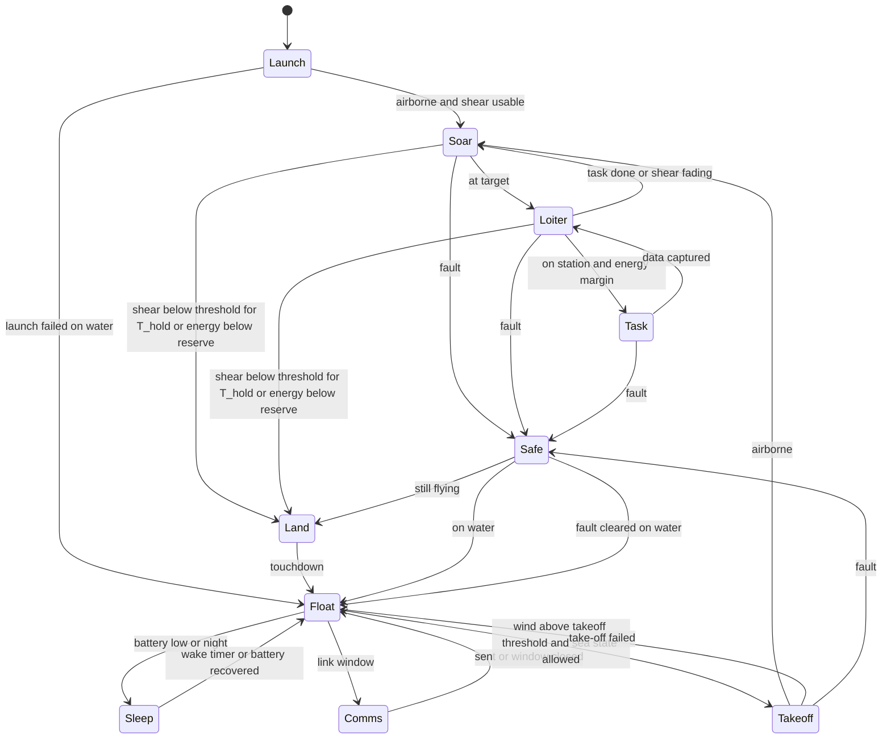
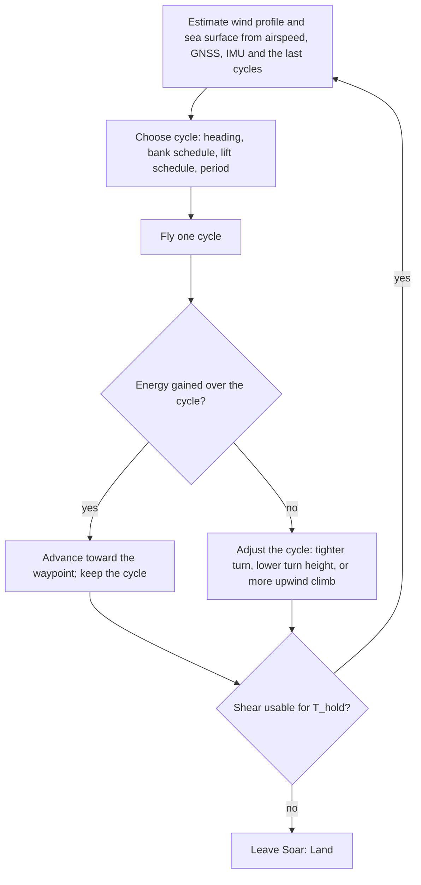

# 1.2 Form

Candidate forms, the yardsticks, rough availability and cost of each, the comparison, and the selection.

## Computation environment

The form study needs a place to fly candidate aircraft in a wind field that looks like the sea, so the environment was built first (D-010).
The code lives in `sim/` and is a tool, not a fact; what it produces enters the record as calculated values that cite the section of this document, or a check, that explains them (see `docs/00-conventions.md`).

### Sea surface and wind model (`sim/seawind.py`) {#environment-model}

- Coordinates are x east, y north, z up, in metres and seconds.
- The mean wind is a neutral logarithmic profile over the local sea surface, with friction velocity and roughness length solved from U10 by the Charnock relation (env.charnock) plus the smooth-flow term (env.air_kinematic_viscosity), and env.karman as the von Karman constant.
- The height in the profile is measured above the local wave surface, so the wind field rides on the waves.
- Each wave component adds a wave-coherent perturbation from linear potential flow over a moving wavy surface: the air speeds up over crests and rises on the face it approaches, decaying as exp(-k z) with height; the reference wind for a component is the mean profile at the height 1/k relative to the wave's phase speed.
- The sea is a linear sum of components drawn from JONSWAP spectra (env.jonswap_gamma) with a cosine-squared directional spread on deep water; a fully developed wind sea follows from U10 by the Pierson-Moskowitz relations (env.pm_hs_coefficient, env.pm_peak_coefficient); swell is a second train.
- Frequencies are sampled by equal energy so the discrete sum reproduces the significant wave height.
- There is no turbulence yet; `gust()` is the hook for it.
- The constants are assumed values until Q-008 verifies them against P38 to P41 and against measured profiles over waves.

### Sea state history and wind-wave coupling (`sim/sea_history.py`) {#sea-coupling}

- Wind to waves: a wind sea grows with the time the wind has blown, by the equivalent-duration growth of the Coastal Engineering Manual (P71) with the constants env.cem_hm0_coeff, env.cem_tp_coeff and env.cem_duration_coeff and the friction velocity from the drag law env.cd_law_a and env.cd_law_b, capped at the fully developed sea (env.cem_full_hm0_limit, env.cem_full_tp_limit); the growth law was checked against the printed pages (K-006) and its repaired code awaits a re-check (Q-018).
- `SeaHistory` keeps an equivalent duration for the wind sea and lets the excess over what the wind can sustain decay as swell with env.sea_decay_tau_h when the wind drops; this is a stand-in for a spectral wave model.
- env.sea_grow_tau_h is no longer used by the code, since the equivalent-duration law replaced the relaxation; it stays in the record because K-005 and K-006 target it, until the standard has a withdrawn status.
- Waves to wind: the roughness length can follow the sea state instead of the Charnock constant, by the wave-steepness form (P59) or the wave-age form (P60); a young steep sea is rougher and slows the wind near the surface, which changes the shear the aircraft can use.
- Crests: an option adds the second-order self-interaction term of each component, so crests are sharper and troughs flatter; the flight model's wind still uses the linear terms.
- Breaking: the surface is flagged as breaking where its slope exceeds env.breaking_slope_limit, an assumed criterion to be sourced.
- Separation: an option takes wind out of the lee of steep crests, a crude stand-in for airflow separation (see the sheltering below).
- Turbulence: an option adds a frozen field of random Fourier modes with a von Karman spectrum of length scale env.turb_length_m, scaled to the offshore turbulence intensity of ISO 19901-1 (P67), with lateral and vertical intensities of env.turb_v_ratio and env.turb_w_ratio of the longitudinal one (P72, not read); its 3 s gust factor over 10 minutes came out at env.turb_gust_factor_check against lit.gust_factor_3s_10min_sea at sea (P68).
- Swell: an option replaces the log profile above a knee at lit.swell_knee_height_m by a constant wind, as measured under swell (P65), and another chooses between the two profiles from the wave age (see the swell knee below); the wave-induced perturbation can decay at the measured rates lit.wave_induced_decay_u and lit.wave_induced_decay_w (P63) instead of exp(-k z).
- The form study runs with the log profile and with the swell knee, since swell dominates most of the time in the Pacific (lit.pacific_swell_dominance, P62) and the knee removes the shear above it (Q-011).
- All of these constants and forms wait for Q-008.

#### Gust factor check {#gust-factor-check}

This check compares the turbulence model with a measured gust factor.
The number was first printed by the unit test at commit 86d6689; the function `gust_factor` in `sim/seawind.py` repeats the computation and gives the same number.
Command: `python -m unittest sim.tests.test_seawind` for now, which calls it.
Inputs by key: env.turb_length_m, env.turb_v_ratio, env.turb_w_ratio, env.karman and env.charnock.
Settings of the function, named here and not keyed: U10 of 10 m/s from 270 degrees, a point at 10 m height, a series of 600 s sampled every 0.1 s, a running window of 3 s, 64 Fourier modes, and seed 1.
Output by key: env.turb_gust_factor_check, to be compared with lit.gust_factor_3s_10min_sea (P68).
It is one realization of a random field and not a statistic, and the test asserts only a band around it.

#### Swell knee from the wave age {#wave-age-knee}

Under swell the measured wind has a knee or a maximum a few metres up and little shear above it (P65), because swell that runs faster than the wind gives momentum back to the air.
Hanley, Belcher and Sullivan sort the sea by the inverse wave age, the wind at 10 m along the waves divided by the phase speed of the spectral peak (P88).
Above env.inverse_wave_age_wind_driven the wind drives the waves, between 0 and env.inverse_wave_age_wave_driven the waves drive the wind, and between the two the sea is mixed; the authors say the limits are not hard and the change is likely smooth.
With `profile_mode="auto"` the model takes the most energetic wave train, computes its inverse wave age, and blends the log profile into the swell-knee profile with a smooth step between the two limits.
The smooth step is a model choice, since the source gives only the limits.
A counterswell, waves against the wind, gives a negative inverse wave age; the model then keeps the log profile, and the enhanced drag reported under counterswell is not modelled.
A fully developed wind sea sits at env.full_sea_inverse_wave_age, just inside the wind-driven limit, so it keeps the log profile.
In the storm scenario, at the hour the wind drops (hour 42), the swell gives an inverse wave age of env.storm_h42_inverse_wave_age and a blend of env.storm_h42_wave_driven_fraction toward the knee.
The wind difference between 2 m and 20 m then falls from env.storm_h42_shear_2_20_log_ms with the log profile to env.storm_h42_shear_2_20_auto_ms.
That is shear a soaring cycle loses after a storm, so the form study and the cycle optimizer will run with this option as well (Q-011).
Script: the numbers come from `Environment(profile_mode="auto").wave_age()` on `SeaHistory(WindHistory(STORM)).environment(42)` with `STORM` from `sim/export_field.py`; the unit tests in `sim/tests/test_seawind.py` cover the limits and the direction.

#### Sheltering behind steep crests {#crest-shelter}

When the wind outruns a steep wave, the air cannot follow the surface down the lee face and separates from it; this was observed at sea over short steep waves (P64).
The separated lee holds slower air near the water, and the layer above it carries a sharp change of wind; the gust soaring proposal places the albatross's energy there (P78, not read), and the birds' use of the troughs may come partly from this.

What the measurements say:

- Whether the air separates depends on the steepness of the single wave and on its age: the slope at which half the waves separate is env.separation_gamma_floor plus env.separation_gamma_span divided by 1 + ((u*/c)/env.separation_ustar_c_ref)^env.separation_exponent, with u* the friction velocity and c the phase speed (P89, eq. 4.8).
- So slow young waves separate at a modest steepness, while fast old waves, such as swell, need a steepness close to the limit at which they break.
- In the separated region over breaking waves the air nearly stops, with a backflow of at most about a fifth of the free stream (P92, P93); over wind waves the phase average stays positive but is much reduced (P91).
- No source read states how high the slow air reaches; the stress returns to its value above the waves at about half of 1/k (P90) and the profile becomes logarithmic again above about 0.7 of 1/k (P91).

The model, with `shelter=True`:

- It takes the slope of the summed surface along the wind, counting only the components the wind outruns at height 1/k, with k the wavenumber that carries the slope.
- The onset slope is the half-separated slope above divided by env.shelter_ramp_ratio; the separated share r grows from 0 there to 1 at twice the onset, so it is one half at the measured half-separated slope; the ramp is a model choice.
- The along-wind wind loses env.shelter_factor times r near the water, fading with height as exp(-k z / env.shelter_decay_kz), and the wave-coherent vertical wind is scaled by 1 - r, since the separated air does not follow the surface.
- The first version tested each component's own steepness against a fixed limit; it was dropped because in a spectral sea no single component is steep, so it never acted.

What it gives:

- For a steep single wave, a k of 0.35 under a wind three times the wave speed, the mean wind over the lee half at 1 m falls by env.shelter_case_lee_drop_fraction of its unsheltered value; the windward half is unchanged, and the effect is gone at three times 1/k.
- At a 10 m/s wind the onset slope is env.shelter_onset_30m_u10_10 for a 30 m wave and env.shelter_onset_3m_u10_10 for a 3 m wave, but the slow air over the 3 m wave reaches only about env.shelter_depth_3m_m.
- Over a fully developed sea at 15 m/s, the steepest slope of the linear surface is env.full_sea_u15_max_slope, below the onset, and the share of the surface that separates is env.shelter_full_sea_u15_fraction.
- So in this model the separation that reaches the flight height of R-12 needs steep crests that the linear sea does not make: breaking crests, or the sharp crests of a nonlinear sea.
- Where the wind does outrun a steep wave, the sheltering changes the soaring cycle markedly (see the cycles synchronized with the waves below), so it is not negligible when it acts.
- The trough as a shelter is still not shown by the model; the next step would let a share of the crests, matched to the measured whitecap cover, break and separate, and that needs a source for which crests break.
- All of this is a crude stand-in, and the real separated region needs a flow solver over moving waves; env.shelter_ramp_ratio and env.shelter_decay_kz wait for Q-008.

#### Roughness of the open sea {#sea-roughness}

The soaring literature sets the roughness length at lit.davenport_open_flat_z0_m, and the minimum winds of the form study fall by about half with it (see the form comparison), so which value the sea has decides much of R-02.

Where the literature's value comes from:

- It is passed on by citation from Sachs 2005, which could not be read; the only reason given is Bower's, that it suits cut grass or a very rough sea (P45).
- The WMO roughness classes give that value to open flat land with grass, and lit.davenport_open_sea_z0_m to the open sea whatever the waves (P99).
- No soaring paper read measured the shear the birds used; Sachs et al. took the wind at 10 m from a satellite with a log model and found the gradient far too small to explain the flight, lit.sachs2013_effective_gradient_per_s against lit.sachs2013_required_gradient_per_s (P47).

What the open sea has, in neutral air over a wind sea:

- Drag measured over the open ocean puts z0 between env.sea_z0_min_m and env.sea_z0_max_m for winds of 3 to 14 m/s (P94, P95, P96).
- The wind difference between 1 m and 10 m is then env.sea_shear_1_10_min to env.sea_shear_1_10_max of the wind at 10 m, against env.z003_shear_1_10 with the literature's value.
- At 10 m/s the wind at 1 m is env.u1_over_u10_charnock_10ms of the wind at 10 m over the sea, and env.u1_over_u10_z003_10ms with the literature's value.
- Profiles over a growing wind sea follow the log law over the sea's roughness down to about 1 m (P100, P102); nearer the water the waves act through the phase of each wave, which the model carries separately (P63, P64, P89).
- The model's Charnock constant env.charnock lies inside the spread of the measurements; COARE 3.5 (P94, P66) is now an option, `roughness="coare35"`, and the form study was rerun with it.

What can add shear near the water:

- Under swell with light wind the shear gathers below a knee or maximum at 5 to 10 m and nearly vanishes above (P65, P100, P101, P103).
- There the measured wind difference between 2.5 and 8 m was env.swell_shear_2p5_8_measured_min to env.swell_shear_2p5_8_measured_max of the wind at 8 m, against about env.swell_shear_2p5_8_log for a neutral log profile; the model's swell knee keeps the log shear below the knee, so it may understate the shear there (Q-061).
- Air warmer than the sea is stable and steepens the shear near the water: a calculation with the stability functions of P95 gives a factor of env.stability_factor_u8_cold_sea at 8 m/s and env.stability_factor_u4_cold_sea at 4 m/s for a difference of 2 K, and air colder than the sea lowers it to env.stability_factor_u8_warm_sea and env.stability_factor_u4_warm_sea; the model is neutral (Q-061).
- Swell across or against the wind can raise the drag severalfold (P98, abstract only).

What it means:

- The literature's roughness is a land value, and the open sea in neutral air has about half its shear near the water, so the form-study numbers with it are not sea values.
- The albatross model of Sachs and Bower itself (P45), gliding on the mean shear of the sea alone, needs dsopt.sachs_sea_charnock_u10_ms with Charnock's roughness and dsopt.sachs_sea_coare35_u10_ms with COARE 3.5 (geometric wingtip, self-consistent roughness), against lit.min_u10_albatross_ms with the land value; this agrees with Sachs et al., who found the mean gradient far too small for the observed flight (P47).
- The birds fill the gap in other ways: they ride the slopes of waves (P76, P77), flap less as the swell rises as well as the wind (P80), spend most of their flight energy in the little time they flap (P81), and sit on the water in light wind, taking off harder when both wind and waves are gentle (P82).
- The routes that remain towards R-02 are the same: a higher lift-to-drag ratio (K-009), the energy of the waves (Q-058), the extra shear under swell and in stable air (Q-061), the motor for the gaps (Q-055), and waiting on the water.

### Viewer (`sim/viewer/index.html`) {#viewer}

- `python -m sim.export_field --u10 10 --from 270` writes `sim/viewer/field.js` with the wind parameters and the wave components.
- Opening `sim/viewer/index.html` in a browser shows the sea, a wind mast with arrows at twelve heights above the local surface, particles advected by the wind, the wind-speed and vertical-wind profiles at the mast, and an aircraft trajectory when `sim/viewer/traj.js` exists.
- The viewer mirrors the Python formulas; it is a picture of the model, not a second model.
- Play runs the sea and the wind of the storm scenario through its hours; the Flight panel launches an aircraft at any moment of it, at the mast or at a clicked point of the sea, with a chosen candidate, cycle and heading, and can hold the scenario hour while it flies.
- The aircraft in the viewer is the same point mass as `sim/aircraft.py`, ported to `sim/viewer/flight.js`, flying the tracker of `sim/autonomy.py` on a precomputed cycle from `sim/viewer/refs.js` (`python -m sim.export_refs --step 2`); a test runs the same flight in Python and in the browser code and requires the states to agree (`sim/tests/test_flight_js.py`).
- The cycles in `refs.js` are the flat-sea cycles of the optimizer as committed before the corrections of K-007, so over waves the aircraft is expected to touch the water, as in the autonomy check; they will be replaced by the cycles of the receding-horizon library once it flies over waves.

### Aircraft model (`sim/aircraft.py`, `sim/dsearch.py`) {#aircraft-model}

- The aircraft is a point mass with a lift coefficient and a bank angle as controls, a parabolic drag polar (cd0, Oswald factor, aspect ratio), and limits on lift coefficient, bank, and load factor.
- The equations are written in the air-relative frame with the wind's acceleration along the path as a pseudo-force, which is where dynamic soaring gets its energy.
- `sim/dsearch.py` searches a periodic bank and lift schedule that gains air-relative energy over one cycle without going below ds.clearance_min_m or above ds.n_limit, and bisects the smallest U10 at which such a cycle exists.
- This search is the yardstick of the form study: for each candidate form, the smallest U10 that sustains soaring, and the ground speed it gives.

### Structural model (`sim/structure.py`) {#structural-model}

- The wing is a cantilever half-span with an elliptical lift distribution; a round carbon tube spar carries all bending; the skin and core carry none.
- The spar is sized so that the stress at the root under ds.n_limit times ds.safety_factor stays under the allowable, and fits inside the airfoil.
- Component masses placed in body axes give the total mass, the centre of gravity, and the inertia tensor that the flight model will use when it grows from a point mass to six degrees of freedom.
- The carbon tube values are sourced (P54); the skin, core and component inputs are assumed (Q-015).

## Numbers from the literature for the form study {#literature-numbers}

The yardsticks of the form study need the bird and the demonstrators as reference points; these are the numbers the record holds (keys `lit.*`), with their sources.

- The wandering albatross weighs lit.albatross_mass_kg with a span of lit.albatross_span_m, a wing area of lit.albatross_wing_area_m2, an aspect ratio of lit.albatross_aspect_ratio, and a best lift-to-drag ratio of about lit.albatross_lift_to_drag (P42, P44, P45).
- Its soaring cycle lasts about lit.ds_cycle_period_s (reported between lit.ds_cycle_period_min_s and lit.ds_cycle_period_max_s) and spans heights up to lit.ds_cycle_height_m; the turns are shallow arcs of about lit.ds_turn_angle_deg (between lit.ds_turn_angle_min_deg and lit.ds_turn_angle_max_deg), not half circles, and the shear it uses sits in a layer about lit.shear_layer_thickness_m thick (between lit.shear_layer_thickness_min_m and lit.shear_layer_thickness_max_m) (P44, P46, P47).
- The two-layer Rayleigh model needs a wind difference of about lit.rayleigh_min_wind_difference_ms across the layer (between lit.rayleigh_min_wind_difference_min_ms and lit.rayleigh_min_wind_difference_max_ms) for a glider of the albatross's lift-to-drag ratio (P42, P43).
- With a logarithmic profile, the smallest wind at 10 m that sustains soaring is lit.min_u10_albatross_ms for the albatross model and lit.min_u10_mariner_ms for a glider of lit.mariner_mass_kg with a lift-to-drag ratio of lit.mariner_lift_to_drag and a wing loading of lit.mariner_wing_loading_n_m2, while a sailplane of lit.sailplane_mass_kg with a high wing loading needs lit.min_u10_sailplane_15kg_ms (P45, P56).
- Those numbers are why the design point of R-02 is ds.min_u10_ms, now sourced rather than assumed; the form study will test it with the simulation.
- The demonstrator closest to this project is a foam trainer of lit.easyglider_span_m span and lit.easyglider_mass_kg with a wing area of lit.easyglider_wing_area_m2 (P48).
- A hand-launched solar aircraft that flew for days drew lit.atlantiksolar_avionics_w for its avionics including a satellite modem, and was designed for a load factor of lit.atlantiksolar_load_factor with a safety factor of lit.atlantiksolar_safety_factor (P49); sailplane certification uses lit.cs22_limit_load_factor with a safety factor of lit.cs22_safety_factor (P55).
- The darkest design day gives lit.insolation_50s_june_kwh_m2_day in the Southern Ocean in June and lit.insolation_home_december_kwh_m2_day at the home design point in December (P51); a 21700 cell holds about lit.cell_p45b_wh_per_kg and still discharges down to lit.cell_p45b_min_discharge_temp_degc (P50).
- A small ultrasonic anemometer weighs lit.anemometer_trisonica_mass_g and draws lit.anemometer_trisonica_power_w (P52); a research multi-hole probe weighs lit.probe_epfl_mass_g (P53).
- Pultruded carbon tube has a modulus of only lit.pultruded_modulus_pa and a flexural strength of lit.pultruded_flexural_pa (P54), far below the values first assumed for the spar; this changed the spar sizing (docs/03-design.md#wing-spar) and opened Q-010.
- A seaplane UAV of lit.flyingfish_mass_kg has taken off from the water on its own in waves up to lit.flyingfish_wave_height_m (P57); no water take-off of a drone in the mass range of this project (ds.mass_max_kg) was found in the sources read, which is why R-05 keeps its water take-off as the open question of the sealed-hull form.

What the literature does not give: a table of the minimum wind against wing loading and lift-to-drag ratio for small gliders over a real sea profile; that is the simulation's job.

### How the single numbers were reduced from ranges

The sources give ranges for four numbers, and the record keeps both ends as sourced keys and the single number as calculated.
lit.ds_cycle_period_s is a working figure chosen by the assistant inside the range between lit.ds_cycle_period_min_s (P47) and lit.ds_cycle_period_max_s (P46), where the two papers report different cycles.
lit.ds_turn_angle_deg is the midpoint of lit.ds_turn_angle_min_deg and lit.ds_turn_angle_max_deg (P44); P74 reports turn angles that change with the wind, so the midpoint is a reference and not a design value.
lit.shear_layer_thickness_m is the midpoint of lit.shear_layer_thickness_min_m and lit.shear_layer_thickness_max_m (P44).
lit.rayleigh_min_wind_difference_ms is the midpoint of lit.rayleigh_min_wind_difference_min_ms and lit.rayleigh_min_wind_difference_max_ms (P42).

## Flight patterns {#flight-patterns}

Albatrosses use several patterns and switch between them with the wind and the sea; `sim/patterns.py` holds the catalogue with its sources and simulates the ones that are new to the environment.

- Dynamic soaring across the wind in shallow S-arcs is the main pattern (P42, P44, P46, P47); the birds prefer headings near lit.albatross_preferred_heading_deg off the wind, like sailing yachts (P73); they tack upwind (P43), loop in place to search or hold station (P44), and turn through smaller angles as the wind rises (P74, P75). These map onto the modes of the cycle optimizer.
- Wave-slope soaring rides the updraft ahead of a moving crest and dominates in light wind over big swell (P76, P42, P77); the model finds it sustainable for most candidates only over swell of about patterns.wave_slope_swell_period_s period and only at the floor of the search, patterns.wave_slope_floor_m above the water, which is below the clearance of R-12 (Q-013).
- Gust soaring is a proposal without a test (P78) and is not simulated.
- Flap-gliding in light or head winds costs the bird most of its flight energy in a small share of its time (P79, P80, P81); for the drone the motor replaces the wing beat, at patterns.flapglide_baseline_wh_per_km_calm in calm air, patterns.flapglide_baseline_wh_per_km_cross10 across a 10 m/s wind, and patterns.flapglide_baseline_wh_per_km_head10 into it, for the baseline with a battery of patterns.battery_fraction of its mass.
- Resting on the water and taking off when the wind returns is what the birds do in a calm, with an easier take-off in more wind and bigger waves (P82); this is the Float and Takeoff states of the control modes.
- The selector follows the birds: dynamic soaring at or above ds.min_u10_ms, wave-slope soaring when the swell allows it, the motor while the battery covers a leg, and the water otherwise.
- The same run showed that the baseline's solar film yields only patterns.solar_avg_baseline_w on average, far below the avionics budget, which is finding Q-012 against R-08.

## Autonomy on estimated states {#autonomy-check}

The question was whether the drone can fly the soaring cycle on what its sensors tell it, not on the true state.
`python -m sim.autonomy` (commit 86d6689 plus the working tree of this branch) takes the optimizer's travelling cycle for the baseline at autonomy.test_u10_ms, tracks it with feedforward and feedback on the estimate, and compares the minimal, standard and full sensor suites of `sim/sensors.py` with the true state as the upper bound, over a flat log wind, a fully developed sea, and the sea with turbulence and the swell knee.
Over the flat log wind the standard suite flew autonomy.flat_standard_cycles cycles without a crash and kept within a few percent of the true state's ground speed (autonomy.flat_standard_ground_speed_ms against autonomy.flat_truth_ground_speed_ms), with a wind error of about autonomy.flat_standard_wind_rms_ms; the full suite did the same.
The minimal suite, with no magnetometer, never got a valid wind estimate before it crashed (Q-052).
Over waves every run crashed, the true state included, because the cycle's lowest point is planned above the mean surface and the crests reach it (Q-050); the load factor also exceeded the limit of R-09 under feedback (Q-051).
So the sensors are not the limit on a flat sea; the plan is the limit on a real one, which is why the planning in height above the local surface follows below.

## Planning from the aircraft's own view of the sea {#receding-horizon}

The owner asked that the drone judge the waves as it sees them and decide its flight from moment to moment (Q-057).
`sim/seasense.py` gives it a downward radar or lidar altimeter and a forward scanner, and fits a few wave components to what they saw along the track (`LocalWaveEstimator`).
`sim/mpc.py` re-plans the next seconds of flight every half second by sampling many control sequences (MPPI) in the predicted surface and wave wind, and flies in the full sea model; the comparison runs the same planner on the true sea, on a flat sea, and on the fitted sea, against the earlier tracker.
Command: `python -m sim.mpc`, which writes `sim/out/mpc.json`; the library of cycles is `sim/out/mpc_library.json`.
Each row is one run with one seed, so small differences mean nothing.

What it found:

- Planning from scratch does not soar: with an energy cost over a horizon of about one cycle, every run glided down and touched the water within mpc.first_pass_survival_max_s, whatever it knew about the sea.
- Seeded with a library of mpc.library_cycles periodic cycles from the optimizer (corrected wingtip, self-consistent roughness, heights constrained between nodes), the planner flies them on a flat sea for mpc.flat_survival_min_s to mpc.flat_survival_max_s, but still touches the water before the run ends, because the cycles sit on the load-factor limit and on the clearance edge.
- Over the sea it lasts mpc.wave_survival_min_s to mpc.wave_survival_max_s, and the fitted sea is not consistently better than assuming a flat one.
- Shifting the cycle so that its low point falls on the forward face of the dominant fitted wave shortened the flight in mpc.phasing_worse_pairs of mpc.phasing_pairs pairs; the cause is not found yet.
- The fit explains most of the surface the aircraft has flown over, but its prediction of the surface ahead is off by mpc.fit_surface_error_min_m to mpc.fit_surface_error_max_m against a sea whose standard deviation is about mpc.sea_std_u13_m, so it has no skill ahead in a wind sea.

What it means:

- The limit is now the margin of the cycles and the prediction of the sea ahead, not the accuracy of the sensors on what is below.
- The next pass gives the library cycles margin, adds cycles synchronized with the waves once Q-058 and Q-059 are settled, models a scanner that sees a wider swath ahead, and finds why the phasing hurts (Q-060).

## Candidate forms {#candidate-forms}

The yardsticks are: the smallest U10 that sustains soaring; progress speed over the ground at the design wind; survival on the water (self-righting, sealing, take-off); solar area; mass; what one person can build and repair; cost.
The candidates to fly in the environment are:

1. **Conventional glider with a tail boom**, the baseline of the structural model (span wing.span_m, wing area form.baseline_2m.wing_area_m2), like the demonstrators: the foam trainer of P48 (lit.easyglider_span_m) and a smaller demonstrator (form.demo_1p5m.span_m) that has no source in the record yet (Q-014). Known handling; the boom and tail are fragile on the water.
2. **Flying wing or tailless with winglets**, span form.flyingwing_2m.span_m. Fewer parts to break, easier to seal, but a lower aspect ratio (its wing area is form.flyingwing_2m.wing_area_m2) and less pitch control margin.
3. **Albatross-like high-aspect-ratio glider**, span form.albatross_3m.span_m, wing area form.albatross_3m.wing_area_m2, mass form.albatross_3m.mass_kg. Best lift-to-drag and lowest wind to soar; the biggest to launch and the most to lose.
4. **Sealed hull glider that floats hull-down**, span form.sealedhull_2p5m.span_m, with the fuselage as a watertight buoyancy body and the wing sealed as a foam-core shell. The form that takes R-05 and R-06 most seriously; take-off from the water is its open question.

The parameters of each candidate are the keys form.<candidate>.span_m, mass_kg, wing_area_m2, cd0, oswald and cl_max, taken from the aircraft registry in `sim/aircraft_models.py` (assumed, Q-014); the span and mass of the baseline are wing.span_m and wing.design_mass_kg.
The comparison is in the next section; availability and rough cost follow the demonstrators' parts (carbon tubes, foam, fiberglass, PX4-class autopilot).

## Form comparison {#form-comparison}

The candidates were flown in the environment by the collocation optimizer of periodic cycles (`sim/dsopt.py`, a point mass in a height-only wind over a flat sea).
The run now uses the corrections of K-007: the wingtip height is the geometric (b/2) sin|mu| cos gamma, and the roughness length is solved together with the minimum wind instead of being fixed at its 8 m/s value (Q-054).
The numbers are in `sim/out/dsopt_corrected.json`, whose meta block holds the call, the commit and the stamp of its inputs; the first run, at commit 86d6689 in `sim/out/dsopt.json`, is kept for comparison.
Candidate 1 is form `baseline_2m`, candidate 2 `flyingwing_2m`, candidate 3 `albatross_3m` and candidate 4 `sealedhull_2p5m`; `demo_1p5m` and `easyglider_1p8m` are the demonstrators as references.
For each candidate the record holds the smallest U10 that sustains a travelling cycle and a loiter cycle, with the log profile and with the swell knee (Q-011), as the keys form.<candidate>.u10_min_travel_log, u10_min_loiter_log, u10_min_travel_knee and u10_min_loiter_knee.
Where the travelling minimum is below the wind of the cross-wind case, the record also holds the progress speed across the wind at that wind, the objective of the case, as form.<candidate>.cross12_speed_log and cross12_speed_knee; it now exists for baseline_2m, albatross_3m and sealedhull_2p5m with both profiles.
The mean ground speed of those cycles is higher than the progress speed and is in the file.
Only converged cycles are recorded, and the cases that were skipped because the travelling minimum is above the cross-wind wind are left out.

What the keys show:

- The lowest minimum wind belongs to the albatross-like glider, form.albatross_3m.u10_min_travel_log; the conventional baseline and the sealed hull come next, and the flying wing and the two demonstrators need much more wind.
- The corrections lowered every minimum, by about a tenth for the baseline and less for the albatross-like glider, against the first run; the order of the candidates did not change.
- A loiter cycle needs more wind than a travelling cycle for every candidate, with either profile.
- The swell knee raises the minimum for four of the six candidates and lowers it slightly for the other two (the flying wing and the foam trainer).
- No candidate reaches ds.min_u10_ms, the design point of R-02; the best, form.albatross_3m.u10_min_travel_log, is the nearest.
- This is raised as finding Q-024, and the owner decides whether to lower the wing loading, change the form, or raise the design wind.

The roughness of the sea decides much of this.
The literature on dynamic soaring uses a fixed z0 of 0.03 m (P45, P86), which is about a hundred times the Charnock value at these winds and gives about twice the shear.
With that roughness the same run (`sim/out/dsopt_z0_003.json`) gives form.baseline_2m.u10_min_travel_log_z003 for the baseline and form.albatross_3m.u10_min_travel_log_z003 for the albatross-like glider; the keys form.<candidate>.*_z003 hold the rest.
Then the baseline, the albatross-like glider, the sealed hull and the small demonstrator come below ds.min_u10_ms, the flying wing is close to it, and only the foam trainer stays far above.
The literature's roughness turned out to be a land value (see the roughness of the open sea), so the sea values are the Charnock and COARE 3.5 ones, and with them no candidate reaches the design point of R-02 on a flat sea in neutral air.
With COARE 3.5 (`sim/out/dsopt_coare35.json`, keys form.<candidate>.*_coare35) the minimum winds move little: form.albatross_3m.u10_min_travel_log_coare35 for the albatross-like glider and form.baseline_2m.u10_min_travel_log_coare35 for the baseline; the small, draggy demonstrators gain most, since COARE 3.5 gives a rougher sea than the constant Charnock value at their higher winds.
That roughness is about dsopt.z003_over_charnock_ratio times the Charnock value of the sea at such a wind, so the low numbers are not sea values yet (K-009).
They also rest on the assumed lift-to-drag ratios of the candidates (Q-014): the minimum wind scales about as the inverse of the lift-to-drag ratio and hardly with the wing loading, since the albatross-like glider with its ratio lowered to that of the Sachs albatross needs dsopt.albatross3m_ld20_u10_ms, close to the heavier bird (K-009).

The same optimizer was run against P45: for an albatross model it gives dsopt.validation_u10_ms where P45 gives lit.min_u10_albatross_ms; without the wingtip clearance, which P45 does not impose, it gives dsopt.validation_no_tip_u10_ms (K-007).
The speed floor (a minimum airspeed set from the stall speed) was off for the validation run and on for the form study, so the two are not the same experiment.
The values table in docs/01-requirements.md lists every key named here.
The optimizer has had three independent checks, K-007 and K-009 on the flat cycles and K-008 on the wave mode; all found it sound as a solver, and K-009 reproduced this rerun to every digit.
They also found defects in its constraints and its search: the flat mode keeps the wingtip clear only at the nodes, and between them it dips to dsopt.flat_tip_mid_min_baseline_m for the baseline (Q-059).

## Cycles synchronized with the waves {#wave-cycles}

The flat-sea cycles of the form comparison ignore the waves; the owner asked that the flight be planned in the height above the moving surface and in the wind that goes with the waves (Q-057).
`sim/dsopt.py` has a wave mode for one dominant deep-water wave component:

- it measures the height above the local surface and uses the wind of `sim/seawind.py` for that component, the log profile over the local surface plus the wave-coherent wind;
- it keeps the height and the wingtip above the moving surface at the nodes and at the midpoints between them;
- the cycle repeats relative to the wave: after one period the wave has slipped by a whole number of wavelengths, and the optimizer also chooses where in the wave the cycle starts;
- options give the measured decay rates of the wave wind (P63) and the sheltering of `sim/seawind.py`;
- the module also has the corrections of K-007, the geometric wingtip height and the roughness length consistent with the wind found.

Command: `python -m sim.dsopt --wave-study2`, which writes `sim/out/dsopt_wave.json`.
Each case is one run of a local optimizer, so the results are examples, not a survey.

What it found:

- Over a dominant swell wave of the grid (Hs 1 to 3 m, Tp 6 to 11 s, along and across the wind), dsopt.wave_floor_cases of dsopt.wave_cases cases closed a cycle at the lowest wind allowed: the air moved by the waves alone carried the glider at least 1 m above the surface.
- Where the wind is needed, the low turn sits on the forward face of the wave or on its crest, where the wave pushes the air up, and never in the trough.
- The measured decay rates moved the minimum wind by at most dsopt.measured_decay_max_shift_ms.
- With sheltering, the albatross-like glider over a steep 20 m wave needed dsopt.shelter_albatross_l20_on_ms instead of dsopt.shelter_albatross_l20_off_ms; the cycle changed and its low point moved to the crest, not into the trough.

What the independent check found (K-008):

- The wave-only cycles are real solutions of the model: a replay in a separate model closes them and balances the energy.
- They are unstable, growing by up to dsopt.wave_cycle_floquet_max per cycle without feedback, so flying them needs the closed loop of Q-057.
- The count is not meaningful: the optimizer keeps the number of wavelengths slipped per cycle from its starting guess and stays in local optima, and a steady-ride estimate puts at least dsopt.wave_steady_ride_cases cases at the floor (Q-059).
- The physics behind them is weak: in calm air the model's vertical wave wind is dsopt.wave_vertical_ratio_model of the water's orbital speed, where the measurement over swell gives about dsopt.wave_vertical_ratio_measured (P64); with that ratio the two replayed cases need dsopt.wave_scaled_u10_baseline_tp8_hs2_ms and dsopt.wave_scaled_u10_albatross_tp6_hs1_ms of wind (Q-058).
- The steep-wave cases in calm air are artefacts, since their controls swing at rates no aircraft has and linear wave theory does not hold at that steepness; they are dropped.
- The sheltering does act where the wind outruns a steep wave; the reading that it hardly acts because of the onset slope was wrong, since in calm air it is the waves outrunning the air that shut it off.

What it means for the design:

- Swell can carry part of the energy, and with a calibrated wave wind the wind needed over swell may still fall below the flat-sea minimum; that is a route towards ds.min_u10_ms of R-02, and it waits for Q-058 and Q-059.
- The flight control must follow the wave phase with feedback, which is the receding-horizon planner of Q-057.

## Control modes {#control-modes}

The owner asked for a state transition diagram as well as a flowchart (2026-10-29).
The states are the modes of the whole aircraft; the flowchart is the loop inside the soaring mode.

### State transition diagram

- Launch: hand launch at sea or take-off from the water; ends when airspeed and height are inside the soaring band.
- Soar: dynamic soaring cycles that make progress toward the waypoint; the loop below runs here.
- Loiter: soaring cycles that hold position near the target.
- Task: the photo or data capture, entered only with an energy margin.
- Land: a controlled descent to the water into the wind at stall speed plus margin.
- Float: on the water, sealed, self-righted, charging, estimating the wind from the drift and the motion.
- Sleep: everything off but the wake timer and the sealed-ness watchdog.
- Comms: the satellite or shore link; also used during Loiter when the link allows.
- Takeoff: the water take-off, whose mechanism is open (R-05).
- Safe: fault handling; the only exits are to the water.

### Flowchart of the soaring loop

The thresholds T_hold, the shear threshold, and the energy reserve are values to be set from the simulation (Q-009).

The owner asked on 2026-10-29 that the drone judge its flight moment to moment from its own view of the waves rather than fly a cycle planned for a flat sea; the soaring loop above becomes a receding-horizon planner that predicts the local surface and wind a few seconds ahead from what the aircraft senses and re-plans every half second (Q-057).
