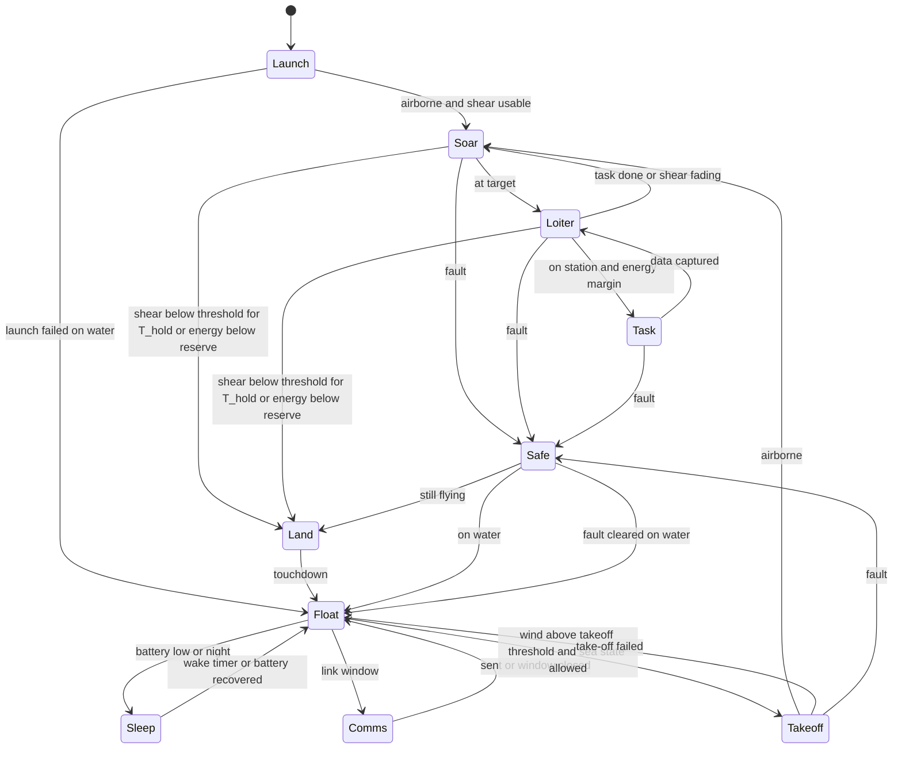
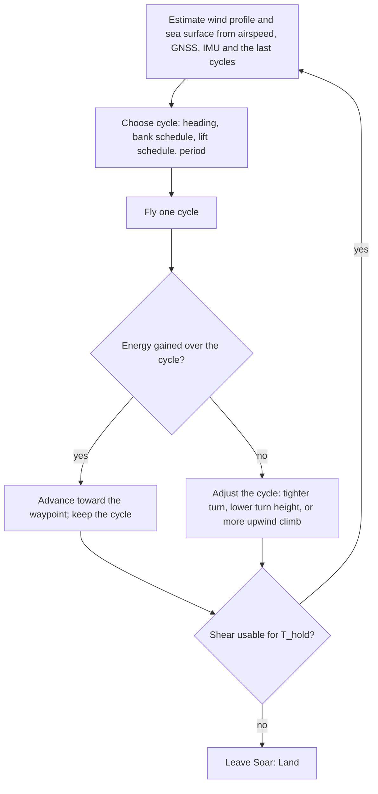

# 1.2 Form

Candidate forms, the yardsticks, rough availability and cost of each, the comparison, and the selection.

## Computation environment

The form study needs a place to fly candidate aircraft in a wind field that looks like the sea, so the environment was built first (D-010).
The code lives in `sim/` and is a tool, not a fact; what it produces enters the record as calculated values that cite the section of this document, or a check, that explains them (see `docs/00-conventions.md`).

### Sea surface and wind model (`sim/seawind.py`) {#environment-model}

- Coordinates are x east, y north, z up, in metres and seconds.
- The mean wind is a neutral logarithmic profile over the local sea surface, with friction velocity and roughness length solved from U10 by the Charnock relation (env.charnock) plus the smooth-flow term (env.air_kinematic_viscosity), and env.karman as the von Karman constant.
- The height in the profile is measured above the local wave surface, so the wind field rides on the waves.
- Each wave component adds a wave-coherent perturbation from linear potential flow over a moving wavy surface: the air speeds up over crests and rises on the face it approaches, decaying as exp(-k z) with height; the reference wind for a component is the mean profile at the height 1/k relative to the wave's phase speed.
- The sea is a linear sum of components drawn from JONSWAP spectra (env.jonswap_gamma) with a cosine-squared directional spread on deep water; a fully developed wind sea follows from U10 by the Pierson-Moskowitz relations (env.pm_hs_coefficient, env.pm_peak_coefficient); swell is a second train.
- Frequencies are sampled by equal energy so the discrete sum reproduces the significant wave height.
- There is no turbulence yet; `gust()` is the hook for it.
- The constants are assumed values until Q-008 verifies them against P38 to P41 and against measured profiles over waves.

### Sea state history and wind-wave coupling (`sim/sea_history.py`) {#sea-coupling}

- Wind to waves: a wind sea grows with the time the wind has blown, by the equivalent-duration growth of the Coastal Engineering Manual (P71) with the constants env.cem_hm0_coeff, env.cem_tp_coeff and env.cem_duration_coeff and the friction velocity from the drag law env.cd_law_a and env.cd_law_b, capped at the fully developed sea (env.cem_full_hm0_limit, env.cem_full_tp_limit); the growth law was checked against the printed pages (K-006) and its repaired code awaits a re-check (Q-018).
- `SeaHistory` keeps an equivalent duration for the wind sea and lets the excess over what the wind can sustain decay as swell with env.sea_decay_tau_h when the wind drops; this is a stand-in for a spectral wave model.
- env.sea_grow_tau_h is no longer used by the code, since the equivalent-duration law replaced the relaxation; it stays in the record because K-005 and K-006 target it, until the standard has a withdrawn status.
- Waves to wind: the roughness length can follow the sea state instead of the Charnock constant, by the wave-steepness form (P59) or the wave-age form (P60); a young steep sea is rougher and slows the wind near the surface, which changes the shear the aircraft can use.
- Crests: an option adds the second-order self-interaction term of each component, so crests are sharper and troughs flatter; the flight model's wind still uses the linear terms.
- Breaking: the surface is flagged as breaking where its slope exceeds env.breaking_slope_limit, an assumed criterion to be sourced.
- Separation: an option takes wind out of the lee of steep crests, a crude stand-in for airflow separation (see the sheltering below).
- Turbulence: an option adds a frozen field of random Fourier modes with a von Karman spectrum of length scale env.turb_length_m, scaled to the offshore turbulence intensity of ISO 19901-1 (P67), with lateral and vertical intensities of env.turb_v_ratio and env.turb_w_ratio of the longitudinal one (P72, not read); its 3 s gust factor over 10 minutes came out at env.turb_gust_factor_check against lit.gust_factor_3s_10min_sea at sea (P68).
- Swell: an option replaces the log profile above a knee at lit.swell_knee_height_m by a constant wind, as measured under swell (P65), and another chooses between the two profiles from the wave age (see the swell knee below); the wave-induced perturbation can decay at the measured rates lit.wave_induced_decay_u and lit.wave_induced_decay_w (P63) instead of exp(-k z).
- The form study runs with the log profile and with the swell knee, since swell dominates most of the time in the Pacific (lit.pacific_swell_dominance, P62) and the knee removes the shear above it (Q-011).
- All of these constants and forms wait for Q-008.

#### Gust factor check {#gust-factor-check}

This check compares the turbulence model with a measured gust factor.
The number was first printed by the unit test at commit 86d6689; the function `gust_factor` in `sim/seawind.py` repeats the computation and gives the same number.
Command: `python -m unittest sim.tests.test_seawind` for now, which calls it.
Inputs by key: env.turb_length_m, env.turb_v_ratio, env.turb_w_ratio, env.karman and env.charnock.
Settings of the function, named here and not keyed: U10 of 10 m/s from 270 degrees, a point at 10 m height, a series of 600 s sampled every 0.1 s, a running window of 3 s, 64 Fourier modes, and seed 1.
Output by key: env.turb_gust_factor_check, to be compared with lit.gust_factor_3s_10min_sea (P68).
It is one realization of a random field and not a statistic, and the test asserts only a band around it.

#### Swell knee from the wave age {#wave-age-knee}

Under swell the measured wind has a knee or a maximum a few metres up and little shear above it (P65), because swell that runs faster than the wind gives momentum back to the air.
Hanley, Belcher and Sullivan sort the sea by the inverse wave age, the wind at 10 m along the waves divided by the phase speed of the spectral peak (P88).
Above env.inverse_wave_age_wind_driven the wind drives the waves, between 0 and env.inverse_wave_age_wave_driven the waves drive the wind, and between the two the sea is mixed; the authors say the limits are not hard and the change is likely smooth.
With `profile_mode="auto"` the model takes the most energetic wave train, computes its inverse wave age, and blends the log profile into the swell-knee profile with a smooth step between the two limits.
The smooth step is a model choice, since the source gives only the limits.
A counterswell, waves against the wind, gives a negative inverse wave age; the model then keeps the log profile, and the enhanced drag reported under counterswell is not modelled.
A fully developed wind sea sits at env.full_sea_inverse_wave_age, just inside the wind-driven limit, so it keeps the log profile.
In the storm scenario, at the hour the wind drops (hour 42), the swell gives an inverse wave age of env.storm_h42_inverse_wave_age and a blend of env.storm_h42_wave_driven_fraction toward the knee.
The wind difference between 2 m and 20 m then falls from env.storm_h42_shear_2_20_log_ms with the log profile to env.storm_h42_shear_2_20_auto_ms.
That is shear a soaring cycle loses after a storm, so the form study and the cycle optimizer will run with this option as well (Q-011).
Script: the numbers come from `Environment(profile_mode="auto").wave_age()` on `SeaHistory(WindHistory(STORM)).environment(42)` with `STORM` from `sim/export_field.py`; the unit tests in `sim/tests/test_seawind.py` cover the limits and the direction.

#### Sheltering behind steep crests {#crest-shelter}

When the wind outruns a steep wave, the air cannot follow the surface down the lee face and separates from it; this was observed at sea over short steep waves (P64).
The separated lee holds slower air near the water, and the layer above it carries a sharp change of wind; the gust soaring proposal places the albatross's energy there (P78, not read), and the birds' use of the troughs may come partly from this.

What the measurements say:

- Whether the air separates depends on the steepness of the single wave and on its age: the slope at which half the waves separate is env.separation_gamma_floor plus env.separation_gamma_span divided by 1 + ((u*/c)/env.separation_ustar_c_ref)^env.separation_exponent, with u* the friction velocity and c the phase speed (P89, eq. 4.8).
- So slow young waves separate at a modest steepness, while fast old waves, such as swell, need a steepness close to the limit at which they break.
- In the separated region over breaking waves the air nearly stops, with a backflow of at most about a fifth of the free stream (P92, P93); over wind waves the phase average stays positive but is much reduced (P91).
- No source read states how high the slow air reaches; the stress returns to its value above the waves at about half of 1/k (P90) and the profile becomes logarithmic again above about 0.7 of 1/k (P91).

The model, with `shelter=True`:

- It takes the slope of the summed surface along the wind, counting only the components the wind outruns at height 1/k, with k the wavenumber that carries the slope.
- The onset slope is the half-separated slope above divided by env.shelter_ramp_ratio; the separated share r grows from 0 there to 1 at twice the onset, so it is one half at the measured half-separated slope; the ramp is a model choice.
- The along-wind wind loses env.shelter_factor times r near the water, fading with height as exp(-k z / env.shelter_decay_kz), and the wave-coherent vertical wind is scaled by 1 - r, since the separated air does not follow the surface.
- The first version tested each component's own steepness against a fixed limit; it was dropped because in a spectral sea no single component is steep, so it never acted.

What it gives:

- For a steep single wave, a k of 0.35 under a wind three times the wave speed, the mean wind over the lee half at 1 m falls by env.shelter_case_lee_drop_fraction of its unsheltered value; the windward half is unchanged, and the effect is gone at three times 1/k.
- At a 10 m/s wind the onset slope is env.shelter_onset_30m_u10_10 for a 30 m wave and env.shelter_onset_3m_u10_10 for a 3 m wave, but the slow air over the 3 m wave reaches only about env.shelter_depth_3m_m.
- Over a fully developed sea at 15 m/s, the steepest slope of the linear surface is env.full_sea_u15_max_slope, below the onset, and the share of the surface that separates is env.shelter_full_sea_u15_fraction.
- So in this model the separation that reaches the flight height of R-12 needs steep crests that the linear sea does not make: breaking crests, or the sharp crests of a nonlinear sea.
- Where the wind does outrun a steep wave, the sheltering changes the soaring cycle markedly (see the cycles synchronized with the waves below), so it is not negligible when it acts.
- The trough as a shelter is still not shown by the model; the next step would let a share of the crests, matched to the measured whitecap cover, break and separate, and that needs a source for which crests break.
- All of this is a crude stand-in, and the real separated region needs a flow solver over moving waves; env.shelter_ramp_ratio and env.shelter_decay_kz wait for Q-008.

#### Roughness of the open sea {#sea-roughness}

The soaring literature sets the roughness length at lit.davenport_open_flat_z0_m, and the minimum winds of the form study fall by about half with it (see the form comparison), so which value the sea has decides much of R-02.

Where the literature's value comes from:

- It is passed on by citation from Sachs 2005, which could not be read; the only reason given is Bower's, that it suits cut grass or a very rough sea (P45).
- The WMO roughness classes give that value to open flat land with grass, and lit.davenport_open_sea_z0_m to the open sea whatever the waves (P99).
- No soaring paper read measured the shear the birds used; Sachs et al. took the wind at 10 m from a satellite with a log model and found the gradient far too small to explain the flight, lit.sachs2013_effective_gradient_per_s against lit.sachs2013_required_gradient_per_s (P47).

What the open sea has, in neutral air over a wind sea:

- Drag measured over the open ocean puts z0 between env.sea_z0_min_m and env.sea_z0_max_m for winds of 3 to 14 m/s (P94, P95, P96).
- The wind difference between 1 m and 10 m is then env.sea_shear_1_10_min to env.sea_shear_1_10_max of the wind at 10 m, against env.z003_shear_1_10 with the literature's value.
- At 10 m/s the wind at 1 m is env.u1_over_u10_charnock_10ms of the wind at 10 m over the sea, and env.u1_over_u10_z003_10ms with the literature's value.
- Profiles over a growing wind sea follow the log law over the sea's roughness down to about 1 m (P100, P102); nearer the water the waves act through the phase of each wave, which the model carries separately (P63, P64, P89).
- The model's Charnock constant env.charnock lies inside the spread of the measurements; COARE 3.5 (P94, P66) is now an option, `roughness="coare35"`, and the form study was rerun with it.

What can add shear near the water:

- Under swell with light wind the shear gathers below a knee or maximum at 5 to 10 m and nearly vanishes above (P65, P100, P101, P103).
- There the measured wind difference between 2.5 and 8 m was env.swell_shear_2p5_8_measured_min to env.swell_shear_2p5_8_measured_max of the wind at 8 m, against about env.swell_shear_2p5_8_log for a neutral log profile; the model's swell knee keeps the log shear below the knee, so it may understate the shear there (Q-061).
- Air warmer than the sea is stable and steepens the shear near the water: a calculation with the stability functions of P95 gives a factor of env.stability_factor_u8_cold_sea at 8 m/s and env.stability_factor_u4_cold_sea at 4 m/s for a difference of 2 K, and air colder than the sea lowers it to env.stability_factor_u8_warm_sea and env.stability_factor_u4_warm_sea; the model is neutral (Q-061).
- Swell across or against the wind can raise the drag severalfold (P98, abstract only).

What it means:

- The literature's roughness is a land value, and the open sea in neutral air has about half its shear near the water, so the form-study numbers with it are not sea values.
- The albatross model of Sachs and Bower itself (P45), gliding on the mean shear of the sea alone, needs dsopt.sachs_sea_charnock_u10_ms with Charnock's roughness and dsopt.sachs_sea_coare35_u10_ms with COARE 3.5 (geometric wingtip, self-consistent roughness), against lit.min_u10_albatross_ms with the land value; this agrees with Sachs et al., who found the mean gradient far too small for the observed flight (P47).
- The birds fill the gap in other ways: they ride the slopes of waves (P76, P77), flap less as the swell rises as well as the wind (P80), spend most of their flight energy in the little time they flap (P81), and sit on the water in light wind, taking off harder when both wind and waves are gentle (P82).
- The routes that remain towards R-02 are the same: a higher lift-to-drag ratio (K-009), the energy of the waves (Q-058), the extra shear under swell and in stable air (Q-061), the motor for the gaps (Q-055), and waiting on the water.

### Is the simulator fit to check low, wave-using flight? {#simulator-fitness}

The candidates that could reach R-02 make their low turn near the water and use the waves (see what carries the albatross), so the question is whether the sea and wind model can check such flight, not only rank it.
The answer on 2026-10-30 is that it can compare strategies but cannot yet verify a low turn within about a metre of the water (Q-064):

- Mean wind: the log profile with the roughness options holds for a wind sea in neutral air; stable air and the shear below the swell knee are missing (Q-061).
- Surface: a linear sum of components, with an optional second-order term that the flight model does not use; real crests are sharper and higher and breaking crests are not in the geometry, so a wingtip contact check on this surface is optimistic.
- Wave-coherent wind: linear potential flow, matched in form and size to the measurements from 2.6 to 15 m (P63); below 1 m it is an extrapolation, and the slow air of a sheltered trough exists only as the crude separation option.
- Turbulence: a frozen von Karman field with a fixed length scale of env.turb_length_m, scaled to the offshore intensity; near the water the eddies should shrink with height, which the model does not do.
- Ground effect: being added to the flight model; no measurement covers a banked wing over waves.
- Sensors: the altimeters return the point under the beam axis and a forward scanner looks ahead; nothing measures the height under the low wingtip, and footprint, spray and the limits of prediction are only partly modelled.

What was added on 2026-10-30 (`sim/seawind.py`, opt-in; `python -m sim.seawind_fitness`, `sim/out/seawind_fitness.json`):

- Second-order crests in the surface used by the contact check and the wind: they match the short-crested crest distribution of Forristall (S4) to env.crest_stokes2_over_forristall_1e2 at a probability of 1e-2, where the linear surface gives env.crest_linear_over_forristall_1e2.
- Breaking of dominant waves with the probability of Banner et al. (P125), lifting the crest towards a Stokes corner (P126) by at most env.breaking_lift_max_frac of the local amplitude and slowing the air in its lee (P92, P93); the marked share of the surface is only about env.breaking_marked_over_whitecap_u10 of the whitecap cover at 10 m/s (P127), since it counts only dominant waves.
- The wave-coherent wind evaluated at each height when the critical-height floor is on, so it changes sign at the critical height as measured and simulated (P128, P129), with the amplitudes and decays of P63; the floor turns the zero crossing into a small jump of about 0.05 m/s, which a flight model's central differences would see as a spike of shear (Q-064); without the floor the P63 preset keeps the wind speed at the height 1/k and does not change sign.
- Turbulence with length scales that shrink near the water, fitted to the marine spectral peaks (P132): the vertical scale is env.turb_lw_at_1m_height_law_m at 1 m.
- Stability by the functions of P95: at an Obukhov length of +50 m, stable air over a cold sea, the shear from 1 to 15 m at 9 m/s is env.stability_l50_shear_factor times neutral and over a 1.5 to 19 m cycle env.stability_l50_cycle_shear_factor; at -50 m it is env.stability_lm50_shear_factor; an independent profile reproduces all three (K-012).
- A swell profile with the shear below the knee as measured in the Baltic (P65, P100), giving env.swell_jet_shear_factor_min to env.swell_jet_shear_factor_max times the neutral shear from 1 to 15 m, the lower end for swell four times faster than the wind; below 1.2 m nothing is measured.
- The cycle optimizer still uses its own log or knee profile, so stability and the swell jet do not enter the minimum winds yet (Q-061).

What remains to add, in order: stability and the swell jet in the cycle optimizer's profile (Q-061); flights in the full near-water sea, with the second-order surface in every contact check; and the wingtip sensors of the next section in the closed loop.
After that, only a flight test can close it: low turns over a lake or a calm sea with RTK and a laser altimeter logging the height and the wind.

### Viewer (`sim/viewer/index.html`) {#viewer}

- `python -m sim.export_field --u10 10 --from 270` writes `sim/viewer/field.js` with the wind parameters and the wave components.
- Opening `sim/viewer/index.html` in a browser shows the sea, a wind mast with arrows at twelve heights above the local surface, particles advected by the wind, the wind-speed and vertical-wind profiles at the mast, and an aircraft trajectory when `sim/viewer/traj.js` exists.
- The viewer mirrors the Python formulas; it is a picture of the model, not a second model.
- Play runs the sea and the wind of the storm scenario through its hours; the Flight panel launches an aircraft at any moment of it, at the mast or at a clicked point of the sea, with a chosen candidate, cycle and heading, and can hold the scenario hour while it flies.
- The aircraft in the viewer is the same point mass as `sim/aircraft.py`, ported to `sim/viewer/flight.js`; a test runs the same flight in Python and in the browser code and requires the states to agree (`sim/tests/test_flight_js.py`). Its parameters come from `sim/viewer/aircraft.js` (`python -m sim.export_aircraft`).
- The reference tracker of `sim/autonomy.py` and its cycles (`refs.js`, `sim.export_refs`) are gone from the viewer: MPC is the only control. The tracker stays in `sim/autonomy.py` for the Python experiments.
- The panel can also fly the aircraft under live MPC: the library-seeded planner of `sim/mpc.py` is ported to `sim/viewer/mpc.js` and runs in a Web Worker every 0.5 s of flight, with the flat-sea or the true-sea world, the actuators and the load limit; its rollouts and its update match Python (rollout cost within 5e-15, update within 1e-11, `sim/tests/test_mpc_js.py`), and the library comes from `python -m sim.export_library`.
- In node a plan took about mpc.js_plan_flat_ms with the flat world and mpc.js_plan_truth_ms with the true sea of 48 components, both within the 0.5 s interval; while the browser also draws the sea on a machine without a graphics processor the true-sea plans ran late, so the time in an ordinary browser is still to be measured (Q-065).
- Section 1 of the panel has three settings. "Scenario" is the storm scenario. "Free setting" takes the 10 m wind, its direction, the sea development (fully developed or 1 to 24 h since the wind began) and an optional swell, and rebuilds the wave components with `sim/viewer/seagen.js` after the slider rests for 150 ms (`sim/viewer/envsea.js`); the flight and the planner see the new sea at once and at the next plan. "Varying" adds a slow change of the mean wind (a seeded sum of cosines with the shape of the mesoscale spectrum, or three open-cell swings), gusts from a frozen turbulence field carried by the set wind, and short waves (period under 2 s) that follow the mean wind with the response time of the wave growth. The gust generator is a port of the turbulence of `sim/seawind.py` with the height-scaled length scales and the ISO intensity (`sim/viewer/gust.js`); its modes come from a seeded generator that `sim/gustmodes.py` repeats in Python, and `sim/tests/test_gust_js.py` requires the same values from both. The planner is given the mean wind of the moment and the wave components of the moment, not the gusts ahead.
- The target is fixed at 20 deg off downwind as in the Python experiments, and the wave-aware phase shift, the estimators and the sensors are not ported yet.

### Aircraft model (`sim/aircraft.py`, `sim/dsearch.py`) {#aircraft-model}

- The aircraft is a point mass with a lift coefficient and a bank angle as controls, a parabolic drag polar (cd0, Oswald factor, aspect ratio), and limits on lift coefficient, bank, and load factor.
- The equations are written in the air-relative frame with the wind's acceleration along the path as a pseudo-force, which is where dynamic soaring gets its energy.
- `sim/dsearch.py` searches a periodic bank and lift schedule that gains air-relative energy over one cycle without going below ds.clearance_min_m or above ds.n_limit, and bisects the smallest U10 at which such a cycle exists.
- This search is the yardstick of the form study: for each candidate form, the smallest U10 that sustains soaring, and the ground speed it gives.

### Roll and pitch authority {#roll-authority}

The point mass takes its bank angle and lift coefficient as controls, and until this pass it could change them as fast as it liked; the optimal cycles used bank rates near 100 deg/s.
How fast a glider can roll scales with its speed over its span, so the measure is the non-dimensional roll rate p b/(2V).

What the sources give:

- A floor for piloted aircraft: below lit.gilruth_pb2v_min pilots always found the roll unsatisfactory (P106); military flying qualities ask a light aircraft to bank 60 deg in 1.3 s (P104).
- A 1.58 m glider flying autonomous circles reached p b/(2V) of lit.bronz_pb2v_p99_min to lit.bronz_pb2v_p99_max and a lift-coefficient rate of up to lit.bronz_cl_rate_p99_max_per_s at the 99th percentile of its logs (P87, computed from the logs).
- Wandering albatrosses roll through a half cycle at a mean rate with a median of lit.albatross_bank_rate_mean_median_deg_s, with peaks of lit.albatross_bank_rate_peak_median_deg_s (median) and lit.albatross_bank_rate_peak_p90_deg_s (90th percentile), from bird-borne loggers (P108, computed from the data).
- Bower's optimizer limited the roll rate to lit.bower_bank_rate_limit_deg_s and the lift-coefficient rate to lit.bower_cl_rate_limit_per_s per second and found them of little importance above about those values (P45).
- A small UAV identified in flight had actuators of about 50 rad/s and a delay of 0.05 s (P107).

What the models now assume (Q-062): a roll rate of ctrl.roll_pb2v in p b/(2V), a lift-coefficient rate of ctrl.cl_rate_max_per_s per second, and actuators with a lag of ctrl.actuator_tau_s and a delay of ctrl.actuator_delay_s; for a 2 m glider at 12 m/s this is about 55 deg/s, and for a 3 m glider about 37 deg/s.
The optimizer holds these limits between nodes, and the flight model, the tracker and the receding-horizon planner fly through the actuators and the load-factor limit.

What it costs, on a flat sea with the corrected settings (`python -m sim.dsopt --constraint-study` and `--constraint-study2`, `sim/out/dsopt_constraints.json`):

- Holding the heights between nodes raises the minimum wind to dsopt.midpoint_u10_baseline_ms for the baseline and dsopt.midpoint_u10_albatross_ms for the albatross-like glider.
- The roll limit at ctrl.roll_pb2v adds little more: dsopt.pb2v008_u10_baseline_ms and dsopt.pb2v008_u10_albatross_ms; only a limit as low as 30 deg/s costs about a metre per second (dsopt.roll30_u10_baseline_ms and dsopt.roll30_u10_albatross_ms).
- Margins for control cost more: with a lowest point of 2 m, a load factor of 0.8 of the limit, 0.9 of the bank limit and 1.2 times the stall speed, the minimum wind becomes dsopt.margin2_u10_baseline_ms and dsopt.margin2_u10_albatross_ms, and with 3 m, 0.7, 0.85 and 1.3 times it becomes dsopt.margin3_u10_baseline_ms and dsopt.margin3_u10_albatross_ms.
- Flying lower does not close the gap (`formstudy.clearance_study()`, `sim/out/dsopt_clearance.json`): with COARE 3.5, lowering the floor from 1.5 m to 0.3 m and the wingtip clearance from 0.3 to 0.05 m takes the Sachs albatross model from dsopt.sachs_coare_floor15_u10_ms to dsopt.sachs_coare_floor03_u10_ms and the albatross-like glider from dsopt.albatross_coare_floor15_u10_ms to dsopt.albatross_coare_floor03_u10_ms, so the thin layer of steep log shear near the water is not what the birds lack; the reason is the wingtip at a steep bank (see what carries the albatross).
The figures for the albatross-like glider are single runs of a local optimizer and move by up to about 0.8 m/s with the starting guess, while the Sachs model's are stable to a few hundredths (K-011).

So the controls are not the limit of soaring; the margins a real controller needs are, and they hit the baseline harder than the albatross-like glider, whose higher lift-to-drag ratio leaves room for them.

### Ground effect and the motor {#ground-motor}

Two things the birds have and the point mass lacked: the drag saving near the water, and flapping, for which the drone has a motor.

Ground effect (`sim/groundeffect.py`):

- The commonly printed McCormick formula omits a factor of pi and understates the effect near the water (P119); the model uses the image method for a rolled wing with elliptic loading, tabulated over the height of its centre above the local surface and its bank relative to the surface, which reproduces Wieselsberger's formula (P118) within 1% and an independent reader's values within 0.4%.
- Banking at a fixed centre height increases the saving (at half a span above the water the ratio falls from about 0.91 level to about 0.83 at 60 deg), but at a fixed wingtip clearance a steep bank removes most of it, which is the case of the low turn (P47 says the same).
- Birds save about 15 to 30% of their flight power in ground effect (P119, P121, P122, P123); it reduces the drag and is not an energy source (P47).
- In the cycle optimizer (`formstudy`, `sim/out/dsopt_ground_motor.json`) it lowers the minimum wind of the Sachs albatross model from dsopt.ge_sachs_off_u10_ms to dsopt.ge_sachs_on_u10_ms, of the albatross-like glider from dsopt.ge_albatross_off_u10_ms to dsopt.ge_albatross_on_u10_ms and of the baseline from dsopt.ge_baseline_off_u10_ms to dsopt.ge_baseline_on_u10_ms; even the impossible bound without a wingtip constraint moves only from dsopt.ge_sachs_notip01_off_u10_ms to dsopt.ge_sachs_notip01_on_u10_ms.
- So ground effect is real but small here, and it is not what separates the model from the birds.

The motor:

- A thrust control with the propulsion values of the sources: a propeller efficiency of prop.prop_eff and a motor and controller efficiency of prop.motor_eff (P140 to P144, P49), and a folded-propeller drag area of prop.folded_drag_cda_m2 when it is off (P145, P146); the smooth switch between the two keeps about a fifth of that drag while the motor runs.
- The optimizer's minimum-power mode finds the cycle that needs the least average electric power at a given wind, on a track 20 deg off downwind as the control library uses, holding at least half the best-glide speed along it; in calm air the best "cycle" is level flight at the speed floor, so the saving against a steady flap-glide at the best-glide speed comes from the slower speed and from ground effect (K-012).
- In calm air the baseline needs motor.baseline_calm_w without ground effect, about 0.7 W less with it (K-012), and the albatross-like glider motor.albatross_calm_w with it; at 6 m/s motor.baseline_u6_w (without) and motor.albatross_u6_w (with); at 9 m/s motor.baseline_u9_w and motor.albatross_u9_w (with); at its soaring minimum nothing; a steady flap-glide needs motor.baseline_flapglide_w and motor.albatross_flapglide_w at every wind. Each figure is a converged single local run after the ground-effect table was corrected; some neighbouring rows stopped at the iteration limit with a small violation and are not used.
- A calm day of motor flight therefore costs about motor.baseline_calm_day_wh or motor.albatross_calm_day_wh, far beyond what the solar film yields (Q-012), so the drone cannot motor through a calm day; it has to soar, rest on the water, or carry the energy (Q-055).

### Structural model (`sim/structure.py`) {#structural-model}

- The wing is a cantilever half-span with an elliptical lift distribution; a round carbon tube spar carries all bending; the skin and core carry none.
- The spar is sized so that the stress at the root under ds.n_limit times ds.safety_factor stays under the allowable, and fits inside the airfoil.
- Component masses placed in body axes give the total mass, the centre of gravity, and the inertia tensor that the flight model will use when it grows from a point mass to six degrees of freedom.
- The carbon tube values are sourced (P54); the skin, core and component inputs are assumed (Q-015).

## Numbers from the literature for the form study {#literature-numbers}

The yardsticks of the form study need the bird and the demonstrators as reference points; these are the numbers the record holds (keys `lit.*`), with their sources.

- The wandering albatross weighs lit.albatross_mass_kg with a span of lit.albatross_span_m, a wing area of lit.albatross_wing_area_m2, an aspect ratio of lit.albatross_aspect_ratio, and a best lift-to-drag ratio of about lit.albatross_lift_to_drag (P42, P44, P45).
- Its soaring cycle lasts about lit.ds_cycle_period_s (reported between lit.ds_cycle_period_min_s and lit.ds_cycle_period_max_s) and spans heights up to lit.ds_cycle_height_m; the turns are shallow arcs of about lit.ds_turn_angle_deg (between lit.ds_turn_angle_min_deg and lit.ds_turn_angle_max_deg), not half circles, and the shear it uses sits in a layer about lit.shear_layer_thickness_m thick (between lit.shear_layer_thickness_min_m and lit.shear_layer_thickness_max_m) (P44, P46, P47).
- The two-layer Rayleigh model needs a wind difference of about lit.rayleigh_min_wind_difference_ms across the layer (between lit.rayleigh_min_wind_difference_min_ms and lit.rayleigh_min_wind_difference_max_ms) for a glider of the albatross's lift-to-drag ratio (P42, P43).
- With a logarithmic profile, the smallest wind at 10 m that sustains soaring is lit.min_u10_albatross_ms for the albatross model and lit.min_u10_mariner_ms for a glider of lit.mariner_mass_kg with a lift-to-drag ratio of lit.mariner_lift_to_drag and a wing loading of lit.mariner_wing_loading_n_m2, while a sailplane of lit.sailplane_mass_kg with a high wing loading needs lit.min_u10_sailplane_15kg_ms (P45, P56).
- Those numbers are why the design point of R-02 is ds.min_u10_ms, now sourced rather than assumed; the form study will test it with the simulation.
- The demonstrator closest to this project is a foam trainer of lit.easyglider_span_m span and lit.easyglider_mass_kg with a wing area of lit.easyglider_wing_area_m2 (P48).
- A hand-launched solar aircraft that flew for days drew lit.atlantiksolar_avionics_w for its avionics including a satellite modem, and was designed for a load factor of lit.atlantiksolar_load_factor with a safety factor of lit.atlantiksolar_safety_factor (P49); sailplane certification uses lit.cs22_limit_load_factor with a safety factor of lit.cs22_safety_factor (P55).
- The darkest design day gives lit.insolation_50s_june_kwh_m2_day in the Southern Ocean in June and lit.insolation_home_december_kwh_m2_day at the home design point in December (P51); a 21700 cell holds about lit.cell_p45b_wh_per_kg and still discharges down to lit.cell_p45b_min_discharge_temp_degc (P50).
- A small ultrasonic anemometer weighs lit.anemometer_trisonica_mass_g and draws lit.anemometer_trisonica_power_w (P52); a research multi-hole probe weighs lit.probe_epfl_mass_g (P53).
- Pultruded carbon tube has a modulus of only lit.pultruded_modulus_pa and a flexural strength of lit.pultruded_flexural_pa (P54), far below the values first assumed for the spar; this changed the spar sizing (docs/03-design.md#wing-spar) and opened Q-010.
- A seaplane UAV of lit.flyingfish_mass_kg has taken off from the water on its own in waves up to lit.flyingfish_wave_height_m (P57); no water take-off of a drone in the mass range of this project (ds.mass_max_kg) was found in the sources read, which is why R-05 keeps its water take-off as the open question of the sealed-hull form.

What the literature does not give: a table of the minimum wind against wing loading and lift-to-drag ratio for small gliders over a real sea profile; that is the simulation's job.

### How the single numbers were reduced from ranges

The sources give ranges for four numbers, and the record keeps both ends as sourced keys and the single number as calculated.
lit.ds_cycle_period_s is a working figure chosen by the assistant inside the range between lit.ds_cycle_period_min_s (P47) and lit.ds_cycle_period_max_s (P46), where the two papers report different cycles.
lit.ds_turn_angle_deg is the midpoint of lit.ds_turn_angle_min_deg and lit.ds_turn_angle_max_deg (P44); P74 reports turn angles that change with the wind, so the midpoint is a reference and not a design value.
lit.shear_layer_thickness_m is the midpoint of lit.shear_layer_thickness_min_m and lit.shear_layer_thickness_max_m (P44).
lit.rayleigh_min_wind_difference_ms is the midpoint of lit.rayleigh_min_wind_difference_min_ms and lit.rayleigh_min_wind_difference_max_ms (P42).

## What carries the albatross, and what the model must include {#energy-sources}

The albatross model of Sachs and Bower needs about 15 m/s of wind at 10 m in this model (see the roughness of the open sea), while tracked albatrosses meet winds of lit.bird_experienced_wind_ms on average (P73) and are seen soaring in much less (P74).
Two readings of the literature asked what fills that gap.

A correction first: Sachs et al.'s gradient of lit.sachs2013_required_gradient_per_s is what a single steady climb needs to keep its airspeed, not what a closed cycle needs; they conclude that the energy comes from turning from windward to leeward in the upper curve, that is from the wind difference between the low and the high turn, and that the low turn loses little because the wind there is slow (P47).

The mechanisms, ranked by the evidence from the birds:

- The wind difference across the cycle, with the low turn close to the water or in a trough: energy gain from the wind is measured on birds with fast GPS (P46, P47), and the birds spend much of their time below 5 m and in troughs (P115, P117); crude estimates give it most of the energy in usual winds (P42).
- Updrafts over swell: seen and correlated with flapping rather than measured at a bird (P76, P80, P82); it matters in light wind with swell and carries everything in a calm (P42, P74).
- Flapping: measured on birds, lit.bird_flapping_time_fraction of the flight time and lit.bird_flapping_energy_fraction of the energy, in light wind, into the wind and at take-off (P81, P79, P80).
- Sitting on the water until the wind returns, which is not an energy source (P82).
- Separation behind crests (gust soaring) is weak: Sachs et al. saw the energy rise smoothly without pulses and found the same cycles over flat land (P47); turbulence has no bird data, and for small gliders it pays only well above the turbulence near the sea (P112, P113, P114).

What the model says about the first one: the gap is the wingtip, not the height.

- With the wingtip held clear, lowering the floor to 0.3 m and the clearance to 0.05 m takes the Sachs model only from dsopt.sachs_coare_floor15_u10_ms to dsopt.sachs_coare_floor03_u10_ms, and its centre never goes below dsopt.sachs_coare_floor03_zmin_m, because the low turn wants a steep bank and a 3.3 m wing then reaches the water.
- Without the wingtip constraint the same model needs dsopt.sachs_coare_notip_floor15_u10_ms at a 1.5 m floor, dsopt.sachs_coare_notip_floor05_u10_ms at 0.5 m and dsopt.sachs_coare_notip_floor01_u10_ms at 0.1 m, and with the land value of z0 only dsopt.sachs_z003_notip_floor05_u10_ms and dsopt.sachs_z003_notip_floor01_u10_ms; the albatross-like glider needs dsopt.albatross_coare_notip_floor01_u10_ms at 0.1 m (`formstudy.clearance_study()`).
- So the bird gains by making its low turn in the slowest air with its lower wingtip almost on the water, which a point mass with a wingtip margin cannot do; how the bird turns low without a steep bank, and how much a wave trough slows the air there, are what the model does not yet capture, and no study has measured the wind at the bird's height (P116).
- The drone cannot copy that: R-12 and the waves keep its wingtip well clear, so its low turn stays higher than the bird's.

The wind difference a cycle needs, from its lowest to its highest point (`formstudy.wind_difference_study()`, `sim/out/dsopt_wind_difference.json`):

- The Sachs model with its wingtip held clear needs dsopt.sachs_coare_dw_ms whether the roughness is the sea's or the land value; the roughness only decides how much wind at 10 m gives that difference over the heights the cycle spans, dsopt.sachs_coare_dw_ratio of the wind at 10 m over the sea against dsopt.sachs_z003_dw_ratio with the land value.
- Without the wingtip constraint it needs dsopt.sachs_notip_dw_ms, close to the two-layer estimate of lit.rayleigh_min_wind_difference_ms for its lift-to-drag ratio (P42, P43); but that cycle banks steeply 0.1 m above the water, which no wing can do, so it is a bound, not a flight.
- The candidates need less because they glide better: dsopt.albatross_coare_dw_ms for the albatross-like glider and dsopt.baseline_coare_dw_ms for the baseline; the difference times the lift-to-drag ratio is roughly constant.

What the physics says about the second one: the vertical wave wind measured over swell from 2.6 to 15 m has the model's own form with an amplitude factor of lit.wave_induced_amp_w and a decay of lit.wave_induced_decay_w (P63), about 0.3 to 0.5 m/s near the surface over a 2 m swell, comparable to the sink rate of a glider; P64's single case is lower (Q-058).
The log profile itself holds within a few percent down to about 0.1 m over waves (P111).

What the model must include, in this order:

1. The wave wind, calibrated by P63 and bounded below by P64, with cycles that follow the wave phase reliably, also at long periods, and a planner that knows the waves; this is the only documented way to soar in light wind and the reason every flight over waves still ends (see the receding horizon below).
2. The motor as the drone's flapping: the energy per hour it needs to bridge the winds below the soaring minimum (Q-055).
3. Turbulence as a cost on the margins of the cycle rather than as a source.
4. The profile shapes under swell and in stable air (Q-061).
5. Separation behind crests stays a crude option and is not developed further.

## Flight patterns {#flight-patterns}

Albatrosses use several patterns and switch between them with the wind and the sea; `sim/patterns.py` holds the catalogue with its sources and simulates the ones that are new to the environment.

- Dynamic soaring across the wind in shallow S-arcs is the main pattern (P42, P44, P46, P47); the birds prefer headings near lit.albatross_preferred_heading_deg off the wind, like sailing yachts (P73); they tack upwind (P43), loop in place to search or hold station (P44), and turn through smaller angles as the wind rises (P74, P75). These map onto the modes of the cycle optimizer.
- Wave-slope soaring rides the updraft ahead of a moving crest and dominates in light wind over big swell (P76, P42, P77); the model finds it sustainable for most candidates only over swell of about patterns.wave_slope_swell_period_s period and only at the floor of the search, patterns.wave_slope_floor_m above the water, which is below the clearance of R-12 (Q-013).
- Gust soaring is a proposal without a test (P78) and is not simulated.
- Flap-gliding in light or head winds costs the bird most of its flight energy in a small share of its time (P79, P80, P81); for the drone the motor replaces the wing beat, at patterns.flapglide_baseline_wh_per_km_calm in calm air, patterns.flapglide_baseline_wh_per_km_cross10 across a 10 m/s wind, and patterns.flapglide_baseline_wh_per_km_head10 into it, for the baseline with a battery of patterns.battery_fraction of its mass.
- Resting on the water and taking off when the wind returns is what the birds do in a calm, with an easier take-off in more wind and bigger waves (P82); this is the Float and Takeoff states of the control modes.
- The selector follows the birds: dynamic soaring at or above ds.min_u10_ms, wave-slope soaring when the swell allows it, the motor while the battery covers a leg, and the water otherwise.
- The same run showed that the baseline's solar film yields only patterns.solar_avg_baseline_w on average, far below the avionics budget, which is finding Q-012 against R-08.

## Autonomy on estimated states {#autonomy-check}

The question was whether the drone can fly the soaring cycle on what its sensors tell it, not on the true state.
`python -m sim.autonomy` (commit 86d6689 plus the working tree of this branch) takes the optimizer's travelling cycle for the baseline at autonomy.test_u10_ms, tracks it with feedforward and feedback on the estimate, and compares the minimal, standard and full sensor suites of `sim/sensors.py` with the true state as the upper bound, over a flat log wind, a fully developed sea, and the sea with turbulence and the swell knee.
Over the flat log wind the standard suite flew autonomy.flat_standard_cycles cycles without a crash and kept within a few percent of the true state's ground speed (autonomy.flat_standard_ground_speed_ms against autonomy.flat_truth_ground_speed_ms), with a wind error of about autonomy.flat_standard_wind_rms_ms; the full suite did the same.
The minimal suite, with no magnetometer, never got a valid wind estimate before it crashed (Q-052).
Over waves every run crashed, the true state included, because the cycle's lowest point is planned above the mean surface and the crests reach it (Q-050); the load factor also exceeded the limit of R-09 under feedback (Q-051).
So the sensors are not the limit on a flat sea; the plan is the limit on a real one, which is why the planning in height above the local surface follows below.

## Planning from the aircraft's own view of the sea {#receding-horizon}

The owner asked that the drone judge the waves as it sees them and decide its flight from moment to moment (Q-057).
`sim/seasense.py` gives it a downward radar or lidar altimeter and a forward scanner, and fits a few wave components to what they saw along the track (`LocalWaveEstimator`).
`sim/mpc.py` re-plans the next seconds of flight every half second by sampling many control sequences (MPPI) in the predicted surface and wave wind, and flies in the full sea model; the comparison runs the same planner on the true sea, on a flat sea, and on the fitted sea, against the earlier tracker.
Command: `python -m sim.mpc`, which writes `sim/out/mpc.json`; the library of cycles is `sim/out/mpc_library.json`.
Each row is one run with one seed, so small differences mean nothing.

What it found:

- Planning from scratch does not soar: with an energy cost over a horizon of about one cycle, every run glided down and touched the water within mpc.first_pass_survival_max_s, whatever it knew about the sea.
- Seeded with a library of mpc.library_cycles periodic cycles from the optimizer (corrected wingtip, self-consistent roughness, heights constrained between nodes), the planner flies them on a flat sea for mpc.flat_survival_min_s to mpc.flat_survival_max_s, but still touches the water before the run ends, because the cycles sit on the load-factor limit and on the clearance edge.
- Over the sea it lasts mpc.wave_survival_min_s to mpc.wave_survival_max_s, and the fitted sea is not consistently better than assuming a flat one.
- Shifting the cycle so that its low point falls on the forward face of the dominant fitted wave shortened the flight in mpc.phasing_worse_pairs of mpc.phasing_pairs pairs; the cause is not found yet.
- The fit explains most of the surface the aircraft has flown over, but its prediction of the surface ahead is off by mpc.fit_surface_error_min_m to mpc.fit_surface_error_max_m against a sea whose standard deviation is about mpc.sea_std_u13_m, so it has no skill ahead in a wind sea.

What it means:

- The limit is now the margin of the cycles and the prediction of the sea ahead, not the accuracy of the sensors on what is below.
- The next pass gives the library cycles margin, adds cycles synchronized with the waves once Q-058 and Q-059 are settled, models a scanner that sees a wider swath ahead, and finds why the phasing hurts (Q-060).

With margins and real control limits (`python -m sim.mpc --build-margin-library` and `--margin-exp`, `sim/out/mpc_library_margin.json`, `sim/out/mpc.json` key margin_exp):

- The library was rebuilt with a lowest point of 2 m, a load factor of 0.8 of the limit, 0.9 of the bank limit and 1.2 times the stall speed (lighter margins where those did not converge), with COARE 3.5, the roll and lift-coefficient rates of Q-062 and the heights held between nodes; mpc.margin_library_entries of mpc.margin_library_slots cycles converged.
- The flight now goes through the actuators and the load-factor limit, and ends when a wingtip touches the water.
- On a flat sea with the true state and wind, every run flew the full mpc.margin_flat_truth_run_s, where the library without margins touched the water in every run: the margins are what a closed loop needs.
- On a flat sea with the estimated state and wind, every run touched the water within mpc.margin_flat_est_survival_min_s to mpc.margin_flat_est_survival_max_s, so the estimate is the next limit there.
- Over waves every run touched the water, a wingtip or the centre, within mpc.margin_sea_survival_min_s to mpc.margin_sea_survival_max_s, with a planner that assumes a flat sea on the true or the estimated state and with a planner on the fitted waves; the planner needs the waves (item 1 of the list in the energy sources).

The motor as a third control (`python -m sim.mpc --burst-exp`, `sim/out/mpc.json` key burst_exp):

- The owner asked whether short bursts of the motor at the right moment could keep the drone up cheaply when soaring is not enough; the planner got the thrust as a third control, with a cost on the electric energy, a thrust lag of prop.thrust_tau_s and the folded-propeller drag while it is off.
- On a flat sea below the soaring minimum, with the middle energy weight, the baseline flew the whole run at 11 m/s on mpc.burst_baseline_u11_normal_w and at 9 m/s on mpc.burst_baseline_u9_normal_w, and the albatross-like glider at 9 m/s on mpc.burst_albatross_u9_normal_w and at 6 m/s on mpc.burst_albatross_u6_normal_w, against motor.baseline_flapglide_w and motor.albatross_flapglide_w for a steady flap-glide.
- The thrust was not a short burst but a low, cycle-modulated trickle of about 2% of the weight on average: above 1% of the weight it ran mpc.burst_on_share_min to mpc.burst_on_share_max of the time, and above 0.1% almost all the time; it was lowest at the low point and rose on the climb after it for the baseline, with no clear timing for the albatross-like glider; with energy almost free the motor ran all the time at mpc.burst_free_min_w to mpc.burst_free_max_w (K-013).
- A heavier energy weight saved energy in two of five cases and still flew the whole run (the baseline at 11 m/s on mpc.burst_costly_baseline_u11_w, the albatross-like glider at 9 m/s on mpc.burst_costly_albatross_u9_w); in the others the planner stopped using the motor and the flight ended, although its plans saw the contact mpc.burst_contact_seen_min_s to mpc.burst_contact_seen_max_s ahead: the cost and the sampling (no thrust in the library's cycles, independent clipped noise per knot) kept the thrust off, while a steady tenth of the weight would have kept the aircraft up (K-013).
- Like for like (the same margins, no ground effect, the same speed along the track) the optimizer's best motor-assisted cycle needs mpc.burst_like_for_like_opt_min_w to mpc.burst_like_for_like_opt_max_w at 9 m/s against the planner's mpc.burst_baseline_u9_normal_w, so the planner spends a quarter to a third more; most of the gap to the optimizer's motor.baseline_u9_w comes from the margins and ground effect (K-013).
- Over waves the thrust did not prevent wingtip contact unless it ran almost continuously; the planner lacks cycles that follow the waves, not power.
- The true wind of these runs used the fixed Charnock constant while the library used COARE 3.5, which helps the planner slightly; and the smooth folded-propeller switch kept most of the folded drag during the spells with little thrust (K-013).
- What follows: cycles with the optimal thrust timing in the library as the planner's seed, thrust samples that can propose sustained thrust, a separate reflex that gives a short strong burst when contact or stall is predicted a second or two ahead, and wave-synchronized cycles for the waves (Q-060).

Motor-assisted cycles in the library and a reflex (`python -m sim.mpc --motor-lib-exp`, `sim/out/mpc_library_motor.json`, `sim/out/mpc.json` key motor_library_exp):

- The library now holds, for the five kept forms from calm to 24 m/s, the soaring cycles where they exist and below them the optimizer's minimum-power cycles with their thrust schedule; those need, for example, mpc.motorlib_baseline_calm_w in calm air, mpc.motorlib_baseline_u9_w at 9 m/s and mpc.motorlib_baseline_u11_w at 11 m/s for the baseline, and mpc.motorlib_albatross_calm_w and mpc.motorlib_albatross_u9_w for the albatross-like glider.
- The planner starts from that thrust schedule, its samples can hold a thrust level over several knots, the folded drag follows the commanded motor state, and the true wind uses COARE 3.5 as the library does.
- On a flat sea below the soaring minimum every run flew the whole mpc.motorlib_run_s, including the baseline at 6 and 9 m/s that ended in the burst experiment, at mpc.motorlib_power_ratio_min to mpc.motorlib_power_ratio_max times the optimizer's power; per kilometre it ranged from mpc.motorlib_per_km_ratio_min to mpc.motorlib_per_km_ratio_max times the optimizer's figure, better where the planner flew faster than the cycle's travel speed (K-015).
- One calm-air library cycle flies straight but 49 deg off its intended course, so it wastes about a third of its energy per kilometre; the library build needs a check on the course of steady entries (K-015).
- The thrust still runs as a low trickle almost all the time rather than in bursts.
- The reflex, set to act when the airspeed is predicted below 1.05 stall speeds or a wingtip below 0.3 m, fired falsely in two of nine flat-sea rows: at 9 m/s the baseline took mpc.reflex_baseline_u9_count reflexes, all on the stall test at the end of the 1.5 s prediction while it actually flew well above the stall, was in reflex for about a fifth of the time, climbed to over 100 m and spent mpc.reflex_energy_factor_min to mpc.reflex_energy_factor_max times the energy (K-015).
- A stall threshold of 0.95 stall speeds removed the false firing and still rescued four constructed dives towards the water, since the height and wingtip tests act first (K-015).
- Over waves the reflex made things worse: mpc.motorlib_wave_ended of mpc.motorlib_wave_runs wave runs ended early, mpc.motorlib_wave_ended_reflex of them with the reflex on; in one, full thrust past the vertical sped the aircraft up so it could not pull out (K-015).
- So the reflex needs redesign (Q-068): a stall threshold below the planner's floor, a stall test that accounts for the load factor, an override that does not zoom (thrust and lift scaled to the attitude, no full thrust past the vertical), and a world that sees the waves; and the waves still need wave-synchronized cycles in the library (Q-060).
- Why those wave runs ended (the crests the flat world did not see, the components the shortened true world left out, and loops after the reflex), and the planner that flies wave-synchronized cycles over swell, are in the section on flight over swell (docs/02-form.md#wave-loop).

## Candidate forms {#candidate-forms}

The yardsticks are: the smallest U10 that sustains soaring; progress speed over the ground at the design wind; survival on the water (self-righting, sealing, take-off); solar area; mass; what one person can build and repair; cost.
The candidates to fly in the environment are:

1. **Conventional glider with a tail boom**, the baseline of the structural model (span wing.span_m, wing area form.baseline_2m.wing_area_m2), like the demonstrators: the foam trainer of P48 (lit.easyglider_span_m) and a smaller demonstrator (form.demo_1p5m.span_m) that has no source in the record yet (Q-014). Known handling; the boom and tail are fragile on the water.
2. **Flying wing or tailless with winglets**, span form.flyingwing_2m.span_m. Fewer parts to break, easier to seal, but a lower aspect ratio (its wing area is form.flyingwing_2m.wing_area_m2) and less pitch control margin.
3. **Albatross-like high-aspect-ratio glider**, span form.albatross_3m.span_m, wing area form.albatross_3m.wing_area_m2, mass form.albatross_3m.mass_kg. Best lift-to-drag and lowest wind to soar; the biggest to launch and the most to lose.
4. **Sealed hull glider that floats hull-down**, span form.sealedhull_2p5m.span_m, with the fuselage as a watertight buoyancy body and the wing sealed as a foam-core shell. The form that takes R-05 and R-06 most seriously; take-off from the water is its open question.

The parameters of each candidate are the keys form.<candidate>.span_m, mass_kg, wing_area_m2, cd0, oswald and cl_max, taken from the aircraft registry in `sim/aircraft_models.py` (assumed, Q-014); the span and mass of the baseline are wing.span_m and wing.design_mass_kg.
The comparison is in the next section; availability and rough cost follow the demonstrators' parts (carbon tubes, foam, fiberglass, PX4-class autopilot).

## Form comparison {#form-comparison}

The candidates were flown in the environment by the collocation optimizer of periodic cycles (`sim/dsopt.py`, a point mass in a height-only wind over a flat sea).
The run now uses the corrections of K-007: the wingtip height is the geometric (b/2) sin|mu| cos gamma, and the roughness length is solved together with the minimum wind instead of being fixed at its 8 m/s value (Q-054).
The numbers are in `sim/out/dsopt_corrected.json`, whose meta block holds the call, the commit and the stamp of its inputs; the first run, at commit 86d6689 in `sim/out/dsopt.json`, is kept for comparison.
Candidate 1 is form `baseline_2m`, candidate 2 `flyingwing_2m`, candidate 3 `albatross_3m` and candidate 4 `sealedhull_2p5m`; `demo_1p5m` and `easyglider_1p8m` are the demonstrators as references.
For each candidate the record holds the smallest U10 that sustains a travelling cycle and a loiter cycle, with the log profile and with the swell knee (Q-011), as the keys form.<candidate>.u10_min_travel_log, u10_min_loiter_log, u10_min_travel_knee and u10_min_loiter_knee.
Where the travelling minimum is below the wind of the cross-wind case, the record also holds the progress speed across the wind at that wind, the objective of the case, as form.<candidate>.cross12_speed_log and cross12_speed_knee; it now exists for baseline_2m, albatross_3m and sealedhull_2p5m with both profiles.
The mean ground speed of those cycles is higher than the progress speed and is in the file.
Only converged cycles are recorded, and the cases that were skipped because the travelling minimum is above the cross-wind wind are left out.

What the keys show:

- The lowest minimum wind belongs to the albatross-like glider, form.albatross_3m.u10_min_travel_log; the conventional baseline and the sealed hull come next, and the flying wing and the two demonstrators need much more wind.
- The corrections lowered every minimum, by about a tenth for the baseline and less for the albatross-like glider, against the first run; the order of the candidates did not change.
- A loiter cycle needs more wind than a travelling cycle for every candidate, with either profile.
- The swell knee raises the minimum for four of the six candidates and lowers it slightly for the other two (the flying wing and the foam trainer).
- No candidate reaches ds.min_u10_ms, the design point of R-02; the best, form.albatross_3m.u10_min_travel_log, is the nearest.
- This is raised as finding Q-024, and the owner decides whether to lower the wing loading, change the form, or raise the design wind.

The roughness of the sea decides much of this.
The literature on dynamic soaring uses a fixed z0 of 0.03 m (P45, P86), which is about a hundred times the Charnock value at these winds and gives about twice the shear.
With that roughness the same run (`sim/out/dsopt_z0_003.json`) gives form.baseline_2m.u10_min_travel_log_z003 for the baseline and form.albatross_3m.u10_min_travel_log_z003 for the albatross-like glider; the keys form.<candidate>.*_z003 hold the rest.
Then the baseline, the albatross-like glider, the sealed hull and the small demonstrator come below ds.min_u10_ms, the flying wing is close to it, and only the foam trainer stays far above.
The literature's roughness turned out to be a land value (see the roughness of the open sea), so the sea values are the Charnock and COARE 3.5 ones, and with them no candidate reaches the design point of R-02 on a flat sea in neutral air.
With COARE 3.5 (`sim/out/dsopt_coare35.json`, keys form.<candidate>.*_coare35) the minimum winds move little: form.albatross_3m.u10_min_travel_log_coare35 for the albatross-like glider and form.baseline_2m.u10_min_travel_log_coare35 for the baseline; the small, draggy demonstrators gain most, since COARE 3.5 gives a rougher sea than the constant Charnock value at their higher winds.
That roughness is about dsopt.z003_over_charnock_ratio times the Charnock value of the sea at such a wind, so the low numbers are not sea values yet (K-009).
They also rest on the assumed lift-to-drag ratios of the candidates (Q-014): the minimum wind scales about as the inverse of the lift-to-drag ratio and hardly with the wing loading, since the albatross-like glider with its ratio lowered to that of the Sachs albatross needs dsopt.albatross3m_ld20_u10_ms, close to the heavier bird (K-009).

The same optimizer was run against P45: for an albatross model it gives dsopt.validation_u10_ms where P45 gives lit.min_u10_albatross_ms; without the wingtip clearance, which P45 does not impose, it gives dsopt.validation_no_tip_u10_ms (K-007).
The speed floor (a minimum airspeed set from the stall speed) was off for the validation run and on for the form study, so the two are not the same experiment.
The values table in docs/01-requirements.md lists every key named here.
The optimizer has had three independent checks, K-007 and K-009 on the flat cycles and K-008 on the wave mode; all found it sound as a solver, and K-009 reproduced this rerun to every digit.
They also found defects in its constraints and its search: the flat mode keeps the wingtip clear only at the nodes, and between them it dips to dsopt.flat_tip_mid_min_baseline_m for the baseline (Q-059).

## Cycles synchronized with the waves {#wave-cycles}

The flat-sea cycles of the form comparison ignore the waves; the owner asked that the flight be planned in the height above the moving surface and in the wind that goes with the waves (Q-057).
`sim/dsopt.py` has a wave mode for one dominant deep-water wave component:

- it measures the height above the local surface and uses the wind of `sim/seawind.py` for that component, the log profile over the local surface plus the wave-coherent wind;
- it keeps the height and the wingtip above the moving surface at the nodes and at the midpoints between them;
- the cycle repeats relative to the wave: after one period the wave has slipped by a whole number of wavelengths, and the optimizer also chooses where in the wave the cycle starts;
- options give the measured decay rates of the wave wind (P63) and the sheltering of `sim/seawind.py`;
- the module also has the corrections of K-007, the geometric wingtip height and the roughness length consistent with the wind found.

Command: `python -m sim.dsopt --wave-study2`, which writes `sim/out/dsopt_wave.json`.
Each case is one run of a local optimizer, so the results are examples, not a survey.

What it found:

- Over a dominant swell wave of the grid (Hs 1 to 3 m, Tp 6 to 11 s, along and across the wind), dsopt.wave_floor_cases of dsopt.wave_cases cases closed a cycle at the lowest wind allowed: the air moved by the waves alone carried the glider at least 1 m above the surface.
- Where the wind is needed, the low turn sits on the forward face of the wave or on its crest, where the wave pushes the air up, and never in the trough.
- The measured decay rates moved the minimum wind by at most dsopt.measured_decay_max_shift_ms.
- With sheltering, the albatross-like glider over a steep 20 m wave needed dsopt.shelter_albatross_l20_on_ms instead of dsopt.shelter_albatross_l20_off_ms; the cycle changed and its low point moved to the crest, not into the trough.

What the independent check found (K-008):

- The wave-only cycles are real solutions of the model: a replay in a separate model closes them and balances the energy.
- They are unstable, growing by up to dsopt.wave_cycle_floquet_max per cycle without feedback, so flying them needs the closed loop of Q-057.
- The count is not meaningful: the optimizer keeps the number of wavelengths slipped per cycle from its starting guess and stays in local optima, and a steady-ride estimate puts at least dsopt.wave_steady_ride_cases cases at the floor (Q-059).
- The physics behind them is weak: in calm air the model's vertical wave wind is dsopt.wave_vertical_ratio_model of the water's orbital speed, where the measurement over swell gives about dsopt.wave_vertical_ratio_measured (P64); with that ratio the two replayed cases need dsopt.wave_scaled_u10_baseline_tp8_hs2_ms and dsopt.wave_scaled_u10_albatross_tp6_hs1_ms of wind (Q-058).
- The steep-wave cases in calm air are artefacts, since their controls swing at rates no aircraft has and linear wave theory does not hold at that steepness; they are dropped.
- The sheltering does act where the wind outruns a steep wave; the reading that it hardly acts because of the onset slope was wrong, since in calm air it is the waves outrunning the air that shut it off.

What it means for the design:

- Swell can carry part of the energy, and with a calibrated wave wind the wind needed over swell may still fall below the flat-sea minimum; that is a route towards ds.min_u10_ms of R-02, and it waits for Q-058 and Q-059.
- The flight control must follow the wave phase with feedback, which is the receding-horizon planner of Q-057.

### Second pass: replay-checked cycles over swell (wave study 4)

The second pass (`python -m sim.dsopt --wave-study4`, `sim/out/dsopt_wave4.json`) fixed what K-008 and K-011 found and asked the question again with the calibrated wave wind:

- every cycle is replayed densely and counts only if it closes and keeps its height and wingtip between nodes; long cycles are re-solved on a finer mesh until they do;
- the wave wind uses the vertical amplitude and the decays of P63 (the horizontal amplitude stays 1.0 against P63's 0.95, which K-012 found changes nothing at the floor), and the low bound of P64 for the vertical part;
- roll and lift-coefficient rates, the load-factor floor and COARE 3.5 are in, and each case runs with the control margins (lowest point 2 m, 0.8 of the load limit) and without them;
- the phase is pinned on the wave and several phase slips and rotated starts are tried.

Of dsopt.wave4_cases_planned cases, dsopt.wave4_cases_run ran within the time; the rest (the albatross-like glider at the longer period and part of the low bound) are left for later.

What it found:

- Over a 3 m swell both candidates sustain a cycle with no wind at all, with and without the margins: dsopt.wave4_floor_cases cases in all, every case run with the wave wind of P63 and dsopt.wave4_p64_floor_cases of dsopt.wave4_p64_cases_run with the low bound of P64 (the one miss looks like a local optimum, since the same case along the wave reaches it); the baseline's cycles last dsopt.wave4_baseline_floor_period_min_s to dsopt.wave4_baseline_floor_period_max_s and turn low mostly on the forward face or the crest, in two cases on the rear face.
- They are wave-slope soaring: an independent replay (K-012) closes them, keeps their margins, and finds the energy coming from the updraft of the forward face, about 1.2 m/s at 2 m above a 3 m swell with P63 and 0.65 m/s with the low bound, against a sink of 0.40 m/s; one cycle rides a single wave at about the wave speed.
- Three of the albatross-like glider's seven cycles over 3 m swell sit at the period bound of dsopt.wave4_period_bound_s and are not natural periods, so for those their existence is shown but not their shape.
- Over a 1 m swell the waves do not help: only one case beats the flat sea, by dsopt.wave4_hs1_best_gain_ms, against flat minima of dsopt.wave4_flat_margin_baseline_ms and dsopt.wave4_flat_margin_albatross_ms with margins and dsopt.wave4_flat_none_baseline_ms and dsopt.wave4_flat_none_albatross_ms without; the others need more wind than the flat sea, because a cycle forced to repeat with the wave pays for that when the wave gives little, so for small waves the right answer is the better of a wave-synchronized and an unsynchronized cycle.

What it means: a large swell can carry the drone with no wind, if it follows the wave phase; a small swell cannot, and the wind must do it.
This is the bird's light-wind behaviour (P42, P74, P80), and it makes the wave-aware closed loop the next thing to show (Q-060); it is shown in the next section.

## Flight over swell in the closed loop {#wave-loop}

Open item Q-060 asks that the receding-horizon planner keep the drone in the air over waves and draw energy from them.
This pass does that in a first stage with a narrow scope:

- the planner knows the sea exactly (an oracle sea); estimating the sea from the sensors is the second stage (Q-064);
- the sea is long-crested swell;
- the aircraft are the albatross-like glider and the baseline;
- the wave-coherent wind is the calibration of P63, with the low bound of P64 beside it (Q-058);
- the margins are the library's standard set (lowest point 2 m above the local surface, the wingtip clearance of the library, 0.8 of the load limit, 0.9 of the bank limit, 1.2 stall speeds); the wingtip close to the water is left to Q-063;
- the reflex is off (Q-068).

The code is `sim/wavelib.py` with the changes to `sim/mpc.py` named below; the unit tests are `sim/tests/test_wavelib.py`.
The commands are `python -m sim.mpc --wave-diagnosis` (key `wave_diagnosis` of `sim/out/mpc.json`), `--build-wave-library` (`sim/out/mpc_library_wave.json`), `--wave-loop-exp` (key `wave_loop_exp`), `--wave-sense-exp` (key `wave_sense_exp`) and `--wave-nav-exp` (key `wave_nav_exp`), each stamped with the commit and the files it used; `python -m sim.wave_keys` writes the record keys of all of them and the key tables below.

### Why the earlier wave runs ended

The motor-library experiment of the receding-horizon section flew a fully developed wind sea at 13 and 16 m/s for 180 s, and some of its wave runs ended early.
Each of them was flown again with every plan logged (`--wave-diagnosis`); all wave.diag_runs reproduced their recorded end to the step (wave.diag_reproduced).

What the planner knew and followed:

- With the "flat" world (wave.diag_flat_world_runs of the runs) the rollouts saw a flat surface at the mean sea level and the log wind with no wave-coherent wind.
- With the "truth" world they saw the surface and the wave wind of the 48 strongest components, not the whole sea.
- The reference was the flat-sea motor library's cycle, with its height measured above the local surface (a terrain-following version of a flat cycle), and the wave-aware phase shift was off; nothing in the reference or the cost asked the planner to use the waves.

Where and why they ended:

- None ended on a stall or for lack of energy: the motor ran most of the time in every run (at least wave.diag_motor_share_min of it), so the waves were never the source of the energy.
- wave.diag_crest_tip_runs ended with a wingtip touching the top of a crest, where the surface stood wave.diag_crest_eta_std_min to wave.diag_crest_eta_std_max standard deviations above the mean.
- In the flat-world runs that ended on a wingtip, the last plans predicted the wingtip wave.diag_flat_plan_tip_min_m to wave.diag_flat_plan_tip_max_m above their flat surface, while against the true surface the same plans put it at wave.diag_flat_true_tip_min_m to wave.diag_flat_true_tip_max_m, in the water: the planner did not see the crest.
- In the truth-world run that ended, the last plans predicted the wingtip wave.diag_truth_plan_tip_m clear of the 48-component surface but wave.diag_truth_true_tip_m against the whole sea, and on average wave.diag_truth_dead_mean of the 96 samples ended in contact: the shortened sea hid the crest.
- wave.diag_looped_runs runs had looped (the flight path angle had turned through a full circle) before they ended, and they are exactly the runs whose reflex had fired, the zoom past the vertical that K-015 found (Q-068).

The same planner over a regular 3 m swell of 10 s (wave.diag_swell_runs runs, calm and 6 m/s, with and without the old phase shift) flew all of them to the end (wave.diag_swell_complete), but with the motor on all the time (wave.diag_swell_motor_share_min), at wave.diag_swell_power_min_w to wave.diag_swell_power_max_w, wave.diag_swell_h_median_min_m to wave.diag_swell_h_median_max_m above the surface, and once as low as wave.diag_swell_h_min_m: it terrain-follows its flat cycle and takes nothing from the swell.

So the planner needed three things: the true surface in its rollouts (the oracle sea of this stage), a reference that is synchronized with the waves, and a guide that keeps that reference on the right part of the wave.

### The sea of the experiments

`swell_env` builds the sea of the optimizer's wave mode inside `sim/seawind.py`: one regular long-crested deep-water component of amplitude Hs / 2 and period Tp, the COARE 3.5 log wind over the local surface, and the wave-coherent wind of the preset (P63: vertical amplitude lit.wave_induced_amp_w and the decays lit.wave_induced_decay_u and lit.wave_induced_decay_w; the low bound of P64: the lower vertical amplitude that Q-058 sets for it, as in wave study 4), with the horizontal amplitude of the optimizer's presets (a new opt-in keyword `wave_amp` of `Environment`).
A unit test requires the wind of this sea to equal the optimizer's wave wind to rounding; the surface for contact and for the height above the surface is the second-order one of the simulator-fitness section.
Calm is flown at the wave mode's lower bound of the wind, 0.1 m/s.
A regular wave has no wave groups; an irregular long-crested swell is the next sea to fly.

### The wave library

`--build-wave-library` writes two kinds of entries, each with its sea (aircraft, preset, Hs, Tp, the swell's direction relative to the wind, wind), its course relative to the swell, the wave phase at its start, its mean ground velocity, its average electric power (zero for a soaring entry) and its replay result.

Cycles of the optimizer (`solve_wave_entry`): for each course a soaring cycle of the wave mode, the speed along the course maximised, with the folded propeller over the whole cycle, the standard margins, COARE 3.5, the geometric wingtip, the midpoints, the roll and lift-coefficient rates, n >= 0, the phase pinned on the wave, three phase slips around each start, and the dense replay check with mesh refinement (Q-059); where no soaring cycle passes, a motor cycle of least average power with a mean speed along the course of at least half the best-glide speed.
The grid is Hs 3, 2 and 1.5 m, Tp 8, 10 and 12 s, the swell along, across and against the wind, u10 0, 3, 6 and 9 m/s, and courses of 0, 90 and 180 deg from the swell's travel (and -90 deg for the swell across the wind, where the two sides are not mirror images).
The optimizer's cycles were solved only at Tp 10 s for Hs 3 and 2 m (the part kept complete); a slot costs about half a minute to four minutes of one core, so the rest of the grid has the crest rides only.

Crest rides (`crest_ride`, `crest_entries`): steady flight in the wave frame on the forward face, the pelican's wave-slope soaring.
The aircraft moves with the swell at the phase speed and along the crest at a chosen speed, wings level, so its phase and its height above the local surface stay constant and the wind it meets is constant; a ride exists where the forward face's updraft balances the sink at the airspeed this needs.
At each along-crest speed the rides form a family over the height: at every height the phase on the crest side of the face where the updraft balances the sink, up to 10 m or the balance height at the phase of the largest surplus.
The crest side is the phase-stable one: an aircraft that falls back towards the crest loses updraft, sinks and speeds up again.
Each sea keeps the ride with the slowest along-crest speed that soars (the course nearest the swell's travel) and the fastest either way; where none soars, it keeps the steady ride with the motor of least electric power, at 2 m.
A replay in the optimizer's dynamics holds each soaring ride over a crest period.

<!-- wave_lib_keys begin -->
| aircraft | wave wind | Hs | Tp | optimizer: soaring, motor (of them near zero power), missing slots | seas with a soaring crest ride, with a motor crest ride only, of |
|---|---|---|---|---|---|
| albatross | p63 | 1.5 | 8 | not solved | wave.lib_albatross_p63_hs1p5_tp8_crest_seas, wave.lib_albatross_p63_hs1p5_tp8_crest_motor_seas, wave.lib_albatross_p63_hs1p5_tp8_seas |
| albatross | p63 | 1.5 | 10 | not solved | wave.lib_albatross_p63_hs1p5_tp10_crest_seas, wave.lib_albatross_p63_hs1p5_tp10_crest_motor_seas, wave.lib_albatross_p63_hs1p5_tp10_seas |
| albatross | p63 | 1.5 | 12 | not solved | wave.lib_albatross_p63_hs1p5_tp12_crest_seas, wave.lib_albatross_p63_hs1p5_tp12_crest_motor_seas, wave.lib_albatross_p63_hs1p5_tp12_seas |
| albatross | p63 | 2 | 8 | not solved | wave.lib_albatross_p63_hs2_tp8_crest_seas, wave.lib_albatross_p63_hs2_tp8_crest_motor_seas, wave.lib_albatross_p63_hs2_tp8_seas |
| albatross | p63 | 2 | 10 | wave.lib_albatross_p63_hs2_tp10_soaring, wave.lib_albatross_p63_hs2_tp10_motor, wave.lib_albatross_p63_hs2_tp10_motor_near_zero, wave.lib_albatross_p63_hs2_tp10_missing | wave.lib_albatross_p63_hs2_tp10_crest_seas, wave.lib_albatross_p63_hs2_tp10_crest_motor_seas, wave.lib_albatross_p63_hs2_tp10_seas |
| albatross | p63 | 2 | 12 | not solved | wave.lib_albatross_p63_hs2_tp12_crest_seas, wave.lib_albatross_p63_hs2_tp12_crest_motor_seas, wave.lib_albatross_p63_hs2_tp12_seas |
| albatross | p63 | 3 | 8 | not solved | wave.lib_albatross_p63_hs3_tp8_crest_seas, wave.lib_albatross_p63_hs3_tp8_crest_motor_seas, wave.lib_albatross_p63_hs3_tp8_seas |
| albatross | p63 | 3 | 10 | wave.lib_albatross_p63_hs3_tp10_soaring, wave.lib_albatross_p63_hs3_tp10_motor, wave.lib_albatross_p63_hs3_tp10_motor_near_zero, wave.lib_albatross_p63_hs3_tp10_missing | wave.lib_albatross_p63_hs3_tp10_crest_seas, wave.lib_albatross_p63_hs3_tp10_crest_motor_seas, wave.lib_albatross_p63_hs3_tp10_seas |
| albatross | p63 | 3 | 12 | not solved | wave.lib_albatross_p63_hs3_tp12_crest_seas, wave.lib_albatross_p63_hs3_tp12_crest_motor_seas, wave.lib_albatross_p63_hs3_tp12_seas |
| albatross | p64 | 1.5 | 8 | not solved | wave.lib_albatross_p64_hs1p5_tp8_crest_seas, wave.lib_albatross_p64_hs1p5_tp8_crest_motor_seas, wave.lib_albatross_p64_hs1p5_tp8_seas |
| albatross | p64 | 1.5 | 10 | not solved | wave.lib_albatross_p64_hs1p5_tp10_crest_seas, wave.lib_albatross_p64_hs1p5_tp10_crest_motor_seas, wave.lib_albatross_p64_hs1p5_tp10_seas |
| albatross | p64 | 1.5 | 12 | not solved | wave.lib_albatross_p64_hs1p5_tp12_crest_seas, wave.lib_albatross_p64_hs1p5_tp12_crest_motor_seas, wave.lib_albatross_p64_hs1p5_tp12_seas |
| albatross | p64 | 2 | 8 | not solved | wave.lib_albatross_p64_hs2_tp8_crest_seas, wave.lib_albatross_p64_hs2_tp8_crest_motor_seas, wave.lib_albatross_p64_hs2_tp8_seas |
| albatross | p64 | 2 | 10 | wave.lib_albatross_p64_hs2_tp10_soaring, wave.lib_albatross_p64_hs2_tp10_motor, wave.lib_albatross_p64_hs2_tp10_motor_near_zero, wave.lib_albatross_p64_hs2_tp10_missing | wave.lib_albatross_p64_hs2_tp10_crest_seas, wave.lib_albatross_p64_hs2_tp10_crest_motor_seas, wave.lib_albatross_p64_hs2_tp10_seas |
| albatross | p64 | 2 | 12 | not solved | wave.lib_albatross_p64_hs2_tp12_crest_seas, wave.lib_albatross_p64_hs2_tp12_crest_motor_seas, wave.lib_albatross_p64_hs2_tp12_seas |
| albatross | p64 | 3 | 8 | not solved | wave.lib_albatross_p64_hs3_tp8_crest_seas, wave.lib_albatross_p64_hs3_tp8_crest_motor_seas, wave.lib_albatross_p64_hs3_tp8_seas |
| albatross | p64 | 3 | 10 | wave.lib_albatross_p64_hs3_tp10_soaring, wave.lib_albatross_p64_hs3_tp10_motor, wave.lib_albatross_p64_hs3_tp10_motor_near_zero, wave.lib_albatross_p64_hs3_tp10_missing | wave.lib_albatross_p64_hs3_tp10_crest_seas, wave.lib_albatross_p64_hs3_tp10_crest_motor_seas, wave.lib_albatross_p64_hs3_tp10_seas |
| albatross | p64 | 3 | 12 | not solved | wave.lib_albatross_p64_hs3_tp12_crest_seas, wave.lib_albatross_p64_hs3_tp12_crest_motor_seas, wave.lib_albatross_p64_hs3_tp12_seas |
| baseline | p63 | 1.5 | 8 | not solved | wave.lib_baseline_p63_hs1p5_tp8_crest_seas, wave.lib_baseline_p63_hs1p5_tp8_crest_motor_seas, wave.lib_baseline_p63_hs1p5_tp8_seas |
| baseline | p63 | 1.5 | 10 | not solved | wave.lib_baseline_p63_hs1p5_tp10_crest_seas, wave.lib_baseline_p63_hs1p5_tp10_crest_motor_seas, wave.lib_baseline_p63_hs1p5_tp10_seas |
| baseline | p63 | 1.5 | 12 | not solved | wave.lib_baseline_p63_hs1p5_tp12_crest_seas, wave.lib_baseline_p63_hs1p5_tp12_crest_motor_seas, wave.lib_baseline_p63_hs1p5_tp12_seas |
| baseline | p63 | 2 | 8 | not solved | wave.lib_baseline_p63_hs2_tp8_crest_seas, wave.lib_baseline_p63_hs2_tp8_crest_motor_seas, wave.lib_baseline_p63_hs2_tp8_seas |
| baseline | p63 | 2 | 10 | wave.lib_baseline_p63_hs2_tp10_soaring, wave.lib_baseline_p63_hs2_tp10_motor, wave.lib_baseline_p63_hs2_tp10_motor_near_zero, wave.lib_baseline_p63_hs2_tp10_missing | wave.lib_baseline_p63_hs2_tp10_crest_seas, wave.lib_baseline_p63_hs2_tp10_crest_motor_seas, wave.lib_baseline_p63_hs2_tp10_seas |
| baseline | p63 | 2 | 12 | not solved | wave.lib_baseline_p63_hs2_tp12_crest_seas, wave.lib_baseline_p63_hs2_tp12_crest_motor_seas, wave.lib_baseline_p63_hs2_tp12_seas |
| baseline | p63 | 3 | 8 | not solved | wave.lib_baseline_p63_hs3_tp8_crest_seas, wave.lib_baseline_p63_hs3_tp8_crest_motor_seas, wave.lib_baseline_p63_hs3_tp8_seas |
| baseline | p63 | 3 | 10 | wave.lib_baseline_p63_hs3_tp10_soaring, wave.lib_baseline_p63_hs3_tp10_motor, wave.lib_baseline_p63_hs3_tp10_motor_near_zero, wave.lib_baseline_p63_hs3_tp10_missing | wave.lib_baseline_p63_hs3_tp10_crest_seas, wave.lib_baseline_p63_hs3_tp10_crest_motor_seas, wave.lib_baseline_p63_hs3_tp10_seas |
| baseline | p63 | 3 | 12 | not solved | wave.lib_baseline_p63_hs3_tp12_crest_seas, wave.lib_baseline_p63_hs3_tp12_crest_motor_seas, wave.lib_baseline_p63_hs3_tp12_seas |
| baseline | p64 | 1.5 | 8 | not solved | wave.lib_baseline_p64_hs1p5_tp8_crest_seas, wave.lib_baseline_p64_hs1p5_tp8_crest_motor_seas, wave.lib_baseline_p64_hs1p5_tp8_seas |
| baseline | p64 | 1.5 | 10 | not solved | wave.lib_baseline_p64_hs1p5_tp10_crest_seas, wave.lib_baseline_p64_hs1p5_tp10_crest_motor_seas, wave.lib_baseline_p64_hs1p5_tp10_seas |
| baseline | p64 | 1.5 | 12 | not solved | wave.lib_baseline_p64_hs1p5_tp12_crest_seas, wave.lib_baseline_p64_hs1p5_tp12_crest_motor_seas, wave.lib_baseline_p64_hs1p5_tp12_seas |
| baseline | p64 | 2 | 8 | not solved | wave.lib_baseline_p64_hs2_tp8_crest_seas, wave.lib_baseline_p64_hs2_tp8_crest_motor_seas, wave.lib_baseline_p64_hs2_tp8_seas |
| baseline | p64 | 2 | 10 | wave.lib_baseline_p64_hs2_tp10_soaring, wave.lib_baseline_p64_hs2_tp10_motor, wave.lib_baseline_p64_hs2_tp10_motor_near_zero, wave.lib_baseline_p64_hs2_tp10_missing | wave.lib_baseline_p64_hs2_tp10_crest_seas, wave.lib_baseline_p64_hs2_tp10_crest_motor_seas, wave.lib_baseline_p64_hs2_tp10_seas |
| baseline | p64 | 2 | 12 | not solved | wave.lib_baseline_p64_hs2_tp12_crest_seas, wave.lib_baseline_p64_hs2_tp12_crest_motor_seas, wave.lib_baseline_p64_hs2_tp12_seas |
| baseline | p64 | 3 | 8 | not solved | wave.lib_baseline_p64_hs3_tp8_crest_seas, wave.lib_baseline_p64_hs3_tp8_crest_motor_seas, wave.lib_baseline_p64_hs3_tp8_seas |
| baseline | p64 | 3 | 10 | wave.lib_baseline_p64_hs3_tp10_soaring, wave.lib_baseline_p64_hs3_tp10_motor, wave.lib_baseline_p64_hs3_tp10_motor_near_zero, wave.lib_baseline_p64_hs3_tp10_missing | wave.lib_baseline_p64_hs3_tp10_crest_seas, wave.lib_baseline_p64_hs3_tp10_crest_motor_seas, wave.lib_baseline_p64_hs3_tp10_seas |
| baseline | p64 | 3 | 12 | not solved | wave.lib_baseline_p64_hs3_tp12_crest_seas, wave.lib_baseline_p64_hs3_tp12_crest_motor_seas, wave.lib_baseline_p64_hs3_tp12_seas |
<!-- wave_lib_keys end -->

### The planner over waves

The rollouts already fly the planner's world; with the oracle sea that world is the true sea, so the height and the wingtip are measured against the moving second-order surface and the rollouts meet the wave wind.
What changed (`sim/mpc.py`):

- A library entry may carry the wave phase at the aircraft per node; `Cycle.theta_at` continues it over the periods.
- `WaveCycleGuide` replaces `CycleGuide` for such an entry: the match picks the cycle phase that best fits the height above the local surface, the airspeed, the flight path angle, the heading relative to the wind and the wave phase at the aircraft, so the time shift is the one that puts the cycle's wave phase on the sea's; the terminal cost and a running tracking cost (weight 5 per second) add the wave-phase error, so the plans keep the aircraft on the same part of the wave as the cycle.
- For a crest ride the guide follows the member of its family 2 m above the aircraft's present height, so the reference is always reachable and leads the aircraft upwards where the face has a surplus; the airspeed tolerance is loose (5 m/s) and the phase tolerance tight (0.1 rad), since the speed must float to hold the phase.
- The wave library comes in through `fly_mpc(wave_library=...)` (`WavePilot`): it reads the swell of the planner's world, matches the library's nearest sea and wind (a sea with the swell to the right of the wind flies the mirrored entries), and names an entry; a run starts in flat flight (the steady motor leg of the navigation section at 10 m, `start_entry`), and the change onto a wave entry, or between wave entries, waits until the wave phase at the aircraft is within 0.3 rad of the cycle's (at most 60 s), as the soaring tacks wait for theirs.
- The pilot's policy "energy" takes soaring entries first (crest rides first, the slowest along-crest speed), else the entry of least power, and stays on the start's flat flight when that entry needs at least the flat library's least power at the wind.
- The wave runs sample with three smooth perturbation modes; without them the planner could not find the coherent bank that turns onto a ride's heading, and it took minutes to turn.
- Without a wave library, or over a sea without a swell, nothing changes (a unit test requires the same trajectory to the bit on a flat sea with and without one); the viewer's port of the planner does not have the wave guide.

Found on the way, with short pilot flights over a 3 m swell of 10 s (not recorded):

- Taking the wave entry at the first plan, without waiting for the phase, locked the aircraft onto the rear face, where it held the wave speed with the motor running.
- A ride at 20 m, the first choice of height, could not be reached from the start at 5 to 15 m: there is no surplus to climb on the crest side of the face, so the plans held a compromise below it and slid back over the crest; hence the family and the 10 m top.
- With the tight airspeed and loose phase tolerances of the cycles the aircraft drifted slowly backwards over the crest, each plan predicting the slip but paying more for a speed error than for the phase; the crest tolerances above hold it.
- A heavy tracking weight (20 per second, terminal 50) dived the aircraft into the water at the start.

### Closed loop over swell

`--wave-loop-exp`: both aircraft over a regular swell of Hs 3 and 2 m at Tp 10 s, the swell along and against the wind, u10 0, 3, 6 and 9 m/s, with the wave wind of P63 and the low bound of P64, each for 10 minutes or until the run ends; calm runs once and stands for both directions.
The oracle sea, the truth state and wind, the motor allowed at the middle energy weight (its cost in the planner), the actuators, the load-factor limit, the stop on a wingtip contact and no reflex, as the navigation runs; the start in flat flight along the swell's travel.
A run counts when it flew the whole time inside the band of R-12 (heights above the local surface) and the margins of the navigation section (`flight_margins`).
The power is the average electric power over the run (the same number as the energy per hour in Wh/h), and also from the entry onto the wave library on; the flat sea's figure is the flat motor library's least average power at the same wind (any course).

<!-- wave_loop_keys begin -->
| aircraft | Hs | swell | u10 | wave wind | aloft s | counted | power w | power after w | motor share | height median m | flat power w |
|---|---|---|---|---|---|---|---|---|---|---|---|
| albatross | 3 | calm | 0 | p63 | wave.loop_albatross_hs3_calm_u0_p63_aloft_s | wave.loop_albatross_hs3_calm_u0_p63_counted | wave.loop_albatross_hs3_calm_u0_p63_power_w | wave.loop_albatross_hs3_calm_u0_p63_power_after_w | wave.loop_albatross_hs3_calm_u0_p63_motor_share | wave.loop_albatross_hs3_calm_u0_p63_height_median_m | wave.loop_albatross_hs3_calm_u0_p63_flat_power_w |
| albatross | 3 | calm | 0 | p64 | wave.loop_albatross_hs3_calm_u0_p64_aloft_s | wave.loop_albatross_hs3_calm_u0_p64_counted | wave.loop_albatross_hs3_calm_u0_p64_power_w | wave.loop_albatross_hs3_calm_u0_p64_power_after_w | wave.loop_albatross_hs3_calm_u0_p64_motor_share | wave.loop_albatross_hs3_calm_u0_p64_height_median_m | wave.loop_albatross_hs3_calm_u0_p64_flat_power_w |
| albatross | 3 | along | 3 | p63 | wave.loop_albatross_hs3_along_u3_p63_aloft_s | wave.loop_albatross_hs3_along_u3_p63_counted | wave.loop_albatross_hs3_along_u3_p63_power_w | wave.loop_albatross_hs3_along_u3_p63_power_after_w | wave.loop_albatross_hs3_along_u3_p63_motor_share | wave.loop_albatross_hs3_along_u3_p63_height_median_m | wave.loop_albatross_hs3_along_u3_p63_flat_power_w |
| albatross | 3 | along | 3 | p64 | wave.loop_albatross_hs3_along_u3_p64_aloft_s | wave.loop_albatross_hs3_along_u3_p64_counted | wave.loop_albatross_hs3_along_u3_p64_power_w | wave.loop_albatross_hs3_along_u3_p64_power_after_w | wave.loop_albatross_hs3_along_u3_p64_motor_share | wave.loop_albatross_hs3_along_u3_p64_height_median_m | wave.loop_albatross_hs3_along_u3_p64_flat_power_w |
| albatross | 3 | along | 6 | p63 | wave.loop_albatross_hs3_along_u6_p63_aloft_s | wave.loop_albatross_hs3_along_u6_p63_counted | wave.loop_albatross_hs3_along_u6_p63_power_w | wave.loop_albatross_hs3_along_u6_p63_power_after_w | wave.loop_albatross_hs3_along_u6_p63_motor_share | wave.loop_albatross_hs3_along_u6_p63_height_median_m | wave.loop_albatross_hs3_along_u6_p63_flat_power_w |
| albatross | 3 | along | 6 | p64 | wave.loop_albatross_hs3_along_u6_p64_aloft_s | wave.loop_albatross_hs3_along_u6_p64_counted | wave.loop_albatross_hs3_along_u6_p64_power_w | wave.loop_albatross_hs3_along_u6_p64_power_after_w | wave.loop_albatross_hs3_along_u6_p64_motor_share | wave.loop_albatross_hs3_along_u6_p64_height_median_m | wave.loop_albatross_hs3_along_u6_p64_flat_power_w |
| albatross | 3 | along | 9 | p63 | wave.loop_albatross_hs3_along_u9_p63_aloft_s | wave.loop_albatross_hs3_along_u9_p63_counted | wave.loop_albatross_hs3_along_u9_p63_power_w | wave.loop_albatross_hs3_along_u9_p63_power_after_w | wave.loop_albatross_hs3_along_u9_p63_motor_share | wave.loop_albatross_hs3_along_u9_p63_height_median_m | wave.loop_albatross_hs3_along_u9_p63_flat_power_w |
| albatross | 3 | along | 9 | p64 | wave.loop_albatross_hs3_along_u9_p64_aloft_s | wave.loop_albatross_hs3_along_u9_p64_counted | wave.loop_albatross_hs3_along_u9_p64_power_w | wave.loop_albatross_hs3_along_u9_p64_power_after_w | wave.loop_albatross_hs3_along_u9_p64_motor_share | wave.loop_albatross_hs3_along_u9_p64_height_median_m | wave.loop_albatross_hs3_along_u9_p64_flat_power_w |
| albatross | 3 | against | 3 | p63 | wave.loop_albatross_hs3_against_u3_p63_aloft_s | wave.loop_albatross_hs3_against_u3_p63_counted | wave.loop_albatross_hs3_against_u3_p63_power_w | wave.loop_albatross_hs3_against_u3_p63_power_after_w | wave.loop_albatross_hs3_against_u3_p63_motor_share | wave.loop_albatross_hs3_against_u3_p63_height_median_m | wave.loop_albatross_hs3_against_u3_p63_flat_power_w |
| albatross | 3 | against | 3 | p64 | wave.loop_albatross_hs3_against_u3_p64_aloft_s | wave.loop_albatross_hs3_against_u3_p64_counted | wave.loop_albatross_hs3_against_u3_p64_power_w | wave.loop_albatross_hs3_against_u3_p64_power_after_w | wave.loop_albatross_hs3_against_u3_p64_motor_share | wave.loop_albatross_hs3_against_u3_p64_height_median_m | wave.loop_albatross_hs3_against_u3_p64_flat_power_w |
| albatross | 3 | against | 6 | p63 | wave.loop_albatross_hs3_against_u6_p63_aloft_s | wave.loop_albatross_hs3_against_u6_p63_counted | wave.loop_albatross_hs3_against_u6_p63_power_w | wave.loop_albatross_hs3_against_u6_p63_power_after_w | wave.loop_albatross_hs3_against_u6_p63_motor_share | wave.loop_albatross_hs3_against_u6_p63_height_median_m | wave.loop_albatross_hs3_against_u6_p63_flat_power_w |
| albatross | 3 | against | 6 | p64 | wave.loop_albatross_hs3_against_u6_p64_aloft_s | wave.loop_albatross_hs3_against_u6_p64_counted | wave.loop_albatross_hs3_against_u6_p64_power_w | wave.loop_albatross_hs3_against_u6_p64_power_after_w | wave.loop_albatross_hs3_against_u6_p64_motor_share | wave.loop_albatross_hs3_against_u6_p64_height_median_m | wave.loop_albatross_hs3_against_u6_p64_flat_power_w |
| albatross | 3 | against | 9 | p63 | wave.loop_albatross_hs3_against_u9_p63_aloft_s | wave.loop_albatross_hs3_against_u9_p63_counted | wave.loop_albatross_hs3_against_u9_p63_power_w | wave.loop_albatross_hs3_against_u9_p63_power_after_w | wave.loop_albatross_hs3_against_u9_p63_motor_share | wave.loop_albatross_hs3_against_u9_p63_height_median_m | wave.loop_albatross_hs3_against_u9_p63_flat_power_w |
| albatross | 3 | against | 9 | p64 | wave.loop_albatross_hs3_against_u9_p64_aloft_s | wave.loop_albatross_hs3_against_u9_p64_counted | wave.loop_albatross_hs3_against_u9_p64_power_w | wave.loop_albatross_hs3_against_u9_p64_power_after_w | wave.loop_albatross_hs3_against_u9_p64_motor_share | wave.loop_albatross_hs3_against_u9_p64_height_median_m | wave.loop_albatross_hs3_against_u9_p64_flat_power_w |
| albatross | 2 | calm | 0 | p63 | wave.loop_albatross_hs2_calm_u0_p63_aloft_s | wave.loop_albatross_hs2_calm_u0_p63_counted | wave.loop_albatross_hs2_calm_u0_p63_power_w | wave.loop_albatross_hs2_calm_u0_p63_power_after_w | wave.loop_albatross_hs2_calm_u0_p63_motor_share | wave.loop_albatross_hs2_calm_u0_p63_height_median_m | wave.loop_albatross_hs2_calm_u0_p63_flat_power_w |
| albatross | 2 | calm | 0 | p64 | wave.loop_albatross_hs2_calm_u0_p64_aloft_s | wave.loop_albatross_hs2_calm_u0_p64_counted | wave.loop_albatross_hs2_calm_u0_p64_power_w | wave.loop_albatross_hs2_calm_u0_p64_power_after_w | wave.loop_albatross_hs2_calm_u0_p64_motor_share | wave.loop_albatross_hs2_calm_u0_p64_height_median_m | wave.loop_albatross_hs2_calm_u0_p64_flat_power_w |
| albatross | 2 | along | 3 | p63 | wave.loop_albatross_hs2_along_u3_p63_aloft_s | wave.loop_albatross_hs2_along_u3_p63_counted | wave.loop_albatross_hs2_along_u3_p63_power_w | wave.loop_albatross_hs2_along_u3_p63_power_after_w | wave.loop_albatross_hs2_along_u3_p63_motor_share | wave.loop_albatross_hs2_along_u3_p63_height_median_m | wave.loop_albatross_hs2_along_u3_p63_flat_power_w |
| albatross | 2 | along | 3 | p64 | wave.loop_albatross_hs2_along_u3_p64_aloft_s | wave.loop_albatross_hs2_along_u3_p64_counted | wave.loop_albatross_hs2_along_u3_p64_power_w | wave.loop_albatross_hs2_along_u3_p64_power_after_w | wave.loop_albatross_hs2_along_u3_p64_motor_share | wave.loop_albatross_hs2_along_u3_p64_height_median_m | wave.loop_albatross_hs2_along_u3_p64_flat_power_w |
| albatross | 2 | along | 6 | p63 | wave.loop_albatross_hs2_along_u6_p63_aloft_s | wave.loop_albatross_hs2_along_u6_p63_counted | wave.loop_albatross_hs2_along_u6_p63_power_w | wave.loop_albatross_hs2_along_u6_p63_power_after_w | wave.loop_albatross_hs2_along_u6_p63_motor_share | wave.loop_albatross_hs2_along_u6_p63_height_median_m | wave.loop_albatross_hs2_along_u6_p63_flat_power_w |
| albatross | 2 | along | 6 | p64 | wave.loop_albatross_hs2_along_u6_p64_aloft_s | wave.loop_albatross_hs2_along_u6_p64_counted | wave.loop_albatross_hs2_along_u6_p64_power_w | wave.loop_albatross_hs2_along_u6_p64_power_after_w | wave.loop_albatross_hs2_along_u6_p64_motor_share | wave.loop_albatross_hs2_along_u6_p64_height_median_m | wave.loop_albatross_hs2_along_u6_p64_flat_power_w |
| albatross | 2 | along | 9 | p63 | wave.loop_albatross_hs2_along_u9_p63_aloft_s | wave.loop_albatross_hs2_along_u9_p63_counted | wave.loop_albatross_hs2_along_u9_p63_power_w | wave.loop_albatross_hs2_along_u9_p63_power_after_w | wave.loop_albatross_hs2_along_u9_p63_motor_share | wave.loop_albatross_hs2_along_u9_p63_height_median_m | wave.loop_albatross_hs2_along_u9_p63_flat_power_w |
| albatross | 2 | along | 9 | p64 | wave.loop_albatross_hs2_along_u9_p64_aloft_s | wave.loop_albatross_hs2_along_u9_p64_counted | wave.loop_albatross_hs2_along_u9_p64_power_w | wave.loop_albatross_hs2_along_u9_p64_power_after_w | wave.loop_albatross_hs2_along_u9_p64_motor_share | wave.loop_albatross_hs2_along_u9_p64_height_median_m | wave.loop_albatross_hs2_along_u9_p64_flat_power_w |
| albatross | 2 | against | 3 | p63 | wave.loop_albatross_hs2_against_u3_p63_aloft_s | wave.loop_albatross_hs2_against_u3_p63_counted | wave.loop_albatross_hs2_against_u3_p63_power_w | wave.loop_albatross_hs2_against_u3_p63_power_after_w | wave.loop_albatross_hs2_against_u3_p63_motor_share | wave.loop_albatross_hs2_against_u3_p63_height_median_m | wave.loop_albatross_hs2_against_u3_p63_flat_power_w |
| albatross | 2 | against | 3 | p64 | wave.loop_albatross_hs2_against_u3_p64_aloft_s | wave.loop_albatross_hs2_against_u3_p64_counted | wave.loop_albatross_hs2_against_u3_p64_power_w | wave.loop_albatross_hs2_against_u3_p64_power_after_w | wave.loop_albatross_hs2_against_u3_p64_motor_share | wave.loop_albatross_hs2_against_u3_p64_height_median_m | wave.loop_albatross_hs2_against_u3_p64_flat_power_w |
| albatross | 2 | against | 6 | p63 | wave.loop_albatross_hs2_against_u6_p63_aloft_s | wave.loop_albatross_hs2_against_u6_p63_counted | wave.loop_albatross_hs2_against_u6_p63_power_w | wave.loop_albatross_hs2_against_u6_p63_power_after_w | wave.loop_albatross_hs2_against_u6_p63_motor_share | wave.loop_albatross_hs2_against_u6_p63_height_median_m | wave.loop_albatross_hs2_against_u6_p63_flat_power_w |
| albatross | 2 | against | 6 | p64 | wave.loop_albatross_hs2_against_u6_p64_aloft_s | wave.loop_albatross_hs2_against_u6_p64_counted | wave.loop_albatross_hs2_against_u6_p64_power_w | wave.loop_albatross_hs2_against_u6_p64_power_after_w | wave.loop_albatross_hs2_against_u6_p64_motor_share | wave.loop_albatross_hs2_against_u6_p64_height_median_m | wave.loop_albatross_hs2_against_u6_p64_flat_power_w |
| albatross | 2 | against | 9 | p63 | wave.loop_albatross_hs2_against_u9_p63_aloft_s | wave.loop_albatross_hs2_against_u9_p63_counted | wave.loop_albatross_hs2_against_u9_p63_power_w | wave.loop_albatross_hs2_against_u9_p63_power_after_w | wave.loop_albatross_hs2_against_u9_p63_motor_share | wave.loop_albatross_hs2_against_u9_p63_height_median_m | wave.loop_albatross_hs2_against_u9_p63_flat_power_w |
| albatross | 2 | against | 9 | p64 | wave.loop_albatross_hs2_against_u9_p64_aloft_s | wave.loop_albatross_hs2_against_u9_p64_counted | wave.loop_albatross_hs2_against_u9_p64_power_w | wave.loop_albatross_hs2_against_u9_p64_power_after_w | wave.loop_albatross_hs2_against_u9_p64_motor_share | wave.loop_albatross_hs2_against_u9_p64_height_median_m | wave.loop_albatross_hs2_against_u9_p64_flat_power_w |
| baseline | 3 | calm | 0 | p63 | wave.loop_baseline_hs3_calm_u0_p63_aloft_s | wave.loop_baseline_hs3_calm_u0_p63_counted | wave.loop_baseline_hs3_calm_u0_p63_power_w | wave.loop_baseline_hs3_calm_u0_p63_power_after_w | wave.loop_baseline_hs3_calm_u0_p63_motor_share | wave.loop_baseline_hs3_calm_u0_p63_height_median_m | wave.loop_baseline_hs3_calm_u0_p63_flat_power_w |
| baseline | 3 | calm | 0 | p64 | wave.loop_baseline_hs3_calm_u0_p64_aloft_s | wave.loop_baseline_hs3_calm_u0_p64_counted | wave.loop_baseline_hs3_calm_u0_p64_power_w | wave.loop_baseline_hs3_calm_u0_p64_power_after_w | wave.loop_baseline_hs3_calm_u0_p64_motor_share | wave.loop_baseline_hs3_calm_u0_p64_height_median_m | wave.loop_baseline_hs3_calm_u0_p64_flat_power_w |
| baseline | 3 | along | 3 | p63 | wave.loop_baseline_hs3_along_u3_p63_aloft_s | wave.loop_baseline_hs3_along_u3_p63_counted | wave.loop_baseline_hs3_along_u3_p63_power_w | wave.loop_baseline_hs3_along_u3_p63_power_after_w | wave.loop_baseline_hs3_along_u3_p63_motor_share | wave.loop_baseline_hs3_along_u3_p63_height_median_m | wave.loop_baseline_hs3_along_u3_p63_flat_power_w |
| baseline | 3 | along | 3 | p64 | wave.loop_baseline_hs3_along_u3_p64_aloft_s | wave.loop_baseline_hs3_along_u3_p64_counted | wave.loop_baseline_hs3_along_u3_p64_power_w | wave.loop_baseline_hs3_along_u3_p64_power_after_w | wave.loop_baseline_hs3_along_u3_p64_motor_share | wave.loop_baseline_hs3_along_u3_p64_height_median_m | wave.loop_baseline_hs3_along_u3_p64_flat_power_w |
| baseline | 3 | along | 6 | p63 | wave.loop_baseline_hs3_along_u6_p63_aloft_s | wave.loop_baseline_hs3_along_u6_p63_counted | wave.loop_baseline_hs3_along_u6_p63_power_w | wave.loop_baseline_hs3_along_u6_p63_power_after_w | wave.loop_baseline_hs3_along_u6_p63_motor_share | wave.loop_baseline_hs3_along_u6_p63_height_median_m | wave.loop_baseline_hs3_along_u6_p63_flat_power_w |
| baseline | 3 | along | 6 | p64 | wave.loop_baseline_hs3_along_u6_p64_aloft_s | wave.loop_baseline_hs3_along_u6_p64_counted | wave.loop_baseline_hs3_along_u6_p64_power_w | wave.loop_baseline_hs3_along_u6_p64_power_after_w | wave.loop_baseline_hs3_along_u6_p64_motor_share | wave.loop_baseline_hs3_along_u6_p64_height_median_m | wave.loop_baseline_hs3_along_u6_p64_flat_power_w |
| baseline | 3 | along | 9 | p63 | wave.loop_baseline_hs3_along_u9_p63_aloft_s | wave.loop_baseline_hs3_along_u9_p63_counted | wave.loop_baseline_hs3_along_u9_p63_power_w | wave.loop_baseline_hs3_along_u9_p63_power_after_w | wave.loop_baseline_hs3_along_u9_p63_motor_share | wave.loop_baseline_hs3_along_u9_p63_height_median_m | wave.loop_baseline_hs3_along_u9_p63_flat_power_w |
| baseline | 3 | along | 9 | p64 | wave.loop_baseline_hs3_along_u9_p64_aloft_s | wave.loop_baseline_hs3_along_u9_p64_counted | wave.loop_baseline_hs3_along_u9_p64_power_w | wave.loop_baseline_hs3_along_u9_p64_power_after_w | wave.loop_baseline_hs3_along_u9_p64_motor_share | wave.loop_baseline_hs3_along_u9_p64_height_median_m | wave.loop_baseline_hs3_along_u9_p64_flat_power_w |
| baseline | 3 | against | 3 | p63 | wave.loop_baseline_hs3_against_u3_p63_aloft_s | wave.loop_baseline_hs3_against_u3_p63_counted | wave.loop_baseline_hs3_against_u3_p63_power_w | wave.loop_baseline_hs3_against_u3_p63_power_after_w | wave.loop_baseline_hs3_against_u3_p63_motor_share | wave.loop_baseline_hs3_against_u3_p63_height_median_m | wave.loop_baseline_hs3_against_u3_p63_flat_power_w |
| baseline | 3 | against | 3 | p64 | wave.loop_baseline_hs3_against_u3_p64_aloft_s | wave.loop_baseline_hs3_against_u3_p64_counted | wave.loop_baseline_hs3_against_u3_p64_power_w | wave.loop_baseline_hs3_against_u3_p64_power_after_w | wave.loop_baseline_hs3_against_u3_p64_motor_share | wave.loop_baseline_hs3_against_u3_p64_height_median_m | wave.loop_baseline_hs3_against_u3_p64_flat_power_w |
| baseline | 3 | against | 6 | p63 | wave.loop_baseline_hs3_against_u6_p63_aloft_s | wave.loop_baseline_hs3_against_u6_p63_counted | wave.loop_baseline_hs3_against_u6_p63_power_w | wave.loop_baseline_hs3_against_u6_p63_power_after_w | wave.loop_baseline_hs3_against_u6_p63_motor_share | wave.loop_baseline_hs3_against_u6_p63_height_median_m | wave.loop_baseline_hs3_against_u6_p63_flat_power_w |
| baseline | 3 | against | 6 | p64 | wave.loop_baseline_hs3_against_u6_p64_aloft_s | wave.loop_baseline_hs3_against_u6_p64_counted | wave.loop_baseline_hs3_against_u6_p64_power_w | wave.loop_baseline_hs3_against_u6_p64_power_after_w | wave.loop_baseline_hs3_against_u6_p64_motor_share | wave.loop_baseline_hs3_against_u6_p64_height_median_m | wave.loop_baseline_hs3_against_u6_p64_flat_power_w |
| baseline | 3 | against | 9 | p63 | wave.loop_baseline_hs3_against_u9_p63_aloft_s | wave.loop_baseline_hs3_against_u9_p63_counted | wave.loop_baseline_hs3_against_u9_p63_power_w | wave.loop_baseline_hs3_against_u9_p63_power_after_w | wave.loop_baseline_hs3_against_u9_p63_motor_share | wave.loop_baseline_hs3_against_u9_p63_height_median_m | wave.loop_baseline_hs3_against_u9_p63_flat_power_w |
| baseline | 3 | against | 9 | p64 | wave.loop_baseline_hs3_against_u9_p64_aloft_s | wave.loop_baseline_hs3_against_u9_p64_counted | wave.loop_baseline_hs3_against_u9_p64_power_w | wave.loop_baseline_hs3_against_u9_p64_power_after_w | wave.loop_baseline_hs3_against_u9_p64_motor_share | wave.loop_baseline_hs3_against_u9_p64_height_median_m | wave.loop_baseline_hs3_against_u9_p64_flat_power_w |
| baseline | 2 | calm | 0 | p63 | wave.loop_baseline_hs2_calm_u0_p63_aloft_s | wave.loop_baseline_hs2_calm_u0_p63_counted | wave.loop_baseline_hs2_calm_u0_p63_power_w | wave.loop_baseline_hs2_calm_u0_p63_power_after_w | wave.loop_baseline_hs2_calm_u0_p63_motor_share | wave.loop_baseline_hs2_calm_u0_p63_height_median_m | wave.loop_baseline_hs2_calm_u0_p63_flat_power_w |
| baseline | 2 | calm | 0 | p64 | wave.loop_baseline_hs2_calm_u0_p64_aloft_s | wave.loop_baseline_hs2_calm_u0_p64_counted | wave.loop_baseline_hs2_calm_u0_p64_power_w | wave.loop_baseline_hs2_calm_u0_p64_power_after_w | wave.loop_baseline_hs2_calm_u0_p64_motor_share | wave.loop_baseline_hs2_calm_u0_p64_height_median_m | wave.loop_baseline_hs2_calm_u0_p64_flat_power_w |
| baseline | 2 | along | 3 | p63 | wave.loop_baseline_hs2_along_u3_p63_aloft_s | wave.loop_baseline_hs2_along_u3_p63_counted | wave.loop_baseline_hs2_along_u3_p63_power_w | wave.loop_baseline_hs2_along_u3_p63_power_after_w | wave.loop_baseline_hs2_along_u3_p63_motor_share | wave.loop_baseline_hs2_along_u3_p63_height_median_m | wave.loop_baseline_hs2_along_u3_p63_flat_power_w |
| baseline | 2 | along | 3 | p64 | wave.loop_baseline_hs2_along_u3_p64_aloft_s | wave.loop_baseline_hs2_along_u3_p64_counted | wave.loop_baseline_hs2_along_u3_p64_power_w | wave.loop_baseline_hs2_along_u3_p64_power_after_w | wave.loop_baseline_hs2_along_u3_p64_motor_share | wave.loop_baseline_hs2_along_u3_p64_height_median_m | wave.loop_baseline_hs2_along_u3_p64_flat_power_w |
| baseline | 2 | along | 6 | p63 | wave.loop_baseline_hs2_along_u6_p63_aloft_s | wave.loop_baseline_hs2_along_u6_p63_counted | wave.loop_baseline_hs2_along_u6_p63_power_w | wave.loop_baseline_hs2_along_u6_p63_power_after_w | wave.loop_baseline_hs2_along_u6_p63_motor_share | wave.loop_baseline_hs2_along_u6_p63_height_median_m | wave.loop_baseline_hs2_along_u6_p63_flat_power_w |
| baseline | 2 | along | 6 | p64 | wave.loop_baseline_hs2_along_u6_p64_aloft_s | wave.loop_baseline_hs2_along_u6_p64_counted | wave.loop_baseline_hs2_along_u6_p64_power_w | wave.loop_baseline_hs2_along_u6_p64_power_after_w | wave.loop_baseline_hs2_along_u6_p64_motor_share | wave.loop_baseline_hs2_along_u6_p64_height_median_m | wave.loop_baseline_hs2_along_u6_p64_flat_power_w |
| baseline | 2 | along | 9 | p63 | wave.loop_baseline_hs2_along_u9_p63_aloft_s | wave.loop_baseline_hs2_along_u9_p63_counted | wave.loop_baseline_hs2_along_u9_p63_power_w | wave.loop_baseline_hs2_along_u9_p63_power_after_w | wave.loop_baseline_hs2_along_u9_p63_motor_share | wave.loop_baseline_hs2_along_u9_p63_height_median_m | wave.loop_baseline_hs2_along_u9_p63_flat_power_w |
| baseline | 2 | along | 9 | p64 | wave.loop_baseline_hs2_along_u9_p64_aloft_s | wave.loop_baseline_hs2_along_u9_p64_counted | wave.loop_baseline_hs2_along_u9_p64_power_w | wave.loop_baseline_hs2_along_u9_p64_power_after_w | wave.loop_baseline_hs2_along_u9_p64_motor_share | wave.loop_baseline_hs2_along_u9_p64_height_median_m | wave.loop_baseline_hs2_along_u9_p64_flat_power_w |
| baseline | 2 | against | 3 | p63 | wave.loop_baseline_hs2_against_u3_p63_aloft_s | wave.loop_baseline_hs2_against_u3_p63_counted | wave.loop_baseline_hs2_against_u3_p63_power_w | wave.loop_baseline_hs2_against_u3_p63_power_after_w | wave.loop_baseline_hs2_against_u3_p63_motor_share | wave.loop_baseline_hs2_against_u3_p63_height_median_m | wave.loop_baseline_hs2_against_u3_p63_flat_power_w |
| baseline | 2 | against | 3 | p64 | wave.loop_baseline_hs2_against_u3_p64_aloft_s | wave.loop_baseline_hs2_against_u3_p64_counted | wave.loop_baseline_hs2_against_u3_p64_power_w | wave.loop_baseline_hs2_against_u3_p64_power_after_w | wave.loop_baseline_hs2_against_u3_p64_motor_share | wave.loop_baseline_hs2_against_u3_p64_height_median_m | wave.loop_baseline_hs2_against_u3_p64_flat_power_w |
| baseline | 2 | against | 6 | p63 | wave.loop_baseline_hs2_against_u6_p63_aloft_s | wave.loop_baseline_hs2_against_u6_p63_counted | wave.loop_baseline_hs2_against_u6_p63_power_w | wave.loop_baseline_hs2_against_u6_p63_power_after_w | wave.loop_baseline_hs2_against_u6_p63_motor_share | wave.loop_baseline_hs2_against_u6_p63_height_median_m | wave.loop_baseline_hs2_against_u6_p63_flat_power_w |
| baseline | 2 | against | 6 | p64 | wave.loop_baseline_hs2_against_u6_p64_aloft_s | wave.loop_baseline_hs2_against_u6_p64_counted | wave.loop_baseline_hs2_against_u6_p64_power_w | wave.loop_baseline_hs2_against_u6_p64_power_after_w | wave.loop_baseline_hs2_against_u6_p64_motor_share | wave.loop_baseline_hs2_against_u6_p64_height_median_m | wave.loop_baseline_hs2_against_u6_p64_flat_power_w |
| baseline | 2 | against | 9 | p63 | wave.loop_baseline_hs2_against_u9_p63_aloft_s | wave.loop_baseline_hs2_against_u9_p63_counted | wave.loop_baseline_hs2_against_u9_p63_power_w | wave.loop_baseline_hs2_against_u9_p63_power_after_w | wave.loop_baseline_hs2_against_u9_p63_motor_share | wave.loop_baseline_hs2_against_u9_p63_height_median_m | wave.loop_baseline_hs2_against_u9_p63_flat_power_w |
| baseline | 2 | against | 9 | p64 | wave.loop_baseline_hs2_against_u9_p64_aloft_s | wave.loop_baseline_hs2_against_u9_p64_counted | wave.loop_baseline_hs2_against_u9_p64_power_w | wave.loop_baseline_hs2_against_u9_p64_power_after_w | wave.loop_baseline_hs2_against_u9_p64_motor_share | wave.loop_baseline_hs2_against_u9_p64_height_median_m | wave.loop_baseline_hs2_against_u9_p64_flat_power_w |
<!-- wave_loop_keys end -->

What the runs show:

- wave.loop_full of wave.loop_runs runs flew the whole ten minutes, and wave.loop_counted of them count (inside the band of R-12 and the margins), wave.loop_counted_p63 with the wave wind of P63 and wave.loop_counted_p64 with the low bound of P64.
- Every entry the optimizer found for these seas needs no power or almost none (the motor cycles of the table are motor cycles whose thrust the solver drove to nearly zero), so the library itself says the swell can carry both aircraft; what the runs measure is what it costs to fly that in a closed loop.
- Where the swell carries the aircraft it cuts the energy by about four: the average electric power after the entry, against the flat library's least power at the same wind, is wave.loop_ratio_min to wave.loop_ratio_max times it, with a median of wave.loop_ratio_median over the runs that count; the lowest power is wave.loop_power_min_w and the median wave.loop_power_median_w, against motor.albatross_flapglide_w and motor.baseline_flapglide_w for a steady flap-glide.
- The motor never stops: its share of the time is wave.loop_motor_share_min at best and wave.loop_motor_share_median in the middle, and wave.loop_low_motor_runs runs that count keep it under a tenth of the time. Part of that is the planner's own floor (the clipped nominal thrust of the navigation section applies a few per cent of the weight when thrust does not matter), and part is that a wave cycle flown with feedback is not the optimizer's cycle.
- The wind of 3 m/s is the worst case, not the best: the entry chosen there costs up to wave.loop_u3_power_max_w, more than flying the flat sea, because the crest ride at that wind sits low (its family tops out at a few metres) and the planner pays to hold it. The pilot chooses by the library's nominal power, which is zero for every soaring entry, so it cannot see that; what the loop pays would have to enter the choice.
- The two aircraft behave alike, and the low bound of P64 moves the picture rather than removing it: it ends more runs early and makes the motor work harder, but it also carries runs that the P63 wave wind loses (the albatross-like glider over a 3 m swell against a 6 and a 9 m/s wind).
- In wave.loop_flat_only runs the pilot refused the wave entry, because the only entry of that sea needed at least as much power as the flat library, and flew on the steady flat leg; wave.loop_flat_only_ended of them touched the water with a wingtip. A steady leg level above the local surface is not safe over a swell: its reference rides up and down with the surface, and the planner follows it into the troughs.

### Navigation over swell

`--wave-nav-exp`: the albatross-like glider over a 3 m swell of 10 s running along a 6 m/s wind, to a target 5 km away, the velocity hull built from the wave library's entries at that sea and wind with their mirror images (the sea is symmetric about the wind axis), the hull navigator of the navigation section with its steady motor legs, and the planner flying what it names, the wave entries through the wave guide.
The run starts in flat flight towards the target and the prediction is the kinematic run on the same hull (`sail_hull`).
The target asked for lies across the swell's travel (here across the wind as well); a second run, added because every soaring point of this hull travels with the swell, puts the target along the swell's travel instead.

<!-- wave_nav_keys begin -->
| target | arrival s | counted | vmg ms | hull ms | hull s | energy wh | motor share | height median m | height min m | height max m | hull points |
|---|---|---|---|---|---|---|---|---|---|---|---|
| across the swell | wave.nav_arrival_s_across | wave.nav_counted_across | wave.nav_vmg_ms_across | wave.nav_hull_ms_across | wave.nav_hull_s_across | wave.nav_energy_wh_across | wave.nav_motor_share_across | wave.nav_height_median_m_across | wave.nav_height_min_m_across | wave.nav_height_max_m_across | wave.nav_hull_points_across |
| with the swell | wave.nav_arrival_s_with | wave.nav_counted_with | wave.nav_vmg_ms_with | wave.nav_hull_ms_with | wave.nav_hull_s_with | wave.nav_energy_wh_with | wave.nav_motor_share_with | wave.nav_height_median_m_with | wave.nav_height_min_m_with | wave.nav_height_max_m_with | wave.nav_hull_points_with |
<!-- wave_nav_keys end -->

What the two runs show:

- With the target along the swell's travel the drone soars there: it arrives after wave.nav_arrival_s_with s at wave.nav_vmg_ms_with m/s made good, against the hull's kinematic wave.nav_hull_ms_with m/s and wave.nav_hull_s_with s, on soaring legs only, gybing between the two crest rides, for wave.nav_energy_wh_with Wh with the motor on wave.nav_motor_share_with of the time, between wave.nav_height_min_m_with and wave.nav_height_max_m_with m above the local surface.
  It does not count (wave.nav_counted_with) on one technicality: during a gybe the airspeed dipped a tenth of a metre per second below the stall speed for half a second.
- With the target across the swell's travel the hull has no soaring way there: every soaring point of this sea travels with the swell (the crest rides make good along the crest but drift east at the wave speed), so no pair of them averages to a velocity along the line, and the navigator falls back to a steady powered leg, as it does across the wind on a flat sea.
  That leg is not flyable over a 3 m swell: the run never arrived (wave.nav_arrival_s_across), it ended wave.nav_vmg_ms_across m/s of speed made good, that is farther from the target than it started, and spent wave.nav_energy_wh_across Wh with the motor on wave.nav_motor_share_across of the time, with the airspeed below the stall speed for a minute and a half and the wingtip down to a quarter of a metre.
  The steady leg holds a constant height above the local surface, so its reference rises and falls with the swell and the planner chases it; the same failure ended wave.loop_flat_only_ended of the closed-loop runs above.
  A powered leg over waves needs its own reference (a constant height above the mean surface, or a wave-synchronized powered cycle); that is open.

### What the planner needs to know of the sea (stage 2)

`--wave-sense-exp` flies one case of the closed loop (the albatross-like glider, 3 m swell of 10 s along a 6 m/s wind, P63, 5 minutes) with the planner's sea carrying an error while the aircraft flies the true one: the swell's phase shifted by a constant angle, so that the planner places the crests ahead of or behind where they are, or its height scaled.
This says what the sensing of stage 2 (Q-064) must deliver, in the quantities a sensor has to estimate.

<!-- wave_sense_keys begin -->
| planner's sea | aloft s | counted | power after w | motor share | height median m |
|---|---|---|---|---|---|
| phase +0.15 rad | wave.sense_phase_0p15_aloft_s | wave.sense_phase_0p15_counted | wave.sense_phase_0p15_power_after_w | wave.sense_phase_0p15_motor_share | wave.sense_phase_0p15_height_median_m |
| phase +0.3 rad | wave.sense_phase_0p3_aloft_s | wave.sense_phase_0p3_counted | wave.sense_phase_0p3_power_after_w | wave.sense_phase_0p3_motor_share | wave.sense_phase_0p3_height_median_m |
| phase +0.6 rad | wave.sense_phase_0p6_aloft_s | wave.sense_phase_0p6_counted | wave.sense_phase_0p6_power_after_w | wave.sense_phase_0p6_motor_share | wave.sense_phase_0p6_height_median_m |
| phase +1.2 rad | wave.sense_phase_1p2_aloft_s | wave.sense_phase_1p2_counted | wave.sense_phase_1p2_power_after_w | wave.sense_phase_1p2_motor_share | wave.sense_phase_1p2_height_median_m |
| phase -0.6 rad | wave.sense_phase_m0p6_aloft_s | wave.sense_phase_m0p6_counted | wave.sense_phase_m0p6_power_after_w | wave.sense_phase_m0p6_motor_share | wave.sense_phase_m0p6_height_median_m |
| height x 0.8 | wave.sense_height_0p8_aloft_s | wave.sense_height_0p8_counted | wave.sense_height_0p8_power_after_w | wave.sense_height_0p8_motor_share | wave.sense_height_0p8_height_median_m |
| height x 1.2 | wave.sense_height_1p2_aloft_s | wave.sense_height_1p2_counted | wave.sense_height_1p2_power_after_w | wave.sense_height_1p2_motor_share | wave.sense_height_1p2_height_median_m |
| as it is | wave.sense_none_aloft_s | wave.sense_none_counted | wave.sense_none_power_after_w | wave.sense_none_motor_share | wave.sense_none_height_median_m |
<!-- wave_sense_keys end -->

What it needs:

- The wave phase to about a third of a radian, that is a twentieth of a wavelength: with the planner's crests shifted by 0.15 and 0.3 rad the flight still counts and costs wave.sense_phase_0p15_power_after_w and wave.sense_phase_0p3_power_after_w against wave.sense_none_power_after_w with the sea as it is; at 0.6 rad it leaves the band and the margins (wave.sense_phase_0p6_counted) and at 1.2 rad it costs wave.sense_phase_1p2_power_after_w, four times the power, flying at wave.sense_phase_1p2_height_median_m m above the surface instead of wave.sense_none_height_median_m.
  A shift the other way is as bad (wave.sense_phase_m0p6_power_after_w at -0.6 rad).
  For the 156 m wavelength of a 10 s swell, a third of a radian is about 8 m of position along the swell or half a second of time.
- The swell's height to about a fifth: with the planner's swell a fifth low or a fifth high the flight counts either way, at wave.sense_height_0p8_power_after_w and wave.sense_height_1p2_power_after_w; the low estimate even flies higher and cheaper (wave.sense_height_0p8_height_median_m m above the surface), since the planner then expects less updraft than it gets.
- Against that, the fit of the few-component estimator is off by mpc.fit_surface_error_min_m to mpc.fit_surface_error_max_m in surface height today, which is the whole amplitude of a 3 m swell, so the sensing of stage 2 is not there yet (Q-064); a swell is however the easiest case to fit, being long, narrow in frequency and visible over the whole track.

### What failed, and what remains

What failed in this pass:

- The planner never flies a wave entry with the motor quite off: the lowest share of the time with thrust is wave.loop_motor_share_min, where the optimizer's cycles and the crest rides need none at all. The clipped nominal thrust of the planner (see the navigation section) is one cause and is known; the other is the gap between a cycle solved open-loop and the same cycle flown with feedback, which the margins and the actuators widen.
- At 3 m/s of wind the pilot's choice of entry costs more than flying the flat sea, because it chooses by the library's nominal power and every soaring entry has zero. The choice needs a cost that reflects what the loop pays, measured or estimated.
- A crest ride above about 10 m cannot be entered from below: there is no surplus to climb on the crest side of the face, so the ride at 20 m was unreachable and the family's top was lowered.
- The steady powered leg, which the navigation layer falls back on, is not safe or useful over a swell: it holds a constant height above the local surface, so its reference rides with the surface, and over a 2 to 3 m swell it touched the water in wave.loop_flat_only_ended of the closed-loop runs and lost the navigation run across the swell.
- The optimizer did not converge in part of its slots (each aircraft and wave wind has 33 of them per sea, three or four courses at each of ten winds and directions): wave.lib_albatross_p63_hs3_tp10_missing and wave.lib_baseline_p63_hs3_tp10_missing with the P63 wave wind over the 3 m swell, and wave.lib_albatross_p64_hs3_tp10_missing and wave.lib_baseline_p64_hs3_tp10_missing with the low bound, and more over the 2 m swell (the table above); the failures gather on the baseline with the low bound and at the highest wind of the grid, where the cycle is nearest the flat-sea one, and those seas keep their crest rides only.

What remains, in order:

- The sea from the sensors instead of the oracle (Q-064), with the accuracy above as the target.
- A reference for a powered leg over waves, and the reflex of Q-068 in a world that sees the waves.
- A cost that lets the pilot see what an entry will cost in the loop, so that it does not choose a ride it cannot hold.
- Irregular long-crested swell (wave groups), then a swell with a wind sea on top; a regular wave has no groups, and the library is indexed by Hs and Tp alone.
- The optimizer's wave cycles for the rest of the grid, and the slots that did not converge.
- The wingtip near the water (Q-063) and the crest rides at the heights a bird uses, which this pass kept at 2 m and above.

## Wing sizing with measured airfoil data {#wing-sizing}

Until the first pass the candidate forms carried assumed drag polars and masses (Q-014); the owner asked whether the wing itself had been optimized, and it had not.
`sim/wingopt.py` builds a design from its span, aspect ratio, taper, airfoil and ballast and scores it (`python -m sim.wingopt`, `sim/out/wingopt2.json`; the first pass is `sim/out/wingopt.json`).
The second pass (Q-067) is the current result.
It was run in steps, each a command of `sim/wingopt.py` that adds to `sim/out/wingopt2.json`:
`python -m sim.wingopt --ballast 0,0.5` (span 3.0 m, aspect ratios 12, 16, 20 and 25, both airfoils, ballast none, 0.5 kg and the mass limit); `--followup 4` (the top four by soaring minimum, with h(180) and the motor power at 6, 9 and 13 m/s and courses 20 and 180 deg from the library's full solver settings); and `--c9-steady` (the 9 m/s motor power of every design at both courses, with the steady-flight start and then the seeds).
The steps `--c9-all` and `--c9-standard` ran in between and are superseded by `--c9-steady`; their results stay in the file.
The file's main stamp is that of the first command; each later step carries its own stamp under `steps`, and a step that ran under an earlier version of the file is stamped with the file as it is now.

The model:

- Profile drag from measured low-speed airfoil polars, fitted with a Reynolds-number scaling over the range of the data (P155); a design whose mean chord falls below a Reynolds number of wing.re_floor at 1.2 times its stall speed is left out, since the data end there and the drag rises steeply below.
- Induced drag with the span efficiency of Nita and Scholz for the taper and the fuselage (P156), with their offset of the taper ratio for an unswept wing (their equation 37 at zero sweep, which the first pass had left out).
- Body drag built up, not fixed (the first pass used wing.cda_par_base_m2): a pod and a boom at the turbulent flat-plate friction of their own Reynolds numbers with the Hoerner form factor and the wetted area of a body of revolution; a horizontal and a vertical tail sized by volume coefficients on the mean chord and the span, with the profile drag of the SD7037 fit at the tail's Reynolds number; and a margin for gaps and linkages (P145, S7, S8).
  The sum is wing.body_cda_min_m2 to wing.body_cda_max_m2 over the designs and wing.best_body_cda_m2 for the best, so the fixed area of the first pass was low, as the checker suspected (K-014).
- Wing mass from an areal density of wing.rho_a_base_kg_m2, between thermal sailplanes and slope racers (M17), plus the spar caps for the ultimate load and a joiner; the rest from the component masses of the mass model, plus ballast that the spar also carries.
  The ballast grid is none, 0.5 kg and the mass limit ds.mass_max_kg.
- Objective A, the soaring minimum, with the control library's margins, COARE 3.5, the roll and lift-coefficient rates and the heights held between nodes, from six starts of the optimizer.
- Objective B, the support value h(180) of the achievable mean ground velocities at u10 16 m/s, which is the speed made good straight upwind; the first pass's upwind figure is withdrawn because it was not one (below).
- Objective C, the average electric power of a motor-assisted travel cycle (the optimizer's minimum-power mode with the motor and the control library's margins) at 9 m/s and course 20 deg from downwind, and objective D, its energy per kilometre; the follow-up adds 6 and 13 m/s and the course straight upwind, for the top four designs, with the library's full solver settings.
  The 9 m/s cases of all designs at both courses start from a steady level flight (at the polar of its own airspeed) and then from the seeds: at 20 deg the steady start solved every design, straight upwind it failed for every design and the seeds solved them.

What it found:

- The best soaring minimum is wing.best_u10_min_ms, of a design wing.best_span_m in span with an aspect ratio of wing.best_ar, the SD7037 airfoil and ballast of wing.best_ballast_kg up to the mass limit (wing.best_mass_kg, wing loading wing.best_wing_loading_npm2); its maximum lift-to-drag ratio is wing.best_ld_max at the cycle's mean Reynolds number and wing.best_ld_glide at its own best-glide speed.
- The best of several starts repeats to within wing.start_repeat_ms (K-016), but the tail sizing moves the minima more than the three best designs differ: a tail a quarter smaller lowers the soaring minima by wing.tail_quarter_gain_min_ms to wing.tail_quarter_gain_max_ms and half the tail lowers the best design's by wing.tail_half_gain_best_ms, against wing.top3_spread_ms between the three best, so their order is not reliable; what is reliable is that slender wings with ballast up to the limit beat the broad wing, and that the mass limit binds.
- Ballast helps by wing.ballast_gain_min_ms to wing.ballast_gain_max_ms for the designs that could be solved without it; without ballast the minimum is wing.unballasted_u10_min_ms to wing.unballasted_u10_max_ms.
  The first pass's broad wing ranked first only because ballast was not a variable.
- The price is motor power. At the standard margins the Pareto front of the soaring minimum against the motor power at 9 m/s and course 20 deg is the table below (keys; each row is a design and its ballast), with the motor power straight upwind in the last column; every design could be solved at both courses.
  The motor power is the optimizer's result at the Reynolds number of the motor cycle's own airspeed; at 6 and 9 m/s it is level flight at the speed floor of the margins (the speed of least power lies below it), found from a steady start and from random starts, so the model finds no soaring gain at these winds.
  An earlier comparison took the steady flight's polar at the soaring cycle's Reynolds number, found the optimizer above it, and reported the lower of the two; that is withdrawn (K-016).
  The thrust of the level flight is within the motor's thrust limit (prop.thrust_max_per_weight); the record has no power limit.

| Front row | Design | Ballast | Mass | Wing loading | L/D at glide | Soaring minimum | Motor power at 9 m/s, 20 deg | Energy per km | Motor power at 9 m/s, upwind |
|---|---|---|---|---|---|---|---|---|---|
| 1 | AR 20, SD7037, at the mass limit | wing.front1_ballast_kg | wing.front1_mass_kg | wing.front1_wing_loading_npm2 | wing.front1_ld_glide | wing.front1_u10_ms | wing.front1_c9_w | wing.front1_wh_per_km | wing.front1_c9_chi180_w |
| 2 | AR 16, SD7037, at the mass limit | wing.front2_ballast_kg | wing.front2_mass_kg | wing.front2_wing_loading_npm2 | wing.front2_ld_glide | wing.front2_u10_ms | wing.front2_c9_w | wing.front2_wh_per_km | wing.front2_c9_chi180_w |
| 3 | AR 12, SD7037, at the mass limit | wing.front3_ballast_kg | wing.front3_mass_kg | wing.front3_wing_loading_npm2 | wing.front3_ld_glide | wing.front3_u10_ms | wing.front3_c9_w | wing.front3_wh_per_km | wing.front3_c9_chi180_w |
| 4 | AR 16, SD7037, 0.5 kg of ballast | wing.front4_ballast_kg | wing.front4_mass_kg | wing.front4_wing_loading_npm2 | wing.front4_ld_glide | wing.front4_u10_ms | wing.front4_c9_w | wing.front4_wh_per_km | wing.front4_c9_chi180_w |
| 5 | AR 20, SD7037, 0.5 kg of ballast | wing.front5_ballast_kg | wing.front5_mass_kg | wing.front5_wing_loading_npm2 | wing.front5_ld_glide | wing.front5_u10_ms | wing.front5_c9_w | wing.front5_wh_per_km | wing.front5_c9_chi180_w |
| 6 | AR 16, SD7037, no ballast | wing.front6_ballast_kg | wing.front6_mass_kg | wing.front6_wing_loading_npm2 | wing.front6_ld_glide | wing.front6_u10_ms | wing.front6_c9_w | wing.front6_wh_per_km | wing.front6_c9_chi180_w |
| 7 | AR 20, SD7037, no ballast | wing.front7_ballast_kg | wing.front7_mass_kg | wing.front7_wing_loading_npm2 | wing.front7_ld_glide | wing.front7_u10_ms | wing.front7_c9_w | wing.front7_wh_per_km | wing.front7_c9_chi180_w |

- Over all designs the motor power at 9 m/s is wing.c9_chi20_min_w to wing.c9_chi20_max_w at 20 deg and wing.c9_chi180_min_w to wing.c9_chi180_max_w straight upwind; the unballasted designs need the least and the heaviest the most, and the heavy front rows give the soaring minimum up at a power cost that grows with the ballast.
  An earlier table of seven designs solved only at the light margins is withdrawn: every design is solved at the standard margins.

- Straight upwind, soaring alone makes no progress: the support value h(180) of the top four is wing.h180_ar20_sd7037_ms, wing.h180_ar25_sd7037_ms, wing.h180_ar16_sd7037_ms and wing.h180_ar20_ag35r_ms, all negative, so the drone drifts downwind at 16 m/s however it flies the cycle.
  The first pass reported the progress of the optimizer's maximum-speed cycle at courses off the wind times the cosine of the angle off the wind as a speed made good upwind; that is not one.
  The optimizer maximises only the component of the mean ground velocity along the course and leaves the cross-track velocity free, so its value at a course is a support value of the achievable mean ground velocities, not a speed along a track (see [the navigation section](#navigation)).
  The first pass's upwind figure is therefore withdrawn, and upwind legs are flown on the motor.
- The motor power of the top four, with the library's full settings and the standard margins, is wing.follow_p9_chi20_min_w to wing.follow_p9_chi20_max_w at 9 m/s and course 20 deg (wing.follow_p6_chi20_min_w to wing.follow_p6_chi20_max_w at 6 m/s and wing.follow_p13_chi20_min_w to wing.follow_p13_chi20_max_w at 13 m/s); straight upwind it is wing.follow_p6_chi180_min_w to wing.follow_p6_chi180_max_w, wing.follow_p9_chi180_min_w to wing.follow_p9_chi180_max_w and wing.follow_p13_chi180_min_w to wing.follow_p13_chi180_max_w at 6, 9 and 13 m/s.
- On the geometry of a 3 m thermal sailplane the polar is a few percent pessimistic against its designer's calculation, and measured 3 m sailplanes glide in the range of these ratios, so they are plausible at the top end (K-014).

Fixes to the first pass:

- The first pass's `solve_a` reported the aircraft of a Reynolds number that had not been solved when its second Reynolds pass ended unconverged, and discarded a good first pass when the second failed; it now keeps the last converged pass and its own aircraft and flags a Reynolds number that did not converge.
- Each soaring minimum is the best of six starts with a passing dense replay; the second Reynolds pass is warm-started from it.
- The taper offset and the body drag build-up are above.

Caveats:

- The grid is cut for run time: span 3.0 m only (no 2.5 m rows), aspect ratios 12 to 25, two airfoils, and ballast of none, 0.5 kg and the limit; intermediate ballast and the 2.5 m rows are not run, and aspect ratio 25 without ballast falls below the Reynolds floor.
- The motor powers are local optima: the optimizer returns level flight at the speed floor, and it was not shown to find a cycle that mixes soaring and thrust, which could use less; the main run's cut solver settings failed on most designs, so the front uses the full settings; the top four's 6 and 13 m/s and straight-upwind figures in the follow-up are the optimizer's results from random starts.
- The tail's Reynolds number is below the data of the airfoil fit, so the tail's drag is an extrapolation, and the tail's arm and aspect ratios are assumed; the tails are a large share of the body drag, and the pod's and the boom's wetted areas use Torenbeek's fuselage formula, which the record does not hold (S7 gives the friction and the form factor).
- Everything rests on single airfoil fits (P155), a structure heavier or lighter than the areal density of wing.rho_a_base_kg_m2 changes the minimum (K-014), and the tail sizing moves the minima by more than the three best designs differ.

First pass, kept as history: with the mass fixed by the wing's size, a broad wing of aspect ratio 12 with the AG35 airfoil came first and the lighter slender wings ranked lower; rebuilt with the same polar and mass model the old candidates needed wing.rebuilt_albatross_u10_min_ms (the albatross-like glider), wing.rebuilt_baseline_u10_min_ms (the baseline) and wing.rebuilt_sealedhull_u10_min_ms (the sealed hull), higher than the form comparison's because its polars were too clean and it flew without the control margins; at equal mass an aspect ratio of 20 soared from wing.equal_mass_ar20_u10_ms and 25 from wing.equal_mass_ar25_u10_ms (K-014); a heavier skin lowered the minimum by wing.heavy_skin_gain_min_ms to wing.heavy_skin_gain_max_ms, half through the Reynolds number and half through the rate limits that loosen at higher speed (K-014); a fat sensor pod (twice the drag area) cost wing.fat_pod_loss_min_ms to wing.fat_pod_loss_max_ms (wing.best_fat_pod_u10_ms for the best design then); the taper hardly mattered.

- So on a flat sea in neutral air, with the margins a controller needs, the wind alone carries the drone only from wing.best_u10_min_ms at best; the routes to R-02's design point are the swell (see the cycles synchronized with the waves), the extra shear under swell and in stable air (Q-061), and the motor (Q-055).

## Navigation: the speed polar, the velocity hull and the tactical layer {#navigation}

The planner flies a cycle; which cycle to fly towards a target is the navigation's job, and like a yacht the drone cannot sail straight into the wind (Q-066).
Albatrosses keep headings about lit.albatross_preferred_heading_deg off the wind and route like yacht racers (P73), and can travel upwind (P43).

The speed polar (`python -m sim.polar`, `sim/out/ds_polar.json`): the progress speed along each course relative to the wind, from the cycle optimizer with the control library's margins, COARE 3.5 and the roll and lift-coefficient rates, for the albatross-like glider, the baseline and the sealed hull at 9 to 20 m/s.
Only the albatross-like glider soars at 11 m/s on that grid, the baseline and the sealed hull from 13 m/s, and at 13 m/s only with the light margins.

The progress in that table is a projection, not a speed along a track.
The optimizer maximises the speed along the course and leaves the velocity across it free, so a cycle's mean ground velocity lies off its course: for the albatross-like glider at 16 m/s the cycle of the 120 deg course makes nav.polar_albatross_u16_c120_progress_ms m/s along the course but flies at nav.polar_albatross_u16_c120_ground_ms m/s, nav.polar_albatross_u16_c120_drift_deg deg to the downwind side of it.
The progress is the support function of the cycles' mean ground velocities, and the speed made good towards a target is not the progress times the cosine of the angle to the target.
An earlier version of this section read the table that way (a best upwind course 60 deg off the wind and an upwind progress of several metres per second); those figures were wrong, the navigator built on them (a speed polar and a cosine) has been removed from `sim/navigator.py` and `sim/mpc.py`, and their record keys are replaced by the ones below.

- The best soaring velocity component towards straight upwind (the progress at the 180 deg course) is negative for each form on every row of the polar's grid where it soars: nav.albatross_upwind_support_max_ms to nav.albatross_upwind_support_min_ms for the albatross-like glider at 13 to 20 m/s, nav.baseline_upwind_support_max_ms to nav.baseline_upwind_support_min_ms for the baseline and nav.sealedhull_upwind_support_max_ms to nav.sealedhull_upwind_support_min_ms for the sealed hull at 13 to 20 m/s (the 13 m/s row of the latter two with the light margins).
  The albatross-like glider's 11 m/s row is not a support function: its single local optimizer runs are rough and not monotonic in the course, so its value is left out of the range, though it is negative as well.
  Soaring alone cannot go upwind with these margins, nor hold its position.
- The progress turns negative between the 135 and the 180 deg course, that is within nav.no_progress_within_deg_min to nav.no_progress_within_deg_max of the wind's eye (interpolated between the 15 deg grid points): the nearest to the eye for the albatross-like glider at 16 and 20 m/s, whose progress is still positive at 165 deg, the farthest for the baseline and the sealed hull.
- Going upwind or across the wind needs the motor, and a powered leg does not need a cycle: steady level flight at 10 m, aimed by the wind triangle at the airspeed of least electric energy per metre, makes good nav.albatross_steady_upwind_u16_ms straight upwind at 16 m/s for nav.albatross_steady_upwind_u16_j_per_m of electricity per metre for the albatross-like glider, and nav.albatross_steady_across_u16_ms across the wind for nav.albatross_steady_across_u16_j_per_m.
  The library's own steady upwind motor cycle (nav.albatross_motor_upwind_u16_ms for nav.albatross_motor_upwind_u16_j_per_m) stays as a point of the hull.
- With the margins the albatross-like glider soars from nav.albatross_polar_min_u10_ms and the baseline and the sealed hull from nav.baseline_polar_min_u10_ms; below that the planner's motor-assisted cycles take over.
- The polar comes from single runs of a local optimizer on a 15 deg grid, so the values are good to about the grid.

The velocity hull (`sim/navigator.py`, `VelocityHull`): the points are the mean ground velocities of the library's cycles (net displacement over a period divided by the period) and their mirror images, soaring and motor-assisted kept apart, each motor point with its average electric power; flying cycles in turn gives every velocity inside their convex hull.
At 16 m/s every soaring point has a downwind component, at least nav.albatross_hull_min_downwind_u16_ms for the albatross-like glider, nav.baseline_hull_min_downwind_u16_ms for the baseline and nav.sealedhull_hull_min_downwind_u16_ms for the sealed hull (the library's courses stop at 150 deg, so these are coarser than the support values above); the directions that soaring alone can make good along lie within nav.albatross_soaring_sector_u16_deg, nav.baseline_soaring_sector_u16_deg and nav.sealedhull_soaring_sector_u16_deg of the downwind axis, so a target across the wind or upwind is out of reach without the motor.
Holes of the library: the soaring 135 deg cycle of the albatross-like glider at 24 m/s failed the dense replay and was re-solved from other start seeds (it now passes); the easyglider has no straight upwind motor cycle at 6, 9 and 11 m/s (the optimizer did not converge from either seed set and either margin set) and none of its 120, 135 and 150 deg cycles at 9 and 11 m/s; the demo has no 120 deg cycle at 9 m/s.
The easyglider and the demo are not used in the experiments below.

The tactical layer (`HullNavigator`, mirrored in `sim/viewer/navigator.js`) chooses, for the line to the target, the pair of cycles on either side of the line whose time-weighted mean velocity lies on it, and flies them as legs inside a corridor around the line.
Soaring points are used first (the pair with the largest speed made good).
Only when no soaring pair makes progress does it use the motor, and then not a library cycle but a steady leg (`SteadyModel`): level flight at 10 m aimed by the wind triangle so that the ground track lies on the line, at the airspeed (from 1.2 stall speeds up to 3 best glide speeds, at most 80% of the maximum thrust) of least electric energy per metre made good, with a proportional cross-track guidance (the track turns towards the line by atan(error / 400 m), at most 35 deg).
The wind at 10 m is u10, the reference height of the profile.
The height is 10 m rather than the library's 2 m because level flight into the wind diverges in height where the wind shear exceeds g / V: at 2 m the shear is above that and any slip below the cycle is a contact, at 10 m it is far below it, and on the closed loop the planner then holds the reference.
A mix of a soaring and a motor cycle is not flown (it saves energy on paper, nav.albatross_mix_across_u16_j_per_m against nav.albatross_steady_across_u16_j_per_m for the steady leg across the wind at 16 m/s, but a change of cycle costs a transient of tens of seconds).
The corridor of a soaring pair is as wide as a leg of about max(90 s, tack cost / 10%) at the faster cross speed, is clipped on each side where the target would no longer be reachable by soaring, and narrows towards the target.
Inside five arrival radii the navigator steers straight at the target: a soaring flight stays on soaring cycles (it keeps the cycle it flies while that passes within the arrival radius, else it takes the one that passes nearest), a motor leg stays a motor leg, and only a flight with no leg yet starts a steady one for a miss.
The kind still changes where the plan changes it, at the start, and a soaring flight that finds its target upwind of it (a changed wind) would have to change to a steady leg from a state at the speed and height of a soaring zoom; that transient is not handled, and the first version of the final approach did change kind there and nearly lost the aircraft.
The planner flies what the navigator names (`fly_mpc(..., target=(x, y), navigator=True, nav_hull=..., nav_kw={"steady": SteadyModel})`), the steady leg as a one-period reference of constant height, airspeed, thrust and heading, every 5 s (every second in the final approach).
A change between two soaring cycles (a tack or a gybe) waits, for at most 15 s, for the phase at which the new cycle matches the aircraft's state, because at any other phase the mirrored heading and bank are a jump.

What the closed loop needed, found on the way:

- The motor ran on soaring legs, on cycles that need none.
  On the downwind case with the clipped update the share of time with more than 1% of the weight in thrust was nav.albatross_u16_downwind_clipped_motor_on_share, at nav.albatross_u16_downwind_clipped_avg_power_w W on average over the first minute (the soaring legs; the whole run is soaring).
  Cause: in the MPPI update the thrust perturbations are clipped at zero, so their weighted mean is above the nominal even when no sample asks for thrust; the held samples of the sustained sampling were also one-sided (half-normal).
  With `thrust_update="raw"` the held samples are symmetric about the nominal, the update uses the unclipped perturbations, the nominal stays unclipped inside the planner, and only the applied command and the rollouts clip it at zero.
  A synthetic test (`sim/tests/test_thrust_update.py`, costs independent of the thrust, through `MPPIPlanner.plan`) gives a mean nominal thrust of nav.thrust_bias_clipped_basic_pct % of the weight with the old update and nav.thrust_bias_raw_basic_signed_pct % with the new one (basic sampling), nav.thrust_bias_clipped_sustained_pct and nav.thrust_bias_raw_sustained_signed_pct % with the sustained sampling (the six constant-thrust candidates are real samples and add part of it).
  The applied command is the nominal clipped at zero, and its mean stays positive because of the spread of the weighted mean about zero (nav.thrust_bias_raw_basic_applied_pct % and nav.thrust_bias_raw_sustained_applied_pct %); the wording "unbiased" therefore holds for the signed nominal only.
  The default of the planner for other uses is unchanged ("clipped").
  The motor share of the soaring downwind runs is in the table below.
  What remains has two sources that this pass does not separate: the clip of a noisy nominal, which alone applies about nav.thrust_bias_raw_basic_applied_pct % of the weight when the thrust does not matter, and the shortfall that the planner's dynamics (folded-propeller drag, actuator lags) leave against the library's soaring cycles, which are solved without the propeller drag.
- The heading tolerance of the match to the cycle is 0.1 rad instead of 0.6 rad, the airspeed tolerance 3 m/s instead of a quarter of the mean speed and the flight path tolerance 0.15 rad (`NAV_GUIDE_SIG`): the mean cross velocity of a cycle is set by its mean heading, and with the loose airspeed tolerance and the tight heading the planner let the airspeed fall under the stall speed at the top of a soaring zoom.
- Powered legs climbed off their reference height, to medians of nav.first_run_height_median_min_m to nav.first_run_height_median_max_m m in the first closed-loop runs.
  Causes, each found and fixed: the shortfall term of the terminal cost measured the energy against the aircraft's present energy, so the planner stayed where it had climbed to (for a steady reference it is now measured against the reference energy); the height tolerance of the match was 3 m (now 0.5 m for a steady reference, with a terminal weight of 200 instead of 10, and a heading tolerance of 0.04 rad: with 0.1 rad the cross-track guidance, which turns the reference by a few degrees, was not followed and the upwind legs of the baseline missed the target); and the first plan assumed the thrust started at zero (it now starts at the cycle's own thrust).
  A soft ceiling in the planner (`h_ceil`, 28.5 m for the navigation runs) keeps soaring zooms below the band's top.
- A run counts as arrived only if it also stays inside the height band of R-12 (ds.clearance_min_m to ds.altitude_band_max_m) and breaks no margin: no loop (cos of the flight path angle above zero), the airspeed not below the stall speed, the wingtip at least 0.3 m above the surface, the load factor within its limit.
  The run record holds the median, the minimum and the maximum height and the margins.
- The baseline across the wind at 16 m/s touched the water after nav.first_run_baseline_contact_s s in the first closed-loop run, on a library 150 deg motor cycle (a low steady flight) that the navigator had switched to from a soaring cycle at the speed and height of a zoom: the planner dived to match the reference within its horizon, with the roll rate often at its limit and the load factor near its limit.
  That run also had the loose airspeed tolerance and the clipped thrust update; the same case now flies a steady leg from the start.

Closed loop (`python -m sim.mpc --nav-exp --nav-dist 5000`, key `nav_exp` in `sim/out/mpc.json`; `--nav-dist 10000 --nav-key nav_exp_10km` for the 10 km cases; each stamped with the commit the runs used; the stored `planner` string of their meta predates the wording "the update on the unclipped, symmetric perturbations" and still says "unbiased thrust update"): a flat COARE 3.5 sea, true state and wind, the motor on at the middle energy weight, an arrival radius of 200 m, the navigator called every 5 s.
The prediction (hull speed, hull time) is the kinematic run on the same hull and steady model (`sail_hull`).
The table lists the record keys of every result (`python -m sim.nav_keys` writes them); the values are in the generated value table of docs/01-requirements.md.

<!-- nav_keys begin -->
| aircraft | u10 | target | arrival time | counted | VMG | hull speed | hull time | energy | motor on | height median | height max |
|---|---|---|---|---|---|---|---|---|---|---|---|
| albatross | 13 | upwind 5 km | nav.run5_albatross_u13_upwind_arrival_s | nav.run5_albatross_u13_upwind_counted | nav.run5_albatross_u13_upwind_vmg_ms | nav.run5_albatross_u13_upwind_hull_ms | nav.run5_albatross_u13_upwind_hull_s | nav.run5_albatross_u13_upwind_energy_wh | nav.run5_albatross_u13_upwind_motor_share | nav.run5_albatross_u13_upwind_height_median_m | nav.run5_albatross_u13_upwind_height_max_m |
| albatross | 13 | across 5 km | nav.run5_albatross_u13_across_arrival_s | nav.run5_albatross_u13_across_counted | nav.run5_albatross_u13_across_vmg_ms | nav.run5_albatross_u13_across_hull_ms | nav.run5_albatross_u13_across_hull_s | nav.run5_albatross_u13_across_energy_wh | nav.run5_albatross_u13_across_motor_share | nav.run5_albatross_u13_across_height_median_m | nav.run5_albatross_u13_across_height_max_m |
| albatross | 16 | upwind 5 km | nav.run5_albatross_u16_upwind_arrival_s | nav.run5_albatross_u16_upwind_counted | nav.run5_albatross_u16_upwind_vmg_ms | nav.run5_albatross_u16_upwind_hull_ms | nav.run5_albatross_u16_upwind_hull_s | nav.run5_albatross_u16_upwind_energy_wh | nav.run5_albatross_u16_upwind_motor_share | nav.run5_albatross_u16_upwind_height_median_m | nav.run5_albatross_u16_upwind_height_max_m |
| albatross | 16 | across 5 km | nav.run5_albatross_u16_across_arrival_s | nav.run5_albatross_u16_across_counted | nav.run5_albatross_u16_across_vmg_ms | nav.run5_albatross_u16_across_hull_ms | nav.run5_albatross_u16_across_hull_s | nav.run5_albatross_u16_across_energy_wh | nav.run5_albatross_u16_across_motor_share | nav.run5_albatross_u16_across_height_median_m | nav.run5_albatross_u16_across_height_max_m |
| albatross | 16 | downwind 5 km | nav.run5_albatross_u16_downwind_arrival_s | nav.run5_albatross_u16_downwind_counted | nav.run5_albatross_u16_downwind_vmg_ms | nav.run5_albatross_u16_downwind_hull_ms | nav.run5_albatross_u16_downwind_hull_s | nav.run5_albatross_u16_downwind_energy_wh | nav.run5_albatross_u16_downwind_motor_share | nav.run5_albatross_u16_downwind_height_median_m | nav.run5_albatross_u16_downwind_height_max_m |
| baseline | 16 | upwind 5 km | nav.run5_baseline_u16_upwind_arrival_s | nav.run5_baseline_u16_upwind_counted | nav.run5_baseline_u16_upwind_vmg_ms | nav.run5_baseline_u16_upwind_hull_ms | nav.run5_baseline_u16_upwind_hull_s | nav.run5_baseline_u16_upwind_energy_wh | nav.run5_baseline_u16_upwind_motor_share | nav.run5_baseline_u16_upwind_height_median_m | nav.run5_baseline_u16_upwind_height_max_m |
| baseline | 16 | across 5 km | nav.run5_baseline_u16_across_arrival_s | nav.run5_baseline_u16_across_counted | nav.run5_baseline_u16_across_vmg_ms | nav.run5_baseline_u16_across_hull_ms | nav.run5_baseline_u16_across_hull_s | nav.run5_baseline_u16_across_energy_wh | nav.run5_baseline_u16_across_motor_share | nav.run5_baseline_u16_across_height_median_m | nav.run5_baseline_u16_across_height_max_m |
| albatross | 9 | upwind 5 km | nav.run5_albatross_u9_upwind_arrival_s | nav.run5_albatross_u9_upwind_counted | nav.run5_albatross_u9_upwind_vmg_ms | nav.run5_albatross_u9_upwind_hull_ms | nav.run5_albatross_u9_upwind_hull_s | nav.run5_albatross_u9_upwind_energy_wh | nav.run5_albatross_u9_upwind_motor_share | nav.run5_albatross_u9_upwind_height_median_m | nav.run5_albatross_u9_upwind_height_max_m |
| albatross | 13 | upwind 10 km | nav.run10_albatross_u13_upwind_arrival_s | nav.run10_albatross_u13_upwind_counted | nav.run10_albatross_u13_upwind_vmg_ms | nav.run10_albatross_u13_upwind_hull_ms | nav.run10_albatross_u13_upwind_hull_s | nav.run10_albatross_u13_upwind_energy_wh | nav.run10_albatross_u13_upwind_motor_share | nav.run10_albatross_u13_upwind_height_median_m | nav.run10_albatross_u13_upwind_height_max_m |
| albatross | 13 | across 10 km | nav.run10_albatross_u13_across_arrival_s | nav.run10_albatross_u13_across_counted | nav.run10_albatross_u13_across_vmg_ms | nav.run10_albatross_u13_across_hull_ms | nav.run10_albatross_u13_across_hull_s | nav.run10_albatross_u13_across_energy_wh | nav.run10_albatross_u13_across_motor_share | nav.run10_albatross_u13_across_height_median_m | nav.run10_albatross_u13_across_height_max_m |
| albatross | 16 | upwind 10 km | nav.run10_albatross_u16_upwind_arrival_s | nav.run10_albatross_u16_upwind_counted | nav.run10_albatross_u16_upwind_vmg_ms | nav.run10_albatross_u16_upwind_hull_ms | nav.run10_albatross_u16_upwind_hull_s | nav.run10_albatross_u16_upwind_energy_wh | nav.run10_albatross_u16_upwind_motor_share | nav.run10_albatross_u16_upwind_height_median_m | nav.run10_albatross_u16_upwind_height_max_m |
| albatross | 16 | across 10 km | nav.run10_albatross_u16_across_arrival_s | nav.run10_albatross_u16_across_counted | nav.run10_albatross_u16_across_vmg_ms | nav.run10_albatross_u16_across_hull_ms | nav.run10_albatross_u16_across_hull_s | nav.run10_albatross_u16_across_energy_wh | nav.run10_albatross_u16_across_motor_share | nav.run10_albatross_u16_across_height_median_m | nav.run10_albatross_u16_across_height_max_m |
<!-- nav_keys end -->

- The rows with "counted" 1 arrived inside the height band and the margins; the arrival time is 0 for a run that did not count.
- Downwind the albatross-like glider arrives on soaring cycles after nav.run5_albatross_u16_downwind_arrival_s s, with a motor share of nav.run5_albatross_u16_downwind_motor_share over the whole run (the run is all soaring).
- Upwind and across the wind the motor share is the share of a powered leg and the energy per kilometre made good is the steady leg's.
- Open item Q-066: the condition of the question (a closed-loop flight reaches a target 10 km upwind in the simulation) is met on a flat sea, with the truth state and wind, for the albatross-like glider at 13 and 16 m/s (nav.run10_albatross_u16_upwind_arrival_s s at 16 m/s) with the motor; it stays open for what is not shown: waves, the state and the wind from the estimator, targets at other angles to the wind, a wind that changes during the flight (and with it a change of kind from soaring to a powered leg, see above), the other forms at 10 km, and a mix of soaring and powered legs.
  A node closed loop in the viewer's own code reaches a target 1 km upwind at 16 m/s.

## Control modes {#control-modes}

The owner asked for a state transition diagram as well as a flowchart (2026-10-29).
The states are the modes of the whole aircraft; the flowchart is the loop inside the soaring mode.

### State transition diagram

- Launch: hand launch at sea or take-off from the water; ends when airspeed and height are inside the soaring band.
- Soar: dynamic soaring cycles that make progress toward the waypoint; the loop below runs here.
- Loiter: soaring cycles that hold position near the target.
- Task: the photo or data capture, entered only with an energy margin.
- Land: a controlled descent to the water into the wind at stall speed plus margin.
- Float: on the water, sealed, self-righted, charging, estimating the wind from the drift and the motion.
- Sleep: everything off but the wake timer and the sealed-ness watchdog.
- Comms: the satellite or shore link; also used during Loiter when the link allows.
- Takeoff: the water take-off, whose mechanism is open (R-05).
- Safe: fault handling; the only exits are to the water.

### Flowchart of the soaring loop

The thresholds T_hold, the shear threshold, and the energy reserve are values to be set from the simulation (Q-009).

The owner asked on 2026-10-29 that the drone judge its flight moment to moment from its own view of the waves rather than fly a cycle planned for a flat sea; the soaring loop above becomes a receding-horizon planner that predicts the local surface and wind a few seconds ahead from what the aircraft senses and re-plans every half second (Q-057).
