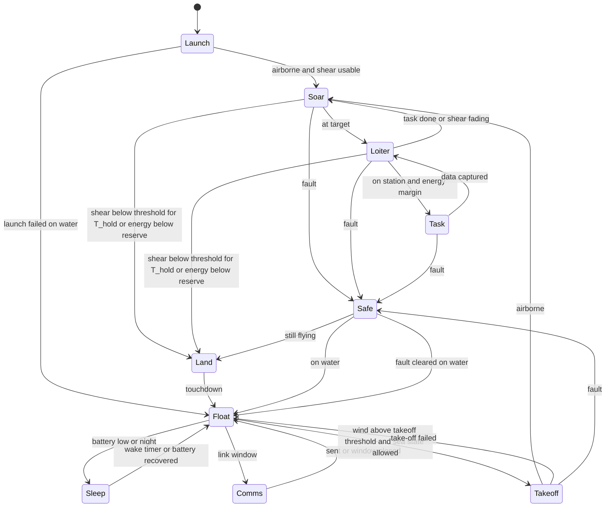
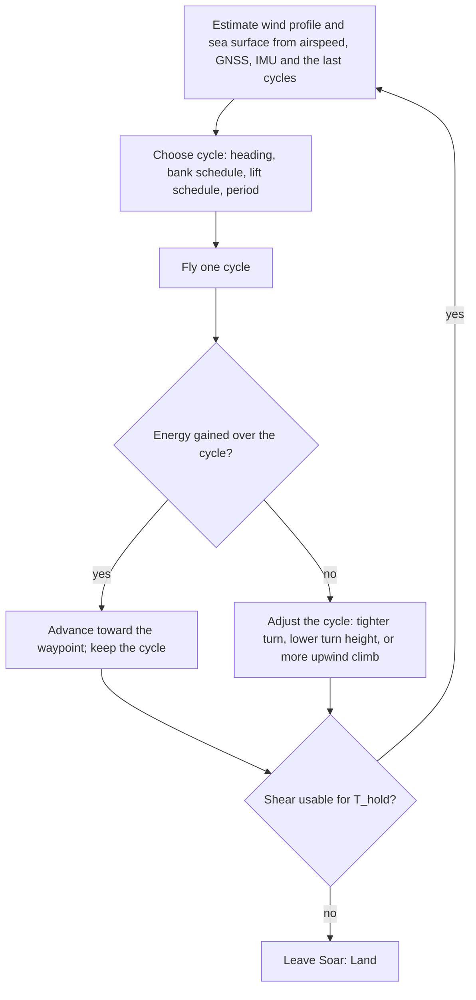

# 1.2 Form

Candidate forms, the yardsticks, rough availability and cost of each, the comparison, and the selection.

## Computation environment

The form study needs a place to fly candidate aircraft in a wind field that looks like the sea, so the environment was built first (D-010).
The code lives in `sim/` and is a tool, not a fact; what it produces enters the record as calculated values that cite the section of this document, or a check, that explains them (see `docs/00-conventions.md`).

### Sea surface and wind model (`sim/seawind.py`) {#environment-model}

- Coordinates are x east, y north, z up, in metres and seconds.
- The mean wind is a neutral logarithmic profile over the local sea surface, with friction velocity and roughness length solved from U10 by the Charnock relation (env.charnock) plus the smooth-flow term (env.air_kinematic_viscosity), and env.karman as the von Karman constant.
- The height in the profile is measured above the local wave surface, so the wind field rides on the waves.
- Each wave component adds a wave-coherent perturbation from linear potential flow over a moving wavy surface: the air speeds up over crests and rises on the face it approaches, decaying as exp(-k z) with height; the reference wind for a component is the mean profile at the height 1/k relative to the wave's phase speed.
- The sea is a linear sum of components drawn from JONSWAP spectra (env.jonswap_gamma) with a cosine-squared directional spread on deep water; a fully developed wind sea follows from U10 by the Pierson-Moskowitz relations (env.pm_hs_coefficient, env.pm_peak_coefficient); swell is a second train.
- Frequencies are sampled by equal energy so the discrete sum reproduces the significant wave height.
- There is no turbulence yet; `gust()` is the hook for it.
- The constants are assumed values until Q-008 verifies them against P38 to P41 and against measured profiles over waves.

### Viewer (`sim/viewer/index.html`)

- `python -m sim.export_field --u10 10 --from 270` writes `sim/viewer/field.js` with the wind parameters and the wave components.
- Opening `sim/viewer/index.html` in a browser shows the sea, a wind mast with arrows at twelve heights above the local surface, particles advected by the wind, the wind-speed and vertical-wind profiles at the mast, and an aircraft trajectory when `sim/viewer/traj.js` exists.
- The viewer mirrors the Python formulas; it is a picture of the model, not a second model.

### Aircraft model (`sim/aircraft.py`, `sim/dsearch.py`) {#aircraft-model}

- The aircraft is a point mass with a lift coefficient and a bank angle as controls, a parabolic drag polar (cd0, Oswald factor, aspect ratio), and limits on lift coefficient, bank, and load factor.
- The equations are written in the air-relative frame with the wind's acceleration along the path as a pseudo-force, which is where dynamic soaring gets its energy.
- `sim/dsearch.py` searches a periodic bank and lift schedule that gains air-relative energy over one cycle without going below ds.clearance_min_m or above ds.n_limit, and bisects the smallest U10 at which such a cycle exists.
- This search is the yardstick of the form study: for each candidate form, the smallest U10 that sustains soaring, and the ground speed it gives.

### Structural model (`sim/structure.py`) {#structural-model}

- The wing is a cantilever half-span with an elliptical lift distribution; a round carbon tube spar carries all bending; the skin and core carry none.
- The spar is sized so that the stress at the root under ds.n_limit times ds.safety_factor stays under the allowable, and fits inside the airfoil.
- Component masses placed in body axes give the total mass, the centre of gravity, and the inertia tensor that the flight model will use when it grows from a point mass to six degrees of freedom.
- Material values are assumed until sourced (Q-009).

## Candidate forms {#candidate-forms}

The yardsticks are: the smallest U10 that sustains soaring; progress speed over the ground at the design wind; survival on the water (self-righting, sealing, take-off); solar area; mass; what one person can build and repair; cost.
The candidates to fly in the environment are:

1. **Conventional glider with a tail boom**, span 2 m, aspect ratio 16, like the demonstrators (ENAC 1.5 m, ETH 1.8 m). Known handling; the boom and tail are fragile on the water.
2. **Flying wing or tailless with winglets**, span 2 m. Fewer parts to break, easier to seal, but lower aspect ratio and less pitch control margin.
3. **Albatross-like high-aspect-ratio glider**, span 3 m, aspect ratio 20 to 25, mass 2.5 to 3 kg. Best lift-to-drag and lowest wind to soar; the biggest to launch and the most to lose.
4. **Sealed hull glider that floats hull-down**, span 2 to 2.5 m, with the fuselage as a watertight buoyancy body and the wing sealed as a foam-core shell. The form that takes R-05 and R-06 most seriously; take-off from the water is its open question.

The comparison runs when the simulation gives the minimum U10 and ground speed per form; availability and rough cost follow the demonstrators' parts (carbon tubes, foam, fiberglass, PX4-class autopilot).

## Control modes {#control-modes}

The owner asked for a state transition diagram as well as a flowchart (2026-10-29).
The states are the modes of the whole aircraft; the flowchart is the loop inside the soaring mode.

### State transition diagram

- Launch: hand launch at sea or take-off from the water; ends when airspeed and height are inside the soaring band.
- Soar: dynamic soaring cycles that make progress toward the waypoint; the loop below runs here.
- Loiter: soaring cycles that hold position near the target.
- Task: the photo or data capture, entered only with an energy margin.
- Land: a controlled descent to the water into the wind at stall speed plus margin.
- Float: on the water, sealed, self-righted, charging, estimating the wind from the drift and the motion.
- Sleep: everything off but the wake timer and the sealed-ness watchdog.
- Comms: the satellite or shore link; also used during Loiter when the link allows.
- Takeoff: the water take-off, whose mechanism is open (R-05).
- Safe: fault handling; the only exits are to the water.

### Flowchart of the soaring loop

The thresholds T_hold, the shear threshold, and the energy reserve are values to be set from the simulation (Q-009).
