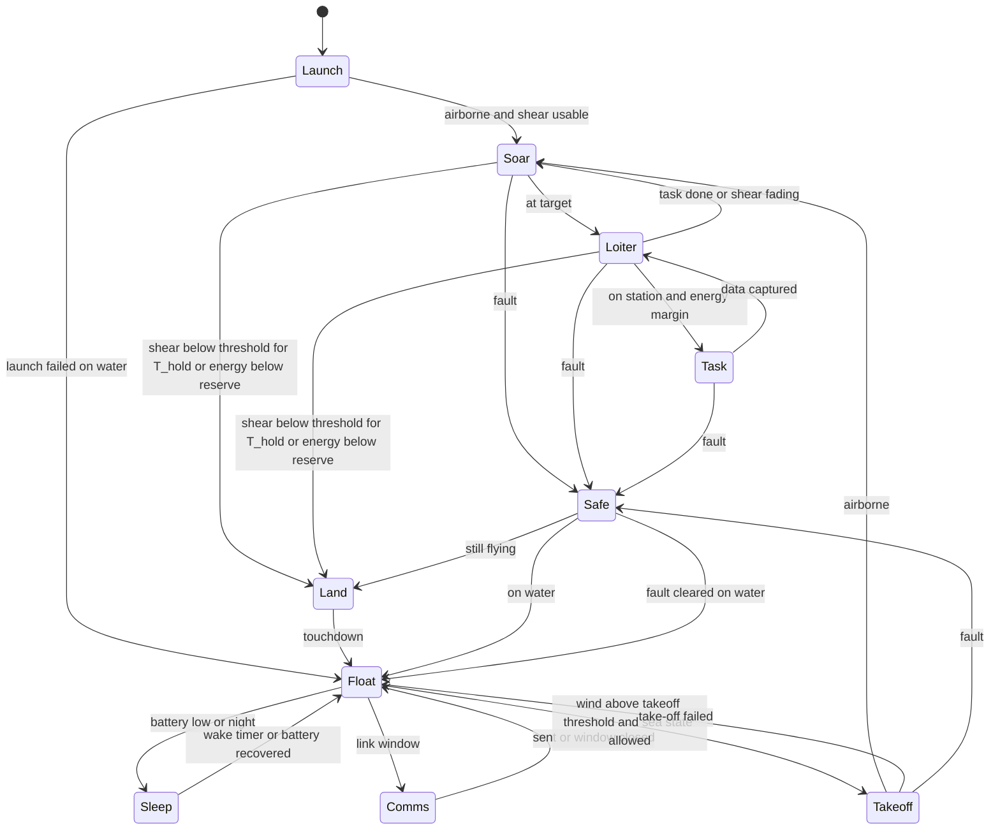
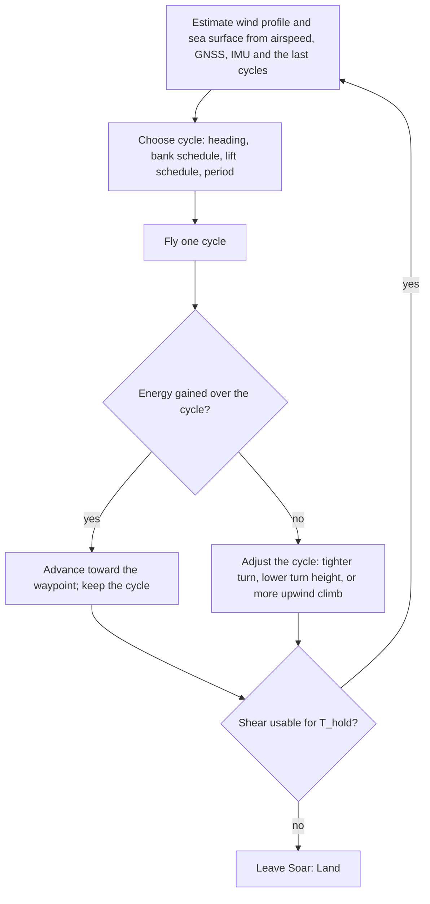

# 1.2 Form

Candidate forms, the yardsticks, rough availability and cost of each, the comparison, and the selection.

## Computation environment

The form study needs a place to fly candidate aircraft in a wind field that looks like the sea, so the environment was built first (D-010).
The code lives in `sim/` and is a tool, not a fact; what it produces enters the record as calculated values that cite the section of this document, or a check, that explains them (see `docs/00-conventions.md`).

### Sea surface and wind model (`sim/seawind.py`) {#environment-model}

- Coordinates are x east, y north, z up, in metres and seconds.
- The mean wind is a neutral logarithmic profile over the local sea surface, with friction velocity and roughness length solved from U10 by the Charnock relation (env.charnock) plus the smooth-flow term (env.air_kinematic_viscosity), and env.karman as the von Karman constant.
- The height in the profile is measured above the local wave surface, so the wind field rides on the waves.
- Each wave component adds a wave-coherent perturbation from linear potential flow over a moving wavy surface: the air speeds up over crests and rises on the face it approaches, decaying as exp(-k z) with height; the reference wind for a component is the mean profile at the height 1/k relative to the wave's phase speed.
- The sea is a linear sum of components drawn from JONSWAP spectra (env.jonswap_gamma) with a cosine-squared directional spread on deep water; a fully developed wind sea follows from U10 by the Pierson-Moskowitz relations (env.pm_hs_coefficient, env.pm_peak_coefficient); swell is a second train.
- Frequencies are sampled by equal energy so the discrete sum reproduces the significant wave height.
- There is no turbulence yet; `gust()` is the hook for it.
- The constants are assumed values until Q-008 verifies them against P38 to P41 and against measured profiles over waves.

### Sea state history and wind-wave coupling (`sim/sea_history.py`) {#sea-coupling}

- Wind to waves: a wind sea grows with the time the wind has blown, by the equivalent-duration growth of the Coastal Engineering Manual (P71) with the constants env.cem_hm0_coeff, env.cem_tp_coeff and env.cem_duration_coeff and the friction velocity from the drag law env.cd_law_a and env.cd_law_b, capped at the fully developed sea (env.cem_full_hm0_limit, env.cem_full_tp_limit); the growth law was checked against the printed pages (K-006) and its repaired code awaits a re-check (Q-018).
- `SeaHistory` keeps an equivalent duration for the wind sea and lets the excess over what the wind can sustain decay as swell with env.sea_decay_tau_h when the wind drops; this is a stand-in for a spectral wave model.
- env.sea_grow_tau_h is no longer used by the code, since the equivalent-duration law replaced the relaxation; it stays in the record because K-005 and K-006 target it, until the standard has a withdrawn status.
- Waves to wind: the roughness length can follow the sea state instead of the Charnock constant, by the wave-steepness form (P59) or the wave-age form (P60); a young steep sea is rougher and slows the wind near the surface, which changes the shear the aircraft can use.
- Crests: an option adds the second-order self-interaction term of each component, so crests are sharper and troughs flatter; the flight model's wind still uses the linear terms.
- Breaking: the surface is flagged as breaking where its slope exceeds env.breaking_slope_limit, an assumed criterion to be sourced.
- The airflow separation behind steep crests is not modelled; that needs a flow solver over moving waves and is left until the design shows that the details within a metre of the waves matter.
- Turbulence: an option adds a frozen field of random Fourier modes with a von Karman spectrum of length scale env.turb_length_m, scaled to the offshore turbulence intensity of ISO 19901-1 (P67), with lateral and vertical intensities of env.turb_v_ratio and env.turb_w_ratio of the longitudinal one (P72, not read); its 3 s gust factor over 10 minutes came out at env.turb_gust_factor_check against lit.gust_factor_3s_10min_sea at sea (P68).
- Swell: an option replaces the log profile above a knee at lit.swell_knee_height_m by a constant wind, as measured under swell (P65); the wave-induced perturbation can decay at the measured rates lit.wave_induced_decay_u and lit.wave_induced_decay_w (P63) instead of exp(-k z).
- The form study runs with the log profile and with the swell knee, since swell dominates most of the time in the Pacific (lit.pacific_swell_dominance, P62) and the knee removes the shear above it (Q-011).
- All of these constants and forms wait for Q-008.

#### Gust factor check {#gust-factor-check}

This check compares the turbulence model with a measured gust factor.
The number was first printed by the unit test at commit 86d6689; the function `gust_factor` in `sim/seawind.py` repeats the computation and gives the same number.
Command: `python -m unittest sim.tests.test_seawind` for now, which calls it.
Inputs by key: env.turb_length_m, env.turb_v_ratio, env.turb_w_ratio, env.karman and env.charnock.
Settings of the function, named here and not keyed: U10 of 10 m/s from 270 degrees, a point at 10 m height, a series of 600 s sampled every 0.1 s, a running window of 3 s, 64 Fourier modes, and seed 1.
Output by key: env.turb_gust_factor_check, to be compared with lit.gust_factor_3s_10min_sea (P68).
It is one realization of a random field and not a statistic, and the test asserts only a band around it.

### Viewer (`sim/viewer/index.html`) {#viewer}

- `python -m sim.export_field --u10 10 --from 270` writes `sim/viewer/field.js` with the wind parameters and the wave components.
- Opening `sim/viewer/index.html` in a browser shows the sea, a wind mast with arrows at twelve heights above the local surface, particles advected by the wind, the wind-speed and vertical-wind profiles at the mast, and an aircraft trajectory when `sim/viewer/traj.js` exists.
- The viewer mirrors the Python formulas; it is a picture of the model, not a second model.

### Aircraft model (`sim/aircraft.py`, `sim/dsearch.py`) {#aircraft-model}

- The aircraft is a point mass with a lift coefficient and a bank angle as controls, a parabolic drag polar (cd0, Oswald factor, aspect ratio), and limits on lift coefficient, bank, and load factor.
- The equations are written in the air-relative frame with the wind's acceleration along the path as a pseudo-force, which is where dynamic soaring gets its energy.
- `sim/dsearch.py` searches a periodic bank and lift schedule that gains air-relative energy over one cycle without going below ds.clearance_min_m or above ds.n_limit, and bisects the smallest U10 at which such a cycle exists.
- This search is the yardstick of the form study: for each candidate form, the smallest U10 that sustains soaring, and the ground speed it gives.

### Structural model (`sim/structure.py`) {#structural-model}

- The wing is a cantilever half-span with an elliptical lift distribution; a round carbon tube spar carries all bending; the skin and core carry none.
- The spar is sized so that the stress at the root under ds.n_limit times ds.safety_factor stays under the allowable, and fits inside the airfoil.
- Component masses placed in body axes give the total mass, the centre of gravity, and the inertia tensor that the flight model will use when it grows from a point mass to six degrees of freedom.
- The carbon tube values are sourced (P54); the skin, core and component inputs are assumed (Q-015).

## Numbers from the literature for the form study {#literature-numbers}

The yardsticks of the form study need the bird and the demonstrators as reference points; these are the numbers the record holds (keys `lit.*`), with their sources.

- The wandering albatross weighs lit.albatross_mass_kg with a span of lit.albatross_span_m, a wing area of lit.albatross_wing_area_m2, an aspect ratio of lit.albatross_aspect_ratio, and a best lift-to-drag ratio of about lit.albatross_lift_to_drag (P42, P44, P45).
- Its soaring cycle lasts about lit.ds_cycle_period_s (reported between lit.ds_cycle_period_min_s and lit.ds_cycle_period_max_s) and spans heights up to lit.ds_cycle_height_m; the turns are shallow arcs of about lit.ds_turn_angle_deg (between lit.ds_turn_angle_min_deg and lit.ds_turn_angle_max_deg), not half circles, and the shear it uses sits in a layer about lit.shear_layer_thickness_m thick (between lit.shear_layer_thickness_min_m and lit.shear_layer_thickness_max_m) (P44, P46, P47).
- The two-layer Rayleigh model needs a wind difference of about lit.rayleigh_min_wind_difference_ms across the layer (between lit.rayleigh_min_wind_difference_min_ms and lit.rayleigh_min_wind_difference_max_ms) for a glider of the albatross's lift-to-drag ratio (P42, P43).
- With a logarithmic profile, the smallest wind at 10 m that sustains soaring is lit.min_u10_albatross_ms for the albatross model and lit.min_u10_mariner_ms for a glider of lit.mariner_mass_kg with a lift-to-drag ratio of lit.mariner_lift_to_drag and a wing loading of lit.mariner_wing_loading_n_m2, while a sailplane of lit.sailplane_mass_kg with a high wing loading needs lit.min_u10_sailplane_15kg_ms (P45, P56).
- Those numbers are why the design point of R-02 is ds.min_u10_ms, now sourced rather than assumed; the form study will test it with the simulation.
- The demonstrator closest to this project is a foam trainer of lit.easyglider_span_m span and lit.easyglider_mass_kg with a wing area of lit.easyglider_wing_area_m2 (P48).
- A hand-launched solar aircraft that flew for days drew lit.atlantiksolar_avionics_w for its avionics including a satellite modem, and was designed for a load factor of lit.atlantiksolar_load_factor with a safety factor of lit.atlantiksolar_safety_factor (P49); sailplane certification uses lit.cs22_limit_load_factor with a safety factor of lit.cs22_safety_factor (P55).
- The darkest design day gives lit.insolation_50s_june_kwh_m2_day in the Southern Ocean in June and lit.insolation_home_december_kwh_m2_day at the home design point in December (P51); a 21700 cell holds about lit.cell_p45b_wh_per_kg and still discharges down to lit.cell_p45b_min_discharge_temp_degc (P50).
- A small ultrasonic anemometer weighs lit.anemometer_trisonica_mass_g and draws lit.anemometer_trisonica_power_w (P52); a research multi-hole probe weighs lit.probe_epfl_mass_g (P53).
- Pultruded carbon tube has a modulus of only lit.pultruded_modulus_pa and a flexural strength of lit.pultruded_flexural_pa (P54), far below the values first assumed for the spar; this changed the spar sizing (docs/03-design.md#wing-spar) and opened Q-010.
- A seaplane UAV of lit.flyingfish_mass_kg has taken off from the water on its own in waves up to lit.flyingfish_wave_height_m (P57); no water take-off of a drone in the mass range of this project (ds.mass_max_kg) was found in the sources read, which is why R-05 keeps its water take-off as the open question of the sealed-hull form.

What the literature does not give: a table of the minimum wind against wing loading and lift-to-drag ratio for small gliders over a real sea profile; that is the simulation's job.

### How the single numbers were reduced from ranges

The sources give ranges for four numbers, and the record keeps both ends as sourced keys and the single number as calculated.
lit.ds_cycle_period_s is a working figure chosen by the assistant inside the range between lit.ds_cycle_period_min_s (P47) and lit.ds_cycle_period_max_s (P46), where the two papers report different cycles.
lit.ds_turn_angle_deg is the midpoint of lit.ds_turn_angle_min_deg and lit.ds_turn_angle_max_deg (P44); P74 reports turn angles that change with the wind, so the midpoint is a reference and not a design value.
lit.shear_layer_thickness_m is the midpoint of lit.shear_layer_thickness_min_m and lit.shear_layer_thickness_max_m (P44).
lit.rayleigh_min_wind_difference_ms is the midpoint of lit.rayleigh_min_wind_difference_min_ms and lit.rayleigh_min_wind_difference_max_ms (P42).

## Flight patterns {#flight-patterns}

Albatrosses use several patterns and switch between them with the wind and the sea; `sim/patterns.py` holds the catalogue with its sources and simulates the ones that are new to the environment.

- Dynamic soaring across the wind in shallow S-arcs is the main pattern (P42, P44, P46, P47); the birds prefer headings near lit.albatross_preferred_heading_deg off the wind, like sailing yachts (P73); they tack upwind (P43), loop in place to search or hold station (P44), and turn through smaller angles as the wind rises (P74, P75). These map onto the modes of the cycle optimizer.
- Wave-slope soaring rides the updraft ahead of a moving crest and dominates in light wind over big swell (P76, P42, P77); the model finds it sustainable for most candidates only over swell of about patterns.wave_slope_swell_period_s period and only at the floor of the search, patterns.wave_slope_floor_m above the water, which is below the clearance of R-12 (Q-013).
- Gust soaring is a proposal without a test (P78) and is not simulated.
- Flap-gliding in light or head winds costs the bird most of its flight energy in a small share of its time (P79, P80, P81); for the drone the motor replaces the wing beat, at patterns.flapglide_baseline_wh_per_km_calm in calm air, patterns.flapglide_baseline_wh_per_km_cross10 across a 10 m/s wind, and patterns.flapglide_baseline_wh_per_km_head10 into it, for the baseline with a battery of patterns.battery_fraction of its mass.
- Resting on the water and taking off when the wind returns is what the birds do in a calm, with an easier take-off in more wind and bigger waves (P82); this is the Float and Takeoff states of the control modes.
- The selector follows the birds: dynamic soaring at or above ds.min_u10_ms, wave-slope soaring when the swell allows it, the motor while the battery covers a leg, and the water otherwise.
- The same run showed that the baseline's solar film yields only patterns.solar_avg_baseline_w on average, far below the avionics budget, which is finding Q-012 against R-08.

## Autonomy on estimated states {#autonomy-check}

The question was whether the drone can fly the soaring cycle on what its sensors tell it, not on the true state.
`python -m sim.autonomy` (commit 86d6689 plus the working tree of this branch) takes the optimizer's travelling cycle for the baseline at autonomy.test_u10_ms, tracks it with feedforward and feedback on the estimate, and compares the minimal, standard and full sensor suites of `sim/sensors.py` with the true state as the upper bound, over a flat log wind, a fully developed sea, and the sea with turbulence and the swell knee.
Over the flat log wind the standard suite flew autonomy.flat_standard_cycles cycles without a crash and kept within a few percent of the true state's ground speed (autonomy.flat_standard_ground_speed_ms against autonomy.flat_truth_ground_speed_ms), with a wind error of about autonomy.flat_standard_wind_rms_ms; the full suite did the same.
The minimal suite, with no magnetometer, never got a valid wind estimate before it crashed (Q-052).
Over waves every run crashed, the true state included, because the cycle's lowest point is planned above the mean surface and the crests reach it (Q-050); the load factor also exceeded the limit of R-09 under feedback (Q-051).
So the sensors are not the limit on a flat sea; the plan is the limit on a real one, and the next pass plans the cycle in height above the local surface.

## Candidate forms {#candidate-forms}

The yardsticks are: the smallest U10 that sustains soaring; progress speed over the ground at the design wind; survival on the water (self-righting, sealing, take-off); solar area; mass; what one person can build and repair; cost.
The candidates to fly in the environment are:

1. **Conventional glider with a tail boom**, the baseline of the structural model (span wing.span_m, wing area form.baseline_2m.wing_area_m2), like the demonstrators: the foam trainer of P48 (lit.easyglider_span_m) and a smaller demonstrator (form.demo_1p5m.span_m) that has no source in the record yet (Q-014). Known handling; the boom and tail are fragile on the water.
2. **Flying wing or tailless with winglets**, span form.flyingwing_2m.span_m. Fewer parts to break, easier to seal, but a lower aspect ratio (its wing area is form.flyingwing_2m.wing_area_m2) and less pitch control margin.
3. **Albatross-like high-aspect-ratio glider**, span form.albatross_3m.span_m, wing area form.albatross_3m.wing_area_m2, mass form.albatross_3m.mass_kg. Best lift-to-drag and lowest wind to soar; the biggest to launch and the most to lose.
4. **Sealed hull glider that floats hull-down**, span form.sealedhull_2p5m.span_m, with the fuselage as a watertight buoyancy body and the wing sealed as a foam-core shell. The form that takes R-05 and R-06 most seriously; take-off from the water is its open question.

The parameters of each candidate are the keys form.<candidate>.span_m, mass_kg, wing_area_m2, cd0, oswald and cl_max, taken from the aircraft registry in `sim/aircraft_models.py` (assumed, Q-014); the span and mass of the baseline are wing.span_m and wing.design_mass_kg.
The comparison is in the next section; availability and rough cost follow the demonstrators' parts (carbon tubes, foam, fiberglass, PX4-class autopilot).

## Form comparison {#form-comparison}

The candidates were flown in the environment by the collocation optimizer of periodic cycles (`sim/dsopt.py`, a point mass in a height-only wind).
The numbers are in `sim/out/dsopt.json` at commit 86d6689, with the optimizer settings in its settings block, which also holds the case that sets the cross-wind wind speed; the command that writes the file is not recorded yet (Q-034).
Candidate 1 is form `baseline_2m`, candidate 2 `flyingwing_2m`, candidate 3 `albatross_3m` and candidate 4 `sealedhull_2p5m`; `demo_1p5m` and `easyglider_1p8m` are the demonstrators as references.
For each candidate the record holds the smallest U10 that sustains a travelling cycle and a loiter cycle, with the log profile and with the swell knee (Q-011), as the keys form.<candidate>.u10_min_travel_log, u10_min_loiter_log, u10_min_travel_knee and u10_min_loiter_knee.
Where the travelling minimum is below the wind of the cross-wind case, the record also holds the progress speed across the wind at that wind, the objective of the case, as form.<candidate>.cross12_speed_log and cross12_speed_knee; it exists for baseline_2m with the log profile and for albatross_3m with both profiles.
The mean ground speed of those cycles is higher than the progress speed and is in the file.
Only converged cycles are recorded, and the cases that were skipped because the travelling minimum is above the cross-wind wind are left out.

What the keys show:

- The lowest minimum wind belongs to the albatross-like glider, form.albatross_3m.u10_min_travel_log; the conventional baseline and the sealed hull come next, and the flying wing and the two demonstrators need much more wind.
- A loiter cycle needs more wind than a travelling cycle for every candidate, with either profile.
- The swell knee raises the minimum for four of the six candidates and lowers it slightly for the other two (the flying wing and the foam trainer).
- No candidate reaches ds.min_u10_ms, the design point of R-02; the best, form.albatross_3m.u10_min_travel_log, is the nearest.
- This is raised as finding Q-024, and the owner decides whether to lower the wing loading, change the form, or raise the design wind.

The same optimizer was run against P45: for an albatross model it gave dsopt.validation_u10_ms where P45 gives lit.min_u10_albatross_ms.
The speed floor (a minimum airspeed set from the stall speed) was off for the validation run and on for the form study, so the two are not the same experiment.
The values table in docs/01-requirements.md lists every key named here.
The repair of the search and the optimizer have no independent check yet (Q-017).

## Control modes {#control-modes}

The owner asked for a state transition diagram as well as a flowchart (2026-10-29).
The states are the modes of the whole aircraft; the flowchart is the loop inside the soaring mode.

### State transition diagram

- Launch: hand launch at sea or take-off from the water; ends when airspeed and height are inside the soaring band.
- Soar: dynamic soaring cycles that make progress toward the waypoint; the loop below runs here.
- Loiter: soaring cycles that hold position near the target.
- Task: the photo or data capture, entered only with an energy margin.
- Land: a controlled descent to the water into the wind at stall speed plus margin.
- Float: on the water, sealed, self-righted, charging, estimating the wind from the drift and the motion.
- Sleep: everything off but the wake timer and the sealed-ness watchdog.
- Comms: the satellite or shore link; also used during Loiter when the link allows.
- Takeoff: the water take-off, whose mechanism is open (R-05).
- Safe: fault handling; the only exits are to the water.

### Flowchart of the soaring loop

The thresholds T_hold, the shear threshold, and the energy reserve are values to be set from the simulation (Q-009).
